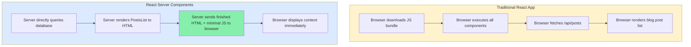
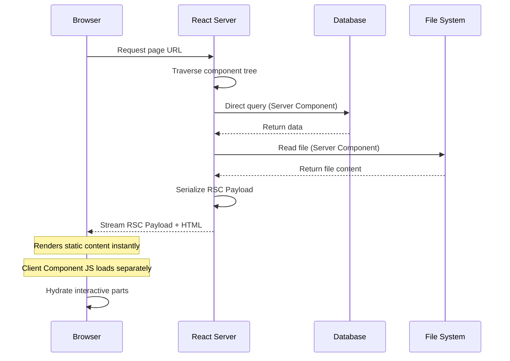
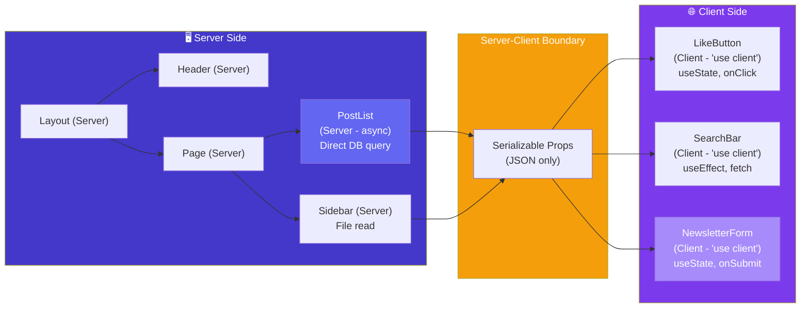
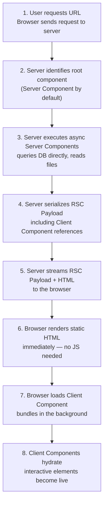

# React Server Components (RSC)

## Introduction

React Server Components (RSC) represent the most significant architectural shift in React since Hooks. Introduced as a research project in 2020 and stabilized in React 19, RSC allows components to run exclusively on the server during rendering. These components send zero JavaScript to the browser, can directly access databases and file systems, and seamlessly integrate with interactive Client Components. RSC is the default component type in the Next.js App Router and marks the future of React development.

---

## Why do we need this?

Traditional React applications ship all component JavaScript to the browser, even when components only fetch and display data without interactivity. This bloats bundle sizes, slows initial loads, and wastes bandwidth.

### Problem Statement

Consider a blog homepage that renders:
- A header with navigation links (interactive — needs JS)
- A list of 20 blog posts fetched from a database (static display — no JS needed)
- A sidebar with recent comments (static display — no JS needed)
- A newsletter signup form (interactive — needs JS)

In a traditional React app:
1. The entire page JavaScript bundle (including the blog list renderer, the sidebar logic, and the data fetching code) is downloaded and executed in the browser.
2. The browser fetches an API endpoint to get the blog post data.
3. Only after both steps complete can the user see the content.

This wastes bandwidth: the blog list component code and the data fetching roundtrip could have been handled entirely on the server, sending only the finished HTML to the browser. For a page with 20 static elements and 2 interactive ones, **90% of the shipped JavaScript is unnecessary**.

---

## Real World Story

In December 2020, the React team at Facebook (now Meta) published a research paper and prototype demonstrating Server Components. The team had been exploring ways to reduce client-side JavaScript bundle sizes, which had grown significantly in large-scale React applications.

The key insight was that many components in a typical React app don't need interactivity — they simply fetch data and display it. By allowing these components to run on the server, the team could eliminate their JavaScript from the client bundle entirely.

In 2021, Next.js partnered with the React team to integrate RSC into the Next.js App Router (shipped in Next.js 13.4 in May 2023). By React 19 (2024), RSC became a stable, first-class feature of React itself, usable with any RSC-compatible framework.

---

## Real World Analogy

Think of Server Components like a **Curbside Grocery Pickup** compared to a **Full Grocery Store Visit**.

- **Traditional React (Full Store Visit)**: You drive to the grocery store (download the full JS bundle), walk through every aisle (execute all components), pick items off shelves (fetch data from APIs), and carry everything back to your car (browser processes all the data). Even if you only needed bread and milk, you walked past all 20 aisles.

- **Server Components (Curbside Pickup)**: You order your groceries online (server renders the components), the store staff picks your items and packs them (server fetches data and generates HTML), and you drive to the pickup spot where they load the bags into your trunk (browser receives finished HTML). The only time you get out of your car is to sign the receipt (interactive Client Components).

---

## Visual Explanation

Below is a comparison of the traditional React data-fetching flow vs. the Server Components flow.

### Traditional React Data Flow
```
[Browser] ──> Download all JS ──> Execute components ──> Fetch API ──> Render data
```

### Server Components Data Flow
```
[Server] ──> Direct DB access ──> Render to HTML ──> Send to browser
                                                  ──> (Interactive parts hydrate on client)
```



---

## Internal Working

React Server Components operate through a special protocol. When a page is requested:

1. The server traverses the component tree. For each component, it checks if it's a Server Component (default) or a Client Component (marked with `"use client"`).
2. Server Components execute on the server. They can be `async` functions that `await` database queries, file reads, or internal API calls.
3. The server serializes the rendered output of Server Components into a special format called **RSC Payload**. This is a compact, streamable data format that describes the component tree output.
4. Client Components are identified and their code is bundled separately. The RSC Payload includes placeholders where Client Components will mount.
5. The browser receives the RSC Payload and renders the static HTML immediately. Client Components hydrate as their JavaScript bundles arrive.



---

## Architecture

React Server Components introduce a new mental model for component architecture. The key principle is the **"Server-Client Boundary"** — the line where server-rendered components pass data to client-interactive components.

```
[RSC Tree (Server)] ──serializable props──> [Client Components ("use client")]
                                              ├── useState / useEffect
                                              ├── onClick / onSubmit
                                              └── Browser APIs (window, document)
```



---

## Step-by-Step Flow

When a user visits a page that uses Server Components, the following steps execute:



---

## Syntax

```jsx
// Server Component (default — no directive needed)
// Can be async, can import Node.js modules
import db from '@/lib/database';

export default async function PostList() {
  const posts = await db.query('SELECT * FROM posts');
  return (
    <ul>
      {posts.map(post => <li key={post.id}>{post.title}</li>)}
    </ul>
  );
}

// Client Component — requires "use client" directive
"use client";

import { useState } from 'react';

export default function LikeButton({ postId }) {
  const [liked, setLiked] = useState(false);
  return (
    <button onClick={() => setLiked(!liked)}>
      {liked ? '❤️' : '🤍'}
    </button>
  );
}
```

---

## Basic Example

Here is a basic Server Component that fetches and displays a list of products directly from the database.

```jsx
// ProductList.js — Server Component (no "use client")
import db from '@/lib/database';

export default async function ProductList() {
  // Direct database query — no API endpoint required
  const products = await db.query(
    'SELECT id, name, price FROM products ORDER BY name'
  );

  return (
    <div style={{ padding: '16px' }}>
      <h2>Our Products</h2>
      <div style={{ display: 'grid', gap: '12px' }}>
        {products.map(product => (
          <div
            key={product.id}
            style={{
              border: '1px solid #e2e8f0',
              borderRadius: '8px',
              padding: '12px'
            }}
          >
            <h3 style={{ margin: 0 }}>{product.name}</h3>
            <p style={{ color: '#059669', fontWeight: 'bold' }}>
              ${product.price.toFixed(2)}
            </p>
          </div>
        ))}
      </div>
    </div>
  );
}
```

**Explanation:**
- The component is `async` — it can `await` asynchronous operations directly.
- It imports a database client and queries the database — no REST API needed.
- The component renders JSX that will be serialized into HTML on the server.
- **Zero JavaScript** from this component is sent to the browser.

---

## Intermediate Example

An intermediate example showing how Server Components and Client Components work together on a single page.

```jsx
// ====== page.js — Server Component (Parent) ======
import db from '@/lib/database';
import ProductCard from './ProductCard'; // Client Component
import AddToCartButton from './AddToCartButton'; // Client Component

export default async function StorePage() {
  // Server Component fetches data directly
  const products = await db.query(
    'SELECT id, name, price, image_url FROM products LIMIT 20'
  );

  return (
    <div>
      <h1>Store</h1>
      <div style={{ display: 'grid', gridTemplateColumns: 'repeat(4, 1fr)', gap: '16px' }}>
        {products.map(product => (
          <ProductCard key={product.id} product={product}>
            {/* Client Component receives data as props */}
            <AddToCartButton productId={product.id} />
          </ProductCard>
        ))}
      </div>
    </div>
  );
}

// ====== ProductCard.js — Client Component ======
"use client";

export default function ProductCard({ product, children }) {
  return (
    <div style={{ border: '1px solid #ccc', borderRadius: '8px', padding: '12px' }}>
      
      <h3>{product.name}</h3>
      <p>${product.price}</p>
      {children} {/* Interactive button injected here */}
    </div>
  );
}

// ====== AddToCartButton.js — Client Component ======
"use client";

import { useState } from 'react';

export default function AddToCartButton({ productId }) {
  const [added, setAdded] = useState(false);

  const handleAdd = () => {
    setAdded(true);
    // In production: call cart API, show toast, etc.
    setTimeout(() => setAdded(false), 2000);
  };

  return (
    <button
      onClick={handleAdd}
      style={{
        backgroundColor: added ? '#059669' : '#3b82f6',
        color: 'white',
        border: 'none',
        padding: '8px 16px',
        borderRadius: '4px',
        cursor: 'pointer'
      }}
    >
      {added ? '✓ Added!' : 'Add to Cart'}
    </button>
  );
}
```

**Key Insights:**
- The Server Component (`StorePage`) handles all data fetching — the Client Components receive data as props.
- Client Components (`ProductCard`, `AddToCartButton`) only ship their own JavaScript — not the data fetching logic.
- The Server Component passes serializable props (strings, numbers, plain objects) across the boundary.

---

## Advanced Example

An advanced example demonstrating **streaming**, **Suspense boundaries**, and **nested server/client composition**.

```jsx
// ====== page.js — Server Component with Streaming ======
import { Suspense } from 'react';
import db from '@/lib/database';
import SlowRecommendations from './SlowRecommendations';
import NewsletterSignup from './NewsletterSignup';

// Server Component — page shell streams immediately
export default async function HomePage() {
  const heroData = await db.query(
    'SELECT title, subtitle FROM hero_content WHERE active = true LIMIT 1'
  );

  return (
    <div>
      {/* Static content — renders immediately */}
      <section style={{ padding: '40px', backgroundColor: '#f8fafc' }}>
        <h1>{heroData[0].title}</h1>
        <p>{heroData[0].subtitle}</p>
      </section>

      {/* Slow content wrapped in Suspense — streams in when ready */}
      <Suspense fallback={<div style={{ padding: '20px' }}>Loading recommendations...</div>}>
        <SlowRecommendations />
      </Suspense>

      {/* Interactive Client Component */}
      <section style={{ marginTop: '40px' }}>
        <NewsletterSignup />
      </section>
    </div>
  );
}

// ====== SlowRecommendations.js — Server Component ======
// This component takes 2 seconds to load — wrapped in Suspense above
import db from '@/lib/database';

export default async function SlowRecommendations() {
  // Simulate a slow query
  await new Promise(resolve => setTimeout(resolve, 2000));

  const recommendations = await db.query(
    'SELECT id, name, price FROM products WHERE recommended = true LIMIT 4'
  );

  return (
    <section style={{ padding: '20px' }}>
      <h2>Recommended for You</h2>
      <div style={{ display: 'flex', gap: '12px' }}>
        {recommendations.map(item => (
          <div key={item.id} style={{
            border: '1px solid #e2e8f0',
            borderRadius: '8px',
            padding: '12px',
            flex: 1
          }}>
            <h4>{item.name}</h4>
            <p>${item.price}</p>
          </div>
        ))}
      </div>
    </section>
  );
}

// ====== NewsletterSignup.js — Client Component ======
"use client";

import { useState } from 'react';

export default function NewsletterSignup() {
  const [email, setEmail] = useState('');
  const [status, setStatus] = useState('idle'); // idle | loading | success | error

  const handleSubmit = async (e) => {
    e.preventDefault();
    setStatus('loading');
    try {
      const res = await fetch('/api/newsletter', {
        method: 'POST',
        body: JSON.stringify({ email }),
        headers: { 'Content-Type': 'application/json' }
      });
      if (!res.ok) throw new Error('Failed');
      setStatus('success');
    } catch {
      setStatus('error');
    }
  };

  return (
    <div style={{
      padding: '24px',
      backgroundColor: '#f0fdf4',
      borderRadius: '12px',
      border: '1px solid #bbf7d0'
    }}>
      <h3>Stay Updated</h3>
      {status === 'success' ? (
        <p style={{ color: '#166534' }}>✓ Thanks for subscribing!</p>
      ) : (
        <form onSubmit={handleSubmit}>
          <input
            type="email"
            value={email}
            onChange={e => setEmail(e.target.value)}
            placeholder="your@email.com"
            required
            style={{
              padding: '8px',
              marginRight: '8px',
              border: '1px solid #ccc',
              borderRadius: '4px'
            }}
          />
          <button
            type="submit"
            disabled={status === 'loading'}
            style={{
              padding: '8px 16px',
              backgroundColor: status === 'loading' ? '#9ca3af' : '#16a34a',
              color: 'white',
              border: 'none',
              borderRadius: '4px',
              cursor: status === 'loading' ? 'not-allowed' : 'pointer'
            }}
          >
            {status === 'loading' ? 'Subscribing...' : 'Subscribe'}
          </button>
          {status === 'error' && (
            <p style={{ color: '#dc2626', marginTop: '8px' }}>
              Something went wrong. Please try again.
            </p>
          )}
        </form>
      )}
    </div>
  );
}
```

**Key Insights:**
- The page shell and hero content render immediately — no waiting.
- `SlowRecommendations` is wrapped in `<Suspense>` — it streams in when the slow query completes.
- The `<NewsletterSignup>` Client Component ships its own interactivity JS.
- Users see the main content immediately, getting a faster perceived load time.

---

## Production Example

A production-grade Server Components pattern for a dashboard with authentication, multiple data sources, and client-side interactivity.

```jsx
// ====== dashboard/page.js — Server Component ======
import { Suspense } from 'react';
import { redirect } from 'next/navigation';
import { getServerSession } from 'next-auth';
import db from '@/lib/database';
import DashboardHeader from './DashboardHeader'; // Client Component
import RevenueChart from './RevenueChart'; // Client Component
import RecentOrders from './RecentOrders'; // Server Component
import ActivityFeed from './ActivityFeed'; // Server Component
import StatsCards from './StatsCards'; // Server Component
import DashboardSkeleton from './DashboardSkeleton'; // Client Component

export default async function DashboardPage() {
  // 1. Authenticate on the server — never expose auth logic to the client
  const session = await getServerSession();
  if (!session) {
    redirect('/login');
  }

  // 2. Fetch data in parallel on the server
  const [stats, recentOrders] = await Promise.all([
    db.query(`
      SELECT
        COUNT(*) as total_orders,
        SUM(amount) as revenue,
        COUNT(DISTINCT user_id) as active_users
      FROM orders
      WHERE created_at > NOW() - INTERVAL '30 days'
    `),
    db.query(`
      SELECT id, user_name, amount, status, created_at
      FROM orders
      ORDER BY created_at DESC
      LIMIT 10
    `)
  ]);

  const statsData = stats[0];

  return (
    <div style={{ padding: '24px', maxWidth: '1200px', margin: '0 auto' }}>
      {/* Client Component — interactive header with user menu, notifications */}
      <DashboardHeader userName={session.user.name} />

      {/* Server Component — rendered on server, zero JS */}
      <StatsCards
        totalOrders={statsData.total_orders}
        revenue={statsData.revenue}
        activeUsers={statsData.active_users}
      />

      {/* Client Component — interactive chart with tooltips */}
      <Suspense fallback={<DashboardSkeleton />}>
        <RevenueChart />
      </Suspense>

      {/* Server Components — rendered on server */}
      <div style={{ display: 'grid', gridTemplateColumns: '1fr 1fr', gap: '24px', marginTop: '24px' }}>
        <RecentOrders orders={recentOrders} />
        <Suspense fallback={<DashboardSkeleton />}>
          <ActivityFeed userId={session.user.id} />
        </Suspense>
      </div>
    </div>
  );
}

// ====== StatsCards.js — Server Component ======
export default async function StatsCards({ totalOrders, revenue, activeUsers }) {
  return (
    <div style={{
      display: 'grid',
      gridTemplateColumns: 'repeat(3, 1fr)',
      gap: '16px',
      marginBottom: '24px'
    }}>
      <div style={{ padding: '20px', backgroundColor: '#f0f9ff', borderRadius: '8px' }}>
        <p style={{ color: '#0369a1', fontSize: '0.875rem' }}>Total Orders</p>
        <p style={{ fontSize: '2rem', fontWeight: 'bold', color: '#0c4a6e' }}>
          {totalOrders.toLocaleString()}
        </p>
      </div>
      <div style={{ padding: '20px', backgroundColor: '#f0fdf4', borderRadius: '8px' }}>
        <p style={{ color: '#15803d', fontSize: '0.875rem' }}>Revenue (30d)</p>
        <p style={{ fontSize: '2rem', fontWeight: 'bold', color: '#14532d' }}>
          ${Number(revenue).toLocaleString()}
        </p>
      </div>
      <div style={{ padding: '20px', backgroundColor: '#faf5ff', borderRadius: '8px' }}>
        <p style={{ color: '#7e22ce', fontSize: '0.875rem' }}>Active Users</p>
        <p style={{ fontSize: '2rem', fontWeight: 'bold', color: '#4c1d95' }}>
          {activeUsers.toLocaleString()}
        </p>
      </div>
    </div>
  );
}

// ====== DashboardHeader.js — Client Component ======
"use client";

import { useState } from 'react';
import { signOut } from 'next-auth/react';

export default function DashboardHeader({ userName }) {
  const [menuOpen, setMenuOpen] = useState(false);

  return (
    <header style={{
      display: 'flex',
      justifyContent: 'space-between',
      alignItems: 'center',
      padding: '16px 0',
      borderBottom: '1px solid #e2e8f0',
      marginBottom: '24px'
    }}>
      <h1 style={{ margin: 0, fontSize: '1.5rem' }}>Dashboard</h1>
      <div style={{ position: 'relative' }}>
        <button
          onClick={() => setMenuOpen(!menuOpen)}
          style={{
            padding: '8px 16px',
            backgroundColor: '#f1f5f9',
            border: '1px solid #cbd5e1',
            borderRadius: '6px',
            cursor: 'pointer'
          }}
          aria-haspopup="true"
          aria-expanded={menuOpen}
        >
          {userName} ▾
        </button>
        {menuOpen && (
          <div style={{
            position: 'absolute',
            right: 0,
            top: '100%',
            marginTop: '4px',
            backgroundColor: 'white',
            border: '1px solid #e2e8f0',
            borderRadius: '6px',
            boxShadow: '0 4px 6px rgba(0,0,0,0.1)',
            zIndex: 10
          }}>
            <button
              onClick={() => signOut()}
              style={{
                padding: '8px 16px',
                border: 'none',
                background: 'none',
                cursor: 'pointer',
                width: '100%',
                textAlign: 'left'
              }}
            >
              Sign Out
            </button>
          </div>
        )}
      </div>
    </header>
  );
}
```

**Production Considerations:**
- Authentication runs entirely on the server — no auth logic leaks to the client.
- Data fetching is parallelized with `Promise.all` for optimal performance.
- Server Components handle all data display; Client Components only handle interactivity.
- Suspense boundaries ensure fast initial paint with streaming fallbacks.
- Error boundaries and loading states are handled at the page level.

---

## Folder Structure

```
react-server-components/
├── src/
│   ├── app/
│   │   ├── page.js                    # Server Component (root)
│   │   ├── dashboard/
│   │   │   ├── page.js                # Server Component
│   │   │   ├── DashboardHeader.js     # Client Component
│   │   │   ├── RevenueChart.js        # Client Component
│   │   │   ├── DashboardSkeleton.js   # Client Component
│   │   │   ├── StatsCards.js          # Server Component
│   │   │   ├── RecentOrders.js        # Server Component
│   │   │   └── ActivityFeed.js        # Server Component
│   │   └── layout.js                  # Server Component (shared layout)
│   ├── lib/
│   │   └── database.js                # Shared on server only
│   └── components/
│       ├── ui/
│       │   ├── Button.js              # Client Component
│       │   └── Input.js               # Client Component
│       └── providers/
│           └── SessionProvider.js     # Client Component
├── package.json
└── next.config.js
```

---

## Best Practices

💡 **Did You Know?**  \
Server Components are the **default** in RSC-compatible frameworks (Next.js App Router). You don't need to mark them — they're automatically server-rendered. You only need `"use client"` when you need interactivity.

🚀 **Best Practices**
- **Default to Server Components** — Only add `"use client"` when you need state, effects, event handlers, or browser-only APIs.
- **Push data fetching to the server** — Server Components can directly query databases, read files, and call internal APIs without exposing endpoints.
- **Use `Suspense` for streaming** — Wrap slow Server Components in `<Suspense>` boundaries to stream content progressively.
- **Keep props serializable** — Only pass plain objects, strings, numbers, arrays, and React elements across the server-client boundary. Functions, JSX with client components, and Promises cannot be passed.
- **Colocate Client Components at leaf nodes** — Keep Client Components as deep as possible in the tree to minimize the client bundle.

---

## Common Mistakes

⚠ **Common Mistakes**

### 1. Putting "use client" on Everything

The most common mistake is adding `"use client"` to components that don't need interactivity, defeating the purpose of RSC.

```jsx
// ❌ WRONG — This component only displays data, no interactivity needed
"use client";
import db from '@/lib/database';

export default function UserList() {
  const [users, setUsers] = useState([]);
  // ... fetch and display users
}

//  RIGHT — Remove "use client", use async component with direct DB access
import db from '@/lib/database';

export default async function UserList() {
  const users = await db.query('SELECT * FROM users');
  return (
    <ul>
      {users.map(user => <li key={user.id}>{user.name}</li>)}
    </ul>
  );
}
```

### 2. Passing Functions or Non-Serializable Props to Client Components

Server Components can only pass serializable data (JSON-compatible) to Client Components.

```jsx
// ❌ WRONG — Functions cannot be serialized across the boundary
async function ServerComponent() {
  const handleClick = () => console.log('clicked');
  return <ClientComponent onClick={handleClick} />;
}

//  RIGHT — Handle events entirely on the client
"use client";
function ClientComponent() {
  const handleClick = () => console.log('clicked');
  return <button onClick={handleClick}>Click me</button>;
}
```

### 3. Using Hooks in Server Components

Server Components cannot use React hooks — they have no state or lifecycle.

```jsx
// ❌ WRONG — Server Components cannot use hooks
export default async function BadComponent() {
  const [data, setData] = useState(null); // Error!
  useEffect(() => {}, []); // Error!
  return <div>{data}</div>;
}
```

---

## Performance Notes

⚡ **Performance Tips**
- Server Components eliminate entire chunks of JavaScript from the client bundle — a page with 10 Server Components and 2 Client Components ships only the 2 Client Component bundles.
- Use streaming with `<Suspense>` to show content progressively — the browser doesn't wait for all data to load before painting.
- Server Components can cache database results at the request level, reducing redundant queries.
- In Next.js, Server Components benefit from automatic static optimization — pages that don't use dynamic data are pre-rendered at build time.

---

## Accessibility Notes

♿ **Accessibility Tips**
- Since Server Components render HTML on the server, they provide **semantic HTML** to assistive technologies immediately — no JavaScript required.
- Ensure loading fallbacks inside `<Suspense>` boundaries have appropriate `aria-label` or `role="status"` attributes.
- Client Components should manage focus when content streams in — use `aria-live="polite"` regions to announce dynamic updates.

---

## SEO Notes

Server Components render HTML on the server, providing:
- **Fully indexable content** — Search engine crawlers receive complete HTML, not a blank shell waiting for JavaScript hydration.
- **Improved Largest Contentful Paint (LCP)** — Content is sent as HTML in the initial response.
- **Streaming improves Time to First Byte (TTFB)** — The server sends the page shell immediately while slow queries complete.

This makes RSC-based frameworks (Next.js) inherently SEO-friendly without additional configuration.

---

## Interview Questions

🎯 **Interview Tips**  \
In an interview, explain RSC as "components that run exclusively on the server, sending zero JavaScript to the client, with direct access to data sources." Emphasize that RSC is the default in modern React and that `"use client"` is the opt-in for interactivity.

### Q1: What is the difference between Server Components and Server-Side Rendering (SSR)?
**Answer:** SSR renders entire pages on the server but still ships all component JavaScript to the client for hydration. Server Components render on the server and **send zero JavaScript** to the browser — only their HTML output. SSR + RSC can be combined: SSR renders the initial HTML shell, RSC eliminates the JS for non-interactive parts, and Client Components handle interactivity.

### Q2: Why can't Server Components use hooks like useState or useEffect?
**Answer:** Server Components execute on the server, not in the browser. Hooks like `useState` and `useEffect` rely on browser APIs (DOM, event loop, etc.) and state that persists across renders in the client. Since Server Components run once per request and produce static output, they have no state, no lifecycle, and no access to browser APIs.

### Q3: What is the "use client" directive?
**Answer:** `"use client"` is a directive placed at the top of a file that marks the component as a Client Component. Client Components run in the browser, can use hooks and event handlers, and ship their JavaScript to the client. All other components in an RSC-compatible framework are Server Components by default.

---

## MCQs

1. **What is the primary benefit of React Server Components?**
   - A) They make components run faster on the client
   - B) They send zero JavaScript to the browser for non-interactive components
   - C) They replace all Client Components entirely
   - D) They automatically add CSS styles
   - *Answer: B*

2. **Which directive is used to mark a component as a Client Component?**
   - A) `"use server"`
   - B) `"use client"`
   - C) `"use strict"`
   - D) `"use browser"`
   - *Answer: B*

3. **What type of props can be passed from a Server Component to a Client Component?**
   - A) Functions and Promises
   - B) Only serializable data (JSON-compatible)
   - C) React class instances
   - D) Any JavaScript value
   - *Answer: B*

4. **Can Server Components use React hooks like useState?**
   - A) Yes, they have full hook support
   - B) No, Server Components have no state or lifecycle
   - C) Only useEffect is supported
   - D) Only in development mode
   - *Answer: B*

5. **How do Server Components improve initial page load performance?**
   - A) They compress images automatically
   - B) They eliminate the need for Client Component JavaScript on static content
   - C) They disable animations
   - D) They reduce the number of HTTP requests
   - *Answer: B*

---

## Practice Exercise

### Exercise 1: Identify Component Type
For each component below, determine if it should be a Server Component or a Client Component:
```jsx
// Component A: Displays user profile from database
async function UserProfile({ userId }) {
  const user = await db.query('SELECT * FROM users WHERE id = $1', [userId]);
  return <div><h1>{user.name}</h1><p>{user.bio}</p></div>;
}

// Component B: Interactive star rating
function StarRating({ productId, initialRating }) {
  const [rating, setRating] = useState(initialRating);
  return (
    <div>
      {[1,2,3,4,5].map(star => (
        <button key={star} onClick={() => setRating(star)}>
          {star <= rating ? '★' : '☆'}
        </button>
      ))}
    </div>
  );
}
```

*Solution:* Component A = Server Component (no interactivity, fetches data). Component B = Client Component (uses useState, onClick).

### Exercise 2: Server Component to Client Boundary
Create a Server Component that fetches a list of articles and renders each one with a Client Component "Save for Later" button.

### Exercise 3: Streaming with Suspense
Write a Server Component that wraps a slow data-fetching component in a Suspense boundary with a meaningful loading fallback.

---

## Debugging Exercise

### The Serialization Error

A developer is trying to pass a click handler from a Server Component to a Client Component. The app throws an error: "Functions cannot be passed to Client Components." Identify the bug and write the fix.

```jsx
// Server Component — page.js
import db from '@/lib/database';
import ActionButton from './ActionButton';

export default async function ProductPage({ params }) {
  const product = await db.query(
    'SELECT * FROM products WHERE id = $1', [params.id]
  );

  // BUG: Passing a function to a Client Component
  const handlePurchase = () => {
    console.log('Purchasing:', product.id);
  };

  return (
    <div>
      <h1>{product.name}</h1>
      <ActionButton onPurchase={handlePurchase} />
    </div>
  );
}

// Client Component — ActionButton.js
"use client";
export default function ActionButton({ onPurchase }) {
  return <button onClick={onPurchase}>Purchase</button>;
}
```

#### Solution
Functions cannot cross the server-client boundary because they can't be serialized. Move the event handling logic entirely into the Client Component, or use a Server Action:

**Option 1: Handle the click entirely in the Client Component:**
```jsx
"use client";
export default function ActionButton({ productId }) {
  const handlePurchase = () => {
    console.log('Purchasing:', productId);
    // Call API or Server Action
  };
  return <button onClick={handlePurchase}>Purchase</button>;
}
```

**Option 2: Use a Server Action (React 19):**
```jsx
// page.js — Server Component
export default async function ProductPage({ params }) {
  const product = await db.query('SELECT * FROM products WHERE id = $1', [params.id]);

  async function purchaseAction() {
    'use server';
    // This runs on the server
    console.log('Purchasing:', params.id);
  }

  return (
    <div>
      <h1>{product.name}</h1>
      <ActionButton purchaseAction={purchaseAction} />
    </div>
  );
}

// ActionButton.js — Client Component
"use client";
export default function ActionButton({ purchaseAction }) {
  return <button onClick={purchaseAction}>Purchase</button>;
}
```

---

## Real-world Scenario

You are leading the migration of a large e-commerce application from a traditional React SPA (Create React App) to the Next.js App Router with Server Components. The app has 200+ components, dozens of API endpoints, and serves millions of users monthly.

**Your approach:**
1. Start by migrating static content pages (product listings, blog, about pages) to Server Components — these have no interactivity and benefit most from zero JS.
2. Identify the "interactivity boundary" — components that use useState, useEffect, or event handlers get `"use client"`.
3. Replace API endpoints with direct database queries in Server Components where possible.
4. Add Suspense boundaries around slow data-fetching Server Components for streaming.
5. Use Server Actions for form mutations instead of separate API routes.
6. Measure bundle size reduction — typically 30-60% smaller JS bundles.

---

## Interview Coding Question

### Problem Statement
Write a page that:
1. Fetches a list of blog posts from a database (Server Component).
2. Renders each post with a title, excerpt, and a Client Component "Like" button.
3. The "Like" button should increment and display a count.
4. Wrap the slow data-fetching part in a Suspense boundary.

```jsx
// ====== blog/page.js — Server Component ======
import { Suspense } from 'react';
import db from '@/lib/database';
import PostCard from './PostCard';
import LikeButton from './LikeButton';

export default async function BlogPage() {
  return (
    <div style={{ maxWidth: '800px', margin: '0 auto', padding: '24px' }}>
      <h1>Blog</h1>
      <Suspense fallback={<div>Loading posts...</div>}>
        <PostList />
      </Suspense>
    </div>
  );
}

async function PostList() {
  const posts = await db.query(
    'SELECT id, title, excerpt, created_at FROM posts ORDER BY created_at DESC'
  );

  return (
    <div style={{ display: 'flex', flexDirection: 'column', gap: '16px' }}>
      {posts.map(post => (
        <PostCard key={post.id} post={post}>
          <LikeButton postId={post.id} />
        </PostCard>
      ))}
    </div>
  );
}

// ====== PostCard.js — Client Component ======
"use client";

export default function PostCard({ post, children }) {
  return (
    <article style={{
      border: '1px solid #e2e8f0',
      borderRadius: '8px',
      padding: '20px'
    }}>
      <h2 style={{ margin: '0 0 8px 0' }}>{post.title}</h2>
      <p style={{ color: '#64748b', margin: '0 0 16px 0' }}>
        {post.excerpt}
      </p>
      <div style={{ display: 'flex', justifyContent: 'space-between', alignItems: 'center' }}>
        <small style={{ color: '#94a3b8' }}>
          {new Date(post.created_at).toLocaleDateString()}
        </small>
        {children}
      </div>
    </article>
  );
}

// ====== LikeButton.js — Client Component ======
"use client";

import { useState } from 'react';

export default function LikeButton({ postId }) {
  const [likes, setLikes] = useState(0);

  return (
    <button
      onClick={() => setLikes(l => l + 1)}
      style={{
        display: 'flex',
        alignItems: 'center',
        gap: '4px',
        padding: '4px 12px',
        backgroundColor: '#fef2f2',
        border: '1px solid #fecaca',
        borderRadius: '999px',
        cursor: 'pointer',
        color: '#dc2626',
        fontSize: '0.875rem'
      }}
      aria-label={`Like this post. ${likes} likes`}
    >
      ♥ {likes}
    </button>
  );
}
```

---

## Mini Project

### RSC-Powered Blog Dashboard

Build a complete blog dashboard using Server Components and Client Components:

**Server Components (no JS sent):**
- `StatsCards.js` — Displays total posts, total views, recent comments count (fetched via direct DB query).
- `RecentPosts.js` — Lists the 5 most recent posts with title, status, and publish date.
- `TopAuthors.js` — Shows authors ranked by post count.

**Client Components (interactive):**
- `PostEditor.js` — Rich text editor with save/draft/publish functionality.
- `DeleteButton.js` — Confirmation dialog and delete action.
- `SearchBar.js` — Real-time search filtering the posts list.

**Architecture:**
- Wrap slow Server Components in `<Suspense>` boundaries.
- Server Actions for mutations (create, update, delete posts).
- All data fetching happens in Server Components — no API routes needed.

---

## Summary

🧠 **Memory Tricks**  \
`Default server, opt-in client` — Components are Server Components by default. Only add `"use client"` when you need interactivity.

📖 **Summary**  \
React Server Components run on the server, send zero JavaScript to the browser for non-interactive content, and can directly access databases and file systems. By defaulting to Server Components and only opting into Client Components for interactivity, modern React applications achieve dramatically smaller bundle sizes and faster initial loads.

---

## Cheat Sheet

```jsx
// Server Component (default)
export default async function Page() {
  const data = await db.query('...');
  return <div>{data}</div>;
}

// Client Component (opt-in)
"use client";
export default function Interactive() {
  const [state, setState] = useState();
  return <button onClick={() => setState()}>Click</button>;
}

// Streaming with Suspense
<Suspense fallback={<Loading />}>
  <SlowServerComponent />
</Suspense>

// Server Action (mutation)
async function action(formData) {
  'use server';
  await db.query('INSERT ...');
}
```

---

## Related Topics

- [Server Actions & Mutations](server-actions)
- [Suspense-Driven Data Fetching](suspense-data-fetching)
- [React Compiler & Automatic Memoization](react-compiler)

---

## Further Reading

- [React Docs: Server Components](https://react.dev/reference/rsc/server-components)
- [Next.js Docs: Server Components](https://nextjs.org/docs/app/building-your-application/rendering/server-components)
- [RSC: The React Server Components RFC](https://github.com/reactjs/rfcs/blob/main/text/0188-server-components.md)
