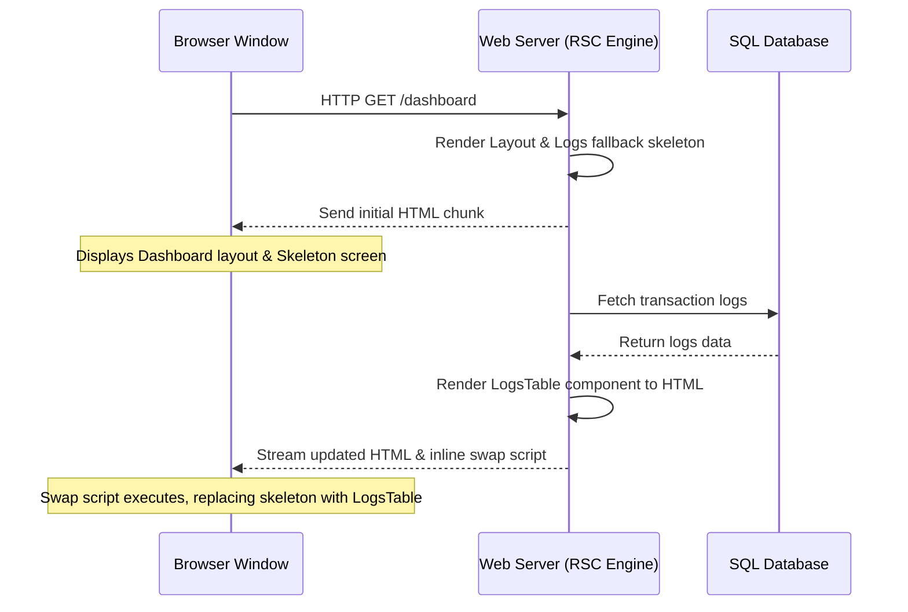
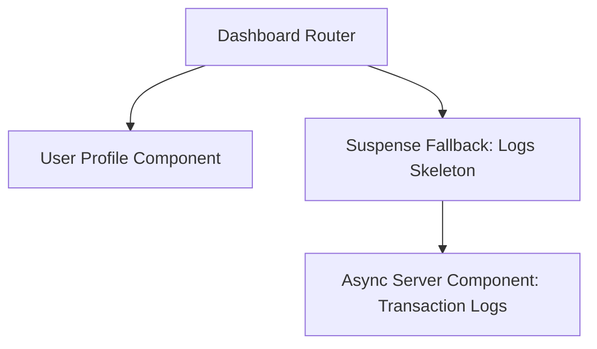
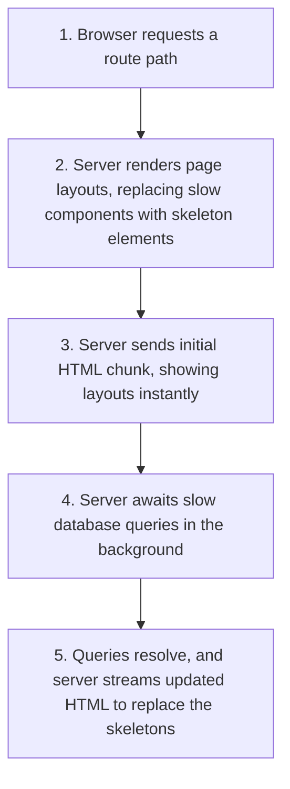

```mermaid
flowchart TD
    subgraph Traditional Blocked Render
        A1[Browser Request] --> B1[Server: Await User Details]
        B1 --> C1[Server: Await slow Transaction Logs]
        C1 --> D1[Server sends completed HTML]
        D1 --> E1[Browser renders layout after 2s]
    end
    subgraph HTML Streaming with Suspense
        A2[Browser Request] --> B2[Server sends header layout & logs skeleton]
        B2 --> C2[Browser displays skeleton instantly]
        C2 --> D2[Server fetches transaction logs in background]
        D2 --> E2[Server streams updated HTML and replaces skeleton]
    end
    style B2 fill:#dfd,stroke:#3a3
    style E2 fill:#dfd,stroke:#3a3
```

# Suspense-Driven Data Fetching

## Introduction

In traditional React single-page applications, loading page layouts and fetching data require multiple steps: the browser downloads the JavaScript bundle, renders a loading spinner, and sends client-side fetch requests. This process is called **Client-Side Data Fetching**. In the React Server Components (RSC) architecture, you fetch data directly on the server by declaring components as **async functions** and using standard **`await`** keywords. By wrapping these components in **`<Suspense>`** boundaries, you can stream HTML layouts to the browser incrementally. This module covers server-side async fetching, HTML streaming, and resolving data waterfalls.

---

## Why do we need this?

If a Server Component awaits multiple slow database queries sequentially, it blocks the entire page render, causing a blank screen for the user.

### Problem Statement
Consider an analytics dashboard that loads user profile details (fast query) and transaction logs (slow query). If you render both in a single Server Component:

```jsx
export default async function Dashboard() {
  const user = await fetchUserProfile(); // Resolves in 100ms
  const logs = await fetchTransactionLogs(); // Resolves in 2000ms (Blocks rendering!)
  
  return (
    <div>
      <ProfileCard user={user} />
      <LogsTable logs={logs} />
    </div>
  );
}
```

Because the logs fetch is awaited sequentially, the server waits 2.1 seconds before rendering anything. The user is stuck staring at a blank page, even though the profile details finished loading in 100ms. We need a way to stream the profile layout instantly and render the logs table dynamically once its query resolves.

---

## Real World Story

In traditional SSR architectures, the server rendered the complete HTML layout before sending anything to the browser.

This meant the Time to First Byte (TTFB) was blocked by the slowest database query. If a database query was slow, users had to wait for a blank page to load. React 18 resolved this by introducing **Suspense HTML Streaming** (Selective Hydration). By wrapping slow components in `<Suspense>` boundaries, the server could send the initial static layout and skeletons to the browser instantly. Once the slow query finished executing, the server streamed the remaining HTML and inline script placeholders, swapping the skeletons with the fully rendered components without requiring a page refresh.

---

## Real World Analogy

Think of Suspense HTML Streaming like a **House Construction Assembly Line** compared to **Moving in only after the House is Fully Decorated**.

- **Traditional Rendering (Moving in only when fully decorated)**: You buy a house. The builder refuses to hand you the keys (blocks render) until the walls are painted, the furniture is placed, the carpets are laid, and the landscaping is finished. You wait months before you can step inside.
- **HTML Streaming (Assembly Line)**: The builder builds the frame and roof, handing you the keys (initial page load) so you can move in. While you sit inside, painters arrive to paint the walls, and movers deliver the sofa (Suspense streaming). The house updates around you incrementally, allowing you to use it immediately.

---

## Visual Explanation

Below is a diagram comparing traditional blocked rendering with Suspense HTML streaming.

### Blocked Render (Slowest query blocks page)
```
[Server: Fetch User] ──> [Server: Await Logs (2s)] ──> [Send completed HTML] ──> [Interactive Page]
```

### HTML Streaming (Suspense)
```
[Server: Render Layout] ──> [Send static HTML & Skeleton instantly] ──> [Browser displays Layout]
                                                                                │
                                                                       (Logs query resolves)
                                                                                │
                                                                                ▼
                                                                [Stream remaining HTML to UI]
```



---

## Internal Working

React Server Components stream layouts to the browser using a single HTTP connection.

When you wrap a slow Server Component in a Suspense boundary:
1. The server renders the parent container and sends the initial HTML chunk to the browser, replacing the slow component with a placeholder div and a template key tag.
2. The browser renders this initial HTML instantly, displaying your fallback loader or skeleton.
3. The server continues executing the slow component's fetch Promise in the background.
4. When the Promise resolves, the server renders the component layout, wraps it in a hidden template tag, and streams it to the browser over the same active HTTP connection.
5. An inline script tag accompanying the template runs in the browser, swapping the placeholder element with the newly loaded HTML.



---

## Architecture

Suspense boundaries organize asynchronous data loads, wrapping slow database queries in separate loading skeletons while rendering fast components instantly.



---

## Step-by-Step Flow

When a user loads a page with nested Suspense streams, the following steps occur:



---

## Syntax

```jsx
import React, { Suspense } from 'react';
import { SkeletonLoader } from './Loader.jsx';
import AsyncWidget from './AsyncWidget.jsx';

export default function Page() {
  return (
    <div>
      <h2>Workspace Dashboard</h2>
      {/* Wrap async Server Component in a Suspense boundary */}
      <Suspense fallback={<SkeletonLoader />}>
        <AsyncWidget />
      </Suspense>
    </div>
  );
}
```

---

## Basic Example

Here is a basic Server Component that fetches data directly on the server using `async/await`, wrapped in a Suspense boundary in the parent component.

```jsx
// 1. UserFeed.jsx (Async Server Component)
import React from 'react';

// Async function fetches data directly on the server
export default async function UserFeed() {
  const response = await fetch('https://jsonplaceholder.typicode.com/users?_limit=3');
  const users = await response.json();

  return (
    <ul>
      {users.map(u => <li key={u.id}>{u.name}</li>)}
    </ul>
  );
}

// 2. Page.jsx (Parent Server Component)
import React, { Suspense } from 'react';
import UserFeed from './UserFeed.jsx';

export default function Page() {
  return (
    <div style={{ padding: '16px' }}>
      <h3>Users Catalog</h3>
      
      {/* Renders the fallback text while UserFeed fetches data on the server */}
      <Suspense fallback={<p>Fetching users from database...</p>}>
        <UserFeed />
      </Suspense>
    </div>
  );
}
```

---

## Intermediate Example

An intermediate component showing how to fetch multiple datasets in parallel inside a Server Component to avoid **network waterfalls**, using `Promise.all`.

```jsx
// DashboardPortal.jsx (Server Component)
import React, { Suspense } from 'react';

async function fetchStats() {
  const res = await fetch('https://jsonplaceholder.typicode.com/todos?_limit=2');
  return res.json();
}

async function fetchComments() {
  const res = await fetch('https://jsonplaceholder.typicode.com/comments?_limit=2');
  return res.json();
}

export default async function DashboardPortal() {
  //  RIGHT: Start both fetch requests in parallel to avoid sequential blocking
  const [stats, comments] = await Promise.all([
    fetchStats(),
    fetchComments()
  ]);

  return (
    <div style={{ padding: '20px', border: '1px solid #ccc' }}>
      <h4>Active Dashboard Feed</h4>
      <p>Loaded Stats Count: {stats.length}</p>
      <p>Loaded Comments Count: {comments.length}</p>
    </div>
  );
}
```

---

## Advanced Example

An advanced component showing how to split a page into multiple Suspense boundaries, allowing fast components to load instantly while slower queries stream in the background independently.

```jsx
import React, { Suspense } from 'react';

// Fast Fetch (Resolves in 200ms)
async function FastProfile() {
  await new Promise(r => setTimeout(r, 200));
  return <div style={{ padding: '10px', background: '#eef' }}>Member Alice (Loaded 200ms)</div>;
}

// Slow Fetch (Resolves in 2000ms)
async function SlowActivity() {
  await new Promise(r => setTimeout(r, 2000));
  return <div style={{ padding: '10px', background: '#ffe' }}>Activity: 124 logs parsed (Loaded 2s)</div>;
}

export default function WorkspaceConsole() {
  return (
    <div style={{ padding: '20px' }}>
      <h3>Workspace Developer Console</h3>

      {/* FastProfile loads quickly, without waiting for the slow component */}
      <Suspense fallback={<p>Loading profile details...</p>}>
        <FastProfile />
      </Suspense>

      <div style={{ marginTop: '16px' }}>
        {/* SlowActivity streams in later without blocking the rest of the page */}
        <Suspense fallback={<p>Streaming heavy logs database (2s)...</p>}>
          <SlowActivity />
        </Suspense>
      </div>
    </div>
  );
}
```

---

## Production Example

A production-ready data-fetching component utilizing database connection pools inside Server Components, logging transaction performance metrics, and handling search query parameter updates dynamically.

```jsx
import React, { Suspense } from 'react';
import { queryStockMetrics } from './dbConnection.js';

// 1. Async Data Component
async function StockGrid({ querySymbol }) {
  const start = performance.now();
  
  // Query database directly on the server
  const stocks = await queryStockMetrics(querySymbol);
  const duration = performance.now() - start;

  console.log(`[PERFORMANCE] DB Query for ${querySymbol} took ${duration.toFixed(2)}ms`);

  return (
    <div>
      <p>Database query speed: {duration.toFixed(2)}ms</p>
      <table style={{ width: '100%', borderCollapse: 'collapse' }}>
        <thead>
          <tr style={{ background: '#f5f5f5' }}>
            <th style={{ padding: '8px', textAlign: 'left' }}>Symbol</th>
            <th style={{ padding: '8px', textAlign: 'right' }}>Price</th>
          </tr>
        </thead>
        <tbody>
          {stocks.map(stock => (
            <tr key={stock.symbol} style={{ borderBottom: '1px solid #eee' }}>
              <td style={{ padding: '8px' }}>{stock.symbol}</td>
              <td style={{ padding: '8px', textAlign: 'right' }}>${stock.price}</td>
            </tr>
          ))}
        </tbody>
      </table>
    </div>
  );
}

// 2. Parent Layout Component
export default function StockDashboard({ searchParams }) {
  const symbol = searchParams.symbol || 'all';

  return (
    <div style={{ maxWidth: '600px', margin: '20px auto', padding: '16px', border: '1px solid #ddd', borderRadius: '8px' }}>
      <h3>Live Stock Exchange</h3>
      
      {/* Key prop ensures the Suspense boundary resets and shows the loader when query parameters change */}
      <Suspense key={symbol} fallback={<div style={{ height: '100px', background: '#f9f9f9', padding: '12px' }}>Loading stock indices...</div>}>
        <StockGrid querySymbol={symbol} />
      </Suspense>
    </div>
  );
}
```

---

## Folder Structure

```
suspense-fetching-demo/
├── src/
│   ├── components/
│   │   ├── StockGrid.jsx
│   │   └── UserFeed.jsx
│   ├── StockDashboard.jsx
│   └── dbConnection.js
├── package.json
└── vite.config.js
```

---

## Best Practices

💡 **Did You Know?**  
When using Suspense HTML streaming, the initial HTML sent to the browser contains complete layouts and skeletons, allowing search engine crawlers to index the basic page structure immediately.

🚀 **Best Practices**
- Fetch data directly in Server Components using `async/await` to avoid client-side API requests and waterfalls.
- Use `Promise.all` to fetch multiple datasets in parallel inside a Server Component, preventing sequential blocking.
- Wrap slow components in `<Suspense>` boundaries to stream HTML layouts incrementally and keep pages loading fast.

---

## Common Mistakes

⚠ **Common Mistakes**

### Awaiting Fetches Sequentially (Network Waterfalls)
Awaiting multiple asynchronous fetches sequentially inside a Server Component creates a performance waterfall. The second fetch does not start until the first fetch completes, doubling the page load time.

```jsx
// ❌ WRONG (Waterfall: takes 3 seconds total)
const user = await fetchUser(); // Takes 1s
const posts = await fetchPosts(user.id); // Takes 2s (Starts after user fetch finishes)

//  RIGHT (Parallel: takes 2 seconds total)
const [user, posts] = await Promise.all([
  fetchUser(),
  fetchPosts()
]);
```

---

## Performance Notes

⚡ **Performance Tips**
Add a `key` prop (e.g., matching query parameters) to your `<Suspense>` boundaries. This ensures that when query parameters change, the boundary resets and shows the fallback loader layout immediately, instead of displaying stale data.

---

## Accessibility Notes

♿ **Accessibility Tips**
Display loading skeletons inside fallback components with `aria-live="polite"` or `role="status"` to inform screen reader users that content is updating.

---

## SEO Notes

Server-side async data fetching compiles layouts into HTML on the server. Search engine crawlers receive a fully structured page immediately on load, improving SEO indexing compared to client-side rendered SPAs.

---

## Interview Questions

🎯 **Interview Tips**  
In an interview, explain Suspense data fetching as declaring Server Components as async functions and using `await`. Explain that wrapping slow components in `<Suspense>` boundaries allows the server to stream HTML layouts to the browser incrementally.

### Q1: How does HTML Streaming improve Time to First Byte (TTFB) in React?
**Answer**: In traditional rendering, the server waits for all database queries to finish before sending the HTML page to the browser. With HTML Streaming, the server sends the initial layout structure and loading skeletons instantly (reducing TTFB). Once slow database queries resolve in the background, the server streams the remaining HTML chunks over the same connection, updating the UI.

### Q2: Why is the composition pattern recommended for Server Components?
**Answer**: The composition pattern (passing components as children props) allows you to nest Server Components inside Client Components. This enables you to wrap interactive client-side layouts (like toggle drawers or tab menus) around static server-rendered data tables without pulling the data-fetching code into the client bundle.

---

## MCQs

1. **How do you fetch data inside a React Server Component?**
   - A) By using the `useEffect` hook.
   - B) By declaring the component as an `async` function and using the `await` keyword on fetches.
   - C) By writing class callbacks.
   - D) By calling the `useQuery` hook inside event handlers.
   - *Answer: B*

2. **What occurs when a slow async component is wrapped in a `<Suspense>` boundary?**
   - A) The entire page load blocks until the slow query resolves.
   - B) The server streams the parent container and fallback layout instantly, then streams the component HTML later once the query resolves.
   - C) Sibling components unmount.
   - D) React throws a compile warning.
   - *Answer: B*

3. **How can you fetch multiple datasets in parallel inside a Server Component?**
   - A) By using sequential `await` keywords on every line.
   - B) By wrapping fetches in `Promise.all()`.
   - C) By wrapping components inside an `if` condition.
   - D) By disabling React Strict Mode.
   - *Answer: B*

4. **Why is adding a key prop (like active category) to `<Suspense>` boundaries useful?**
   - A) It prevents CSS compiling errors.
   - B) It forces the boundary to reset and show the fallback loading skeleton when parameters change, instead of displaying stale data.
   - C) It registers cookies.
   - D) It imports environmental configurations.
   - *Answer: B*

5. **Does HTML Streaming require the browser to open multiple HTTP connections?**
   - A) Yes, one for each Suspense boundary.
   - B) No, the server streams all HTML chunks incrementally over a single active HTTP connection.
   - C) Yes, but only on mobile browsers.
   - D) No, it runs offline.
   - *Answer: B*

---

## Practice Exercise

### Exercise 1: Parallel fetch refactoring
Refactor these sequential awaits to run in parallel using `Promise.all`:
```javascript
// TODO: Refactor sequential awaits
const albums = await fetchAlbums();
const photos = await fetchPhotos();
```

*Solution*:
```javascript
const [albums, photos] = await Promise.all([
  fetchAlbums(),
  fetchPhotos()
]);
```

### Exercise 2: Dynamic category key
Create a page layout where a search query parameter updates. Wrap the data-fetching list component in a Suspense boundary with a `key` prop bound to the query parameter.

### Exercise 3: Streaming skeleton layout
Create a fallback component displaying three gray card shapes. Wrap a slow data-fetching card deck component in a Suspense boundary using the skeleton component as the fallback.

---

## Debugging Exercise

### The Blocked Render Bug
A developer wants to load page headers, footers, and a heavy transactions list. They write database queries directly in the page body, but notice that the entire page hangs on a blank screen during database queries. Identify the bug and write the fix.

```jsx
// Page.jsx (Server Component)
import React from 'react';
import Header from './Header.jsx';
import Footer from './Footer.jsx';

export default async function Page() {
  // BUG: Awaiting database query directly in the main page body blocks the entire page render
  const transactions = await db.queryTransactions();

  return (
    <div>
      <Header />
      <main>
        <h3>Transactions logs</h3>
        <ul>
          {transactions.map(t => <li key={t.id}>{t.label}</li>)}
        </ul>
      </main>
      <Footer />
    </div>
  );
}
```

#### Solution
Awaiting the database query in the main page body blocks the entire page rendering process. The browser cannot render the header or footer layouts until the query finishes. To fix this, extract the transactions list into a separate async component and wrap it in a `<Suspense>` boundary:

```jsx
// Corrected Page layout
import React, { Suspense } from 'react';
import Header from './Header.jsx';
import Footer from './Footer.jsx';
import TransactionList from './TransactionList.jsx'; // Extract to separate async component

export default function Page() {
  return (
    <div>
      <Header />
      <main>
        <h3>Transactions logs</h3>
        {/* Wrap transactions list in a Suspense boundary to prevent blocking the header/footer */}
        <Suspense fallback={<p>Loading transactions...</p>}>
          <TransactionList />
        </Suspense>
      </main>
      <Footer />
    </div>
  );
}

// TransactionList.jsx (Async Server Component)
export async function TransactionList() {
  const transactions = await db.queryTransactions();
  return (
    <ul>
      {transactions.map(t => <li key={t.id}>{t.label}</li>)}
    </ul>
  );
}
```

---

## Real-world Scenario

You are building an analytics dashboard for a high-traffic e-commerce store. The dashboard displays sales graphs, recent orders, and customer lists. Each chart queries databases containing millions of rows. Explain how you would structure the dashboard layout.
- **Design Strategy**: Render the main dashboard layout, page headers, and navigation sidebars statically. Wrap each charts widget and data table in separate, nested `<Suspense>` boundaries with skeleton screen fallbacks, allowing components to load data and stream layouts in parallel.

---

## Interview Coding Question

### Problem Statement
Write a Server Component that:
- Reads a user ID from query parameters.
- Fetches user data (takes 200ms) and logs data (takes 1.5s) in parallel.
- Displays the user profile immediately, while wrapping the logs list in a Suspense boundary with a skeleton loader.

```jsx
import React, { Suspense } from 'react';

// 1. Slow Logs Component
async function LogsList({ userId }) {
  await new Promise(r => setTimeout(r, 1500)); // Mock 1.5s delay
  return <p>Logs loaded successfully.</p>;
}

// 2. Main Page Layout
export default async function UserProfilePage({ searchParams }) {
  const userId = searchParams.id || '1';
  
  // Start fetching profile details on page mount
  await new Promise(r => setTimeout(r, 200)); // Mock 200ms profile load delay

  return (
    <div style={{ padding: '16px' }}>
      <h3>User Profile Registry</h3>
      <p>Active Profile ID: {userId}</p>

      {/* Wrap the slow logs component in a Suspense boundary */}
      <Suspense fallback={<p>Streaming user logs database...</p>}>
        <LogsList userId={userId} />
      </Suspense>
    </div>
  );
}
```

---

## Mini Project

### API Streaming Dashboard
Build a workspace dashboard showcasing streaming data:
- Create three different data-fetching widget components (e.g., weather feed, stocks ticker, chat box), each with artificial delays.
- Wrap each component in its own `<Suspense>` boundary with a skeleton screen.
- Verify in your browser console that all components fetch data in parallel, and layouts stream dynamically over a single HTTP connection.

---

## Summary

🧠 **Memory Tricks**  
`Awaits block, Suspense streams`  
- Awaiting database queries directly in the main page body blocks the page rendering process.
- Wrapping async components in `<Suspense>` boundaries allows page layouts to stream incrementally.

📖 **Summary**  
React Server Components support server-side data fetching using `async/await`. By wrapping async components in `<Suspense>` boundaries, you can stream HTML layouts to the browser incrementally, resolving performance bottlenecks.

---

## Cheat Sheet

```javascript
// Awaiting fetches inside Suspense boundaries
<Suspense fallback={<div>Loading data...</div>}>
  <AsyncList />
</Suspense>
```

---

## Related Topics
- [React Server Components (RSC)](server-components)
- [Server Actions & Mutations (Next Module)](server-actions)

---

## Further Reading
- [React Docs: Suspense HTML Streaming](https://react.dev/reference/react/Suspense#streaming-server-rendering-and-selective-hydration)
- [Next.js Docs: Loading UI & Streaming](https://nextjs.org/docs/app/building-your-application/routing/loading-ui-and-streaming)
