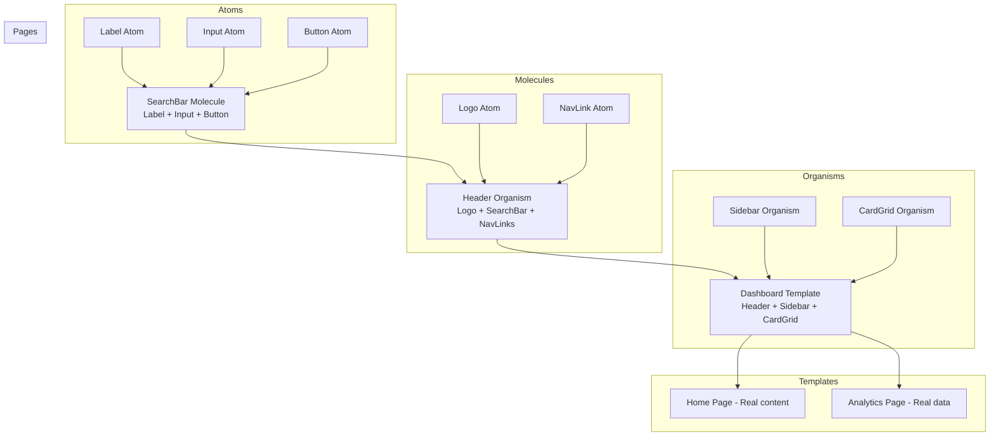
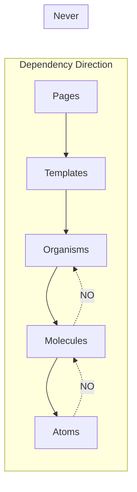
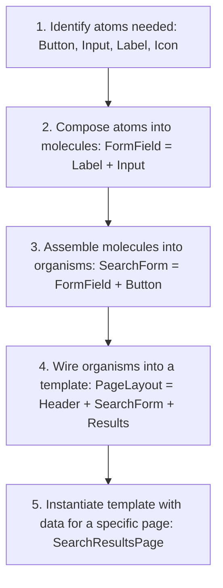

# Atomic Design in React

## Introduction

As React applications grow, maintaining a consistent, reusable component library becomes critical. Without a systematic approach to organizing components, applications end up with duplicated code, inconsistent styling, and a confusing component hierarchy. **Atomic Design**, created by Brad Frost, provides a methodology for building design systems by breaking interfaces down into five distinct levels: **Atoms, Molecules, Organisms, Templates, and Pages**. When applied to React, this methodology gives teams a shared vocabulary for component design, clear boundaries for abstraction, and a scalable structure for component libraries. This module covers each Atomic Design level, how to map them to React components, and how to maintain a living design system.

---

## Why do we need this?

Without a component hierarchy methodology, teams struggle with inconsistent naming, unclear abstraction levels, and duplicated components.

### Problem Statement

Consider a team of 5 developers building a SaaS application. Without a design system methodology:

1. Developer A creates a `<Button>` component that uses `<span>` with a CSS class.
2. Developer B creates a `<PrimaryBtn>` component that looks identical but uses a `<button>` tag.
3. Developer C needs a button with an icon, so they create `<IconButton>` from scratch, duplicating styles from Developer A's button.
4. When the design team changes the button border radius, Developer A updates their button, but no one knows about Developer B's and Developer C's buttons.

The result: inconsistent UIs, wasted development time, and a codebase full of near-identical components. We need a shared component taxonomy that tells every developer: "This is where buttons live. This is how you compose a button with an icon. This is the level at which you use that combination."

---

## Real World Story

In 2013, Brad Frost was working on building responsive design systems for clients. He noticed that teams consistently struggled with the same problem: they had no consistent language to talk about the parts of their interfaces. Designers used terms like "modules" and "blocks" while developers used "partials" and "includes," and neither group's terminology mapped to the other's.

Frost was inspired by chemistry — specifically, the periodic table. In chemistry, atoms combine to form molecules, which combine to form organisms. He realized user interfaces followed the same pattern: a label is an atom; a label combined with an input is a molecule; a search form combining that molecule with a button is an organism.

He published the concept of Atomic Design in 2013, and it was quickly adopted by design systems like Brad Frost's own Pattern Lab, and later by React component libraries like Material-UI, Chakra UI, and Radix UI. Today, Atomic Design is the most widely used methodology for organizing React component libraries in production applications.

---

## Real World Analogy

Think of Atomic Design like **Building a Car** compared to **Casting a Single Block of Metal**.

- **Without Atomic Design (Single Metal Block)**: You carve the entire car dashboard from a single block of metal. If the speedometer needs to be replaced, you must carve a new dashboard. If you want a different radio, you recast the whole block. Every change is expensive and risky.

- **With Atomic Design (Assembly Line)**: The car is built from standardized parts: screws and wires (Atoms), an assembled gauge cluster (Molecules), a dashboard panel (Organism), the dashboard layout blueprint (Template), and the final car configuration with custom trim (Page). When the speedometer design changes, you only swap out that one gauge in the cluster. The rest of the car is unaffected.

---

## Visual Explanation

Below is the five-level hierarchy of Atomic Design and how it maps to React components.

### Atomic Design Levels

```
Atoms (Label, Input, Button)
    ↓
Molecules (SearchBar = Label + Input + Button)
    ↓
Organisms (Header = Logo + SearchBar + NavLinks)
    ↓
Templates (PageLayout = Header + Sidebar + Content)
    ↓
Pages (HomePage = Template + Real Content)
```



---

## Internal Working

Atomic Design in React is implemented by creating distinct component folders for each level. Each level has specific constraints:

### Atoms
- Smallest, most basic building blocks.
- Should be completely agnostic — no knowledge of business logic.
- Examples: `Button`, `Label`, `Input`, `Icon`, `Spinner`, `Badge`.
- Props are generic (e.g., `variant`, `size`, `disabled`).

### Molecules
- Groups of 2-5 atoms working together as a single unit.
- Still agnostic but start to have meaningful structure.
- Examples: `SearchBar` (Input + Button), `FormField` (Label + Input + ErrorMessage), `NavLink` (Icon + Text).
- Props combine atom props with composition logic.

### Organisms
- Complex, distinct sections of an interface.
- May contain molecules, atoms, and other organisms.
- Often tied to specific data structures.
- Examples: `Header` (Logo + SearchBar + Nav), `ProductCard` (Image + Title + Price + Button), `DataTable` (Search + Table + Pagination).

### Templates
- Wireframe-level page layouts.
- Define the structure without specific content.
- Organisms are placed in specific grid positions.
- Examples: `DashboardLayout`, `BlogPostLayout`, `AuthLayout`.

### Pages
- Specific instances of templates with real content.
- This is where data fetching, routing, and business logic connect to the template.
- Examples: `HomePage`, `ProductPage`, `SettingsPage`.

```typescript
// Example: Atom — completely generic
interface ButtonProps {
  variant: 'primary' | 'secondary' | 'ghost';
  size: 'sm' | 'md' | 'lg';
  disabled?: boolean;
  children: React.ReactNode;
  onClick?: () => void;
}

// Example: Molecule — combines atoms
interface SearchBarProps {
  placeholder?: string;
  onSearch: (query: string) => void;
  buttonLabel?: string;
}

// Example: Organism — knows about data structure
interface ProductCardProps {
  product: {
    id: string;
    title: string;
    price: number;
    imageUrl: string;
    rating: number;
  };
  onAddToCart: (productId: string) => void;
}

// Example: Template — defines layout
interface DashboardLayoutProps {
  sidebar: React.ReactNode;
  header: React.ReactNode;
  children: React.ReactNode;
}

// Example: Page — specific instance with data
// No props interface needed — page fetches its own data
```

---

## Architecture

The dependency direction is strictly downward: Pages import Templates, Templates import Organisms, Organisms import Molecules, Molecules import Atoms. Atoms never import from higher levels.



---

## Step-by-Step Flow

When a developer builds a new page using Atomic Design, the following steps occur:



---

## Syntax

```tsx
// ===== Atoms/Button.tsx =====
interface ButtonProps {
  variant: 'primary' | 'secondary';
  size: 'sm' | 'md' | 'lg';
  children: React.ReactNode;
  onClick?: () => void;
}

export function Button({ variant, size, children, onClick }: ButtonProps) {
  return (
    <button className={`btn btn-${variant} btn-${size}`} onClick={onClick}>
      {children}
    </button>
  );
}

// ===== Molecules/SearchBar.tsx =====
import { Input } from '@/atoms/Input';
import { Button } from '@/atoms/Button';

export function SearchBar({ onSearch }: { onSearch: (q: string) => void }) {
  return (
    <div className="search-bar">
      <Input placeholder="Search..." />
      <Button variant="primary" size="md">Search</Button>
    </div>
  );
}
```

---

## Basic Example

Here is a basic Atomic Design implementation showing the Atom → Molecule → Organism hierarchy for a simple card component.

```tsx
// ===== atoms/Text.tsx =====
import React from 'react';

interface TextProps {
  as?: 'h1' | 'h2' | 'h3' | 'p' | 'span';
  variant?: 'title' | 'body' | 'caption';
  children: React.ReactNode;
}

export function Text({ as: Tag = 'p', variant = 'body', children }: TextProps) {
  return <Tag className={`text text-${variant}`}>{children}</Tag>;
}

// ===== atoms/Badge.tsx =====
import React from 'react';

interface BadgeProps {
  variant?: 'new' | 'sale' | 'default';
  children: React.ReactNode;
}

export function Badge({ variant = 'default', children }: BadgeProps) {
  return <span className={`badge badge-${variant}`}>{children}</span>;
}

// ===== molecules/ProductInfo.tsx =====
// Molecule: combines Text atoms to display structured product info
import React from 'react';
import { Text } from '@/atoms/Text';
import { Badge } from '@/atoms/Badge';

interface ProductInfoProps {
  name: string;
  price: number;
  badge?: string;
}

export function ProductInfo({ name, price, badge }: ProductInfoProps) {
  return (
    <div className="product-info">
      {badge && <Badge variant="new">{badge}</Badge>}
      <Text as="h3" variant="title">{name}</Text>
      <Text variant="body">${price.toFixed(2)}</Text>
    </div>
  );
}

// ===== organisms/ProductCard.tsx =====
// Organism: composes molecules and atoms into a self-contained card
import React from 'react';
import { Image } from '@/atoms/Image';
import { Button } from '@/atoms/Button';
import { ProductInfo } from '@/molecules/ProductInfo';

interface ProductCardProps {
  product: {
    id: string;
    name: string;
    price: number;
    imageUrl: string;
    badge?: string;
  };
  onAddToCart: (id: string) => void;
}

export function ProductCard({ product, onAddToCart }: ProductCardProps) {
  return (
    <div className="product-card">
      <Image src={product.imageUrl} alt={product.name} />
      <ProductInfo name={product.name} price={product.price} badge={product.badge} />
      <Button variant="primary" size="md" onClick={() => onAddToCart(product.id)}>
        Add to Cart
      </Button>
    </div>
  );
}
```

---

## Intermediate Example

An intermediate example showing the Template and Page levels, where a Dashboard Template defines the layout structure and organisms are plugged in by the specific page.

```tsx
// ===== templates/DashboardLayout.tsx =====
// Template: defines grid structure without specific content
import React from 'react';

interface DashboardLayoutProps {
  sidebar: React.ReactNode;
  topBar: React.ReactNode;
  mainContent: React.ReactNode;
  widgets?: React.ReactNode[];
}

export function DashboardLayout({ sidebar, topBar, mainContent, widgets }: DashboardLayoutProps) {
  return (
    <div className="dashboard-grid">
      <header className="dashboard-topbar">{topBar}</header>
      <aside className="dashboard-sidebar">{sidebar}</aside>
      <main className="dashboard-main">{mainContent}</main>
      {widgets && (
        <aside className="dashboard-widgets">
          {widgets.map((widget, i) => (
            <div key={i} className="dashboard-widget">{widget}</div>
          ))}
        </aside>
      )}
    </div>
  );
}

// ===== organisms/SidebarNav.tsx =====
// Organism: navigation sidebar
import React from 'react';
import { NavItem } from '@/molecules/NavItem';
import { UserProfile } from '@/molecules/UserProfile';

const NAV_ITEMS = [
  { icon: '📊', label: 'Dashboard', href: '/' },
  { icon: '👥', label: 'Users', href: '/users' },
  { icon: '📦', label: 'Orders', href: '/orders' },
  { icon: '⚙️', label: 'Settings', href: '/settings' },
];

export function SidebarNav({ userName, userEmail }: { userName: string; userEmail: string }) {
  return (
    <nav className="sidebar-nav">
      <UserProfile name={userName} email={userEmail} />
      <ul>
        {NAV_ITEMS.map(item => (
          <NavItem key={item.href} {...item} />
        ))}
      </ul>
    </nav>
  );
}

// ===== organisms/MetricsGrid.tsx =====
// Organism: displays metrics cards
import React from 'react';
import { MetricCard } from '@/molecules/MetricCard';
import type { Metric } from '@/types';

interface MetricsGridProps {
  metrics: Metric[];
}

export function MetricsGrid({ metrics }: MetricsGridProps) {
  return (
    <div className="metrics-grid">
      {metrics.map(metric => (
        <MetricCard key={metric.label} metric={metric} />
      ))}
    </div>
  );
}

// ===== pages/DashboardPage.tsx =====
// Page: specific instance of DashboardLayout with real data
import React, { useState, useEffect } from 'react';
import { DashboardLayout } from '@/templates/DashboardLayout';
import { SidebarNav } from '@/organisms/SidebarNav';
import { MetricsGrid } from '@/organisms/MetricsGrid';
import { TopBar } from '@/organisms/TopBar';

export default function DashboardPage() {
  const [metrics, setMetrics] = useState([]);
  const [user] = useState({ name: 'Alice Johnson', email: 'alice@example.com' });

  useEffect(() => {
    fetch('/api/dashboard/metrics')
      .then(res => res.json())
      .then(setMetrics);
  }, []);

  return (
    <DashboardLayout
      topBar={<TopBar title="Dashboard" />}
      sidebar={<SidebarNav userName={user.name} userEmail={user.email} />}
      mainContent={<MetricsGrid metrics={metrics} />}
      widgets={[
        <div key="1">Recent Activity</div>,
        <div key="2">System Health</div>,
      ]}
    />
  );
}
```

---

## Advanced Example

An advanced example demonstrating how Atomic Design integrates with a **design token system** — atoms consume design tokens, ensuring visual consistency across the entire application.

```tsx
// ===== tokens/design-tokens.css =====
// :root {
//   --color-primary: #6366f1;
//   --color-primary-hover: #4f46e5;
//   --color-text: #1e293b;
//   --color-text-secondary: #64748b;
//   --font-size-sm: 0.875rem;
//   --font-size-md: 1rem;
//   --font-size-lg: 1.25rem;
//   --spacing-xs: 0.25rem;
//   --spacing-sm: 0.5rem;
//   --spacing-md: 1rem;
//   --spacing-lg: 1.5rem;
//   --border-radius-sm: 4px;
//   --border-radius-md: 8px;
//   --shadow-sm: 0 1px 2px rgba(0,0,0,0.05);
//   --shadow-md: 0 4px 6px rgba(0,0,0,0.07);
// }

// ===== atoms/Button/Button.tsx =====
// Atom that consumes design tokens
import React from 'react';
import './Button.css';

interface ButtonProps {
  variant?: 'primary' | 'secondary' | 'ghost';
  size?: 'sm' | 'md' | 'lg';
  children: React.ReactNode;
  onClick?: () => void;
  disabled?: boolean;
  fullWidth?: boolean;
}

export function Button({
  variant = 'primary',
  size = 'md',
  children,
  onClick,
  disabled,
  fullWidth,
}: ButtonProps) {
  return (
    <button
      className={`btn btn--${variant} btn--${size} ${fullWidth ? 'btn--full' : ''}`}
      onClick={onClick}
      disabled={disabled}
    >
      {children}
    </button>
  );
}

// Button.css
// .btn {
//   display: inline-flex;
//   align-items: center;
//   justify-content: center;
//   gap: var(--spacing-xs);
//   border: none;
//   border-radius: var(--border-radius-md);
//   font-family: inherit;
//   font-weight: 600;
//   cursor: pointer;
//   transition: background-color 0.2s, box-shadow 0.2s;
// }
// .btn--primary {
//   background-color: var(--color-primary);
//   color: white;
// }
// .btn--primary:hover {
//   background-color: var(--color-primary-hover);
// }
// .btn--sm  { padding: var(--spacing-xs) var(--spacing-sm); font-size: var(--font-size-sm); }
// .btn--md  { padding: var(--spacing-sm) var(--spacing-md); font-size: var(--font-size-md); }
// .btn--lg  { padding: var(--spacing-md) var(--spacing-lg); font-size: var(--font-size-lg); }
// .btn--full { width: 100%; }

// ===== molecules/FormField/FormField.tsx =====
// Molecule: composes atoms using design tokens
import React from 'react';
import { Label } from '@/atoms/Label';
import { Input } from '@/atoms/Input';
import { Text } from '@/atoms/Text';
import './FormField.css';

interface FormFieldProps {
  label: string;
  name: string;
  type?: string;
  value: string;
  onChange: (value: string) => void;
  error?: string;
  placeholder?: string;
  required?: boolean;
}

export function FormField({
  label,
  name,
  type = 'text',
  value,
  onChange,
  error,
  placeholder,
  required,
}: FormFieldProps) {
  return (
    <div className="form-field">
      <Label htmlFor={name} required={required}>{label}</Label>
      <Input
        id={name}
        type={type}
        value={value}
        onChange={e => onChange(e.target.value)}
        placeholder={placeholder}
        hasError={!!error}
      />
      {error && (
        <Text variant="caption" className="form-field__error">
          {error}
        </Text>
      )}
    </div>
  );
}
```

---

## Production Example

A production-grade **design system component library** organized by Atomic Design levels, with Storybook documentation, visual regression tests, and automated a11y checks.

```tsx
// ===== atoms/Icon/Icon.tsx =====
// Icon atom with SVG sprite system
import React from 'react';
import icons from './icons.svg'; // SVG sprite
import './Icon.css';

interface IconProps {
  name: 'search' | 'cart' | 'user' | 'settings' | 'close';
  size?: 'sm' | 'md' | 'lg';
  ariaLabel?: string;
}

export function Icon({ name, size = 'md', ariaLabel }: IconProps) {
  return (
    <svg
      className={`icon icon--${size}`}
      aria-hidden={!ariaLabel}
      aria-label={ariaLabel}
      role={ariaLabel ? 'img' : undefined}
    >
      <use href={`${icons}#icon-${name}`} />
    </svg>
  );
}

// ===== molecules/Pagination/Pagination.tsx =====
// Molecule: page navigation control
import React from 'react';
import { Button } from '@/atoms/Button';
import { Text } from '@/atoms/Text';
import './Pagination.css';

interface PaginationProps {
  currentPage: number;
  totalPages: number;
  onPageChange: (page: number) => void;
}

export function Pagination({ currentPage, totalPages, onPageChange }: PaginationProps) {
  return (
    <nav className="pagination" aria-label="Pagination">
      <Button
        variant="ghost"
        size="sm"
        disabled={currentPage <= 1}
        onClick={() => onPageChange(currentPage - 1)}
      >
        Previous
      </Button>

      <Text variant="body" aria-current="page">
        Page {currentPage} of {totalPages}
      </Text>

      <Button
        variant="ghost"
        size="sm"
        disabled={currentPage >= totalPages}
        onClick={() => onPageChange(currentPage + 1)}
      >
        Next
      </Button>
    </nav>
  );
}

// ===== organisms/DataTable/DataTable.tsx =====
// Organism: full-featured data table
import React, { useState } from 'react';
import { SearchBar } from '@/molecules/SearchBar';
import { Pagination } from '@/molecules/Pagination';
import { TableRow } from '@/molecules/TableRow';
import { Text } from '@/atoms/Text';
import './DataTable.css';

interface Column<T> {
  key: keyof T;
  header: string;
  render?: (value: T[keyof T], row: T) => React.ReactNode;
}

interface DataTableProps<T> {
  columns: Column<T>[];
  data: T[];
  pageSize?: number;
  searchable?: boolean;
  onRowClick?: (row: T) => void;
}

export function DataTable<T extends { id: string }>({
  columns,
  data,
  pageSize = 10,
  searchable = true,
  onRowClick,
}: DataTableProps<T>) {
  const [searchQuery, setSearchQuery] = useState('');
  const [currentPage, setCurrentPage] = useState(1);

  const filteredData = data.filter(row =>
    JSON.stringify(row).toLowerCase().includes(searchQuery.toLowerCase())
  );

  const totalPages = Math.ceil(filteredData.length / pageSize);
  const paginatedData = filteredData.slice(
    (currentPage - 1) * pageSize,
    currentPage * pageSize
  );

  return (
    <div className="data-table">
      {searchable && (
        <div className="data-table__toolbar">
          <SearchBar value={searchQuery} onChange={setSearchQuery} />
          <Text variant="body">{filteredData.length} results</Text>
        </div>
      )}

      <div className="data-table__table" role="table">
        <div className="data-table__header" role="row">
          {columns.map(col => (
            <div key={String(col.key)} className="data-table__cell data-table__cell--header">
              {col.header}
            </div>
          ))}
        </div>

        {paginatedData.map(row => (
          <TableRow
            key={row.id}
            row={row}
            columns={columns}
            onClick={() => onRowClick?.(row)}
          />
        ))}
      </div>

      <Pagination
        currentPage={currentPage}
        totalPages={totalPages}
        onPageChange={setCurrentPage}
      />
    </div>
  );
}
```

---

## Folder Structure

```
src/
├── components/                      # Atomic Design components
│   ├── atoms/                       # Smallest building blocks
│   │   ├── Button/
│   │   │   ├── Button.tsx
│   │   │   ├── Button.css
│   │   │   ├── Button.stories.tsx
│   │   │   └── Button.test.tsx
│   │   ├── Input/
│   │   ├── Label/
│   │   ├── Icon/
│   │   ├── Text/
│   │   ├── Image/
│   │   ├── Badge/
│   │   ├── Spinner/
│   │   └── index.ts                 # Barrel exports all atoms
│   ├── molecules/                   # Groups of 2-5 atoms
│   │   ├── SearchBar/
│   │   ├── FormField/
│   │   ├── ProductInfo/
│   │   ├── Pagination/
│   │   ├── NavItem/
│   │   ├── MetricCard/
│   │   └── index.ts
│   ├── organisms/                   # Complex UI sections
│   │   ├── Header/
│   │   ├── ProductCard/
│   │   ├── SidebarNav/
│   │   ├── DataTable/
│   │   ├── MetricsGrid/
│   │   ├── Footer/
│   │   └── index.ts
│   ├── templates/                   # Page-level layouts
│   │   ├── DashboardLayout/
│   │   ├── AuthLayout/
│   │   ├── BlogLayout/
│   │   └── index.ts
│   └── pages/                       # Specific page instances
│       ├── HomePage.tsx
│       ├── DashboardPage.tsx
│       ├── ProductPage.tsx
│       └── SettingsPage.tsx
├── tokens/                          # Design tokens
│   ├── colors.css
│   ├── typography.css
│   ├── spacing.css
│   └── index.css
└── hooks/                           # Shared hooks
    └── useMediaQuery.ts
```

---

## Best Practices

💡 **Did You Know?**  \
Brad Frost created Atomic Design while working on responsive web design. The chemical analogy (atoms, molecules, organisms) was inspired by the periodic table — he realized that web interfaces, like chemical compounds, are built from small, reusable elements that combine into increasingly complex structures.

🚀 **Best Practices**
- **Atoms should be completely agnostic**: They should not know about business logic, data structures, or specific use cases. A Button atom only knows about its variant, size, and click handler.
- **Molecules should be single-purpose**: A SearchBar molecule combines an Input atom and a Button atom. It should not contain 15 different atoms.
- **Organisms can be product-specific**: Unlike atoms and molecules, organisms can know about your product's data structures (like User, Product, Order).
- **Templates contain no data**: Templates should use placeholder data or React children. They define the grid and layout structure only.
- **Pages are thin**: Pages orchestrate data fetching and pass data to templates. They should contain minimal JSX.

---

## Common Mistakes

⚠ **Common Mistakes**

### Leaking Business Logic into Atoms

A common mistake is putting business logic (like API calls or Redux dispatch) inside an atom, making it impossible to reuse the atom in other contexts.

```tsx
// ❌ WRONG: Button atom knows about the cart API
function Button({ productId }) {
  const handleClick = () => {
    fetch('/api/cart/add', { body: JSON.stringify({ productId }) }); // Business logic in atom!
  };
  return <button onClick={handleClick}>Add to Cart</button>;
}

// ✅ RIGHT: Button atom receives a generic onClick handler
function Button({ onClick, children }) {
  return <button onClick={onClick}>{children}</button>;
}
```

### Skipping Levels

Some developers skip molecules and go directly from atoms to organisms. This creates organisms that contain 15+ atoms and are hard to maintain. If your organism has more than 7-8 direct children, it likely needs intermediate molecule components.

---

## Performance Notes

⚡ **Performance Tips**
- Atomic Design's strict separation of concerns makes it easy to memoize components at the molecule and organism level. Wrap molecules in `React.memo` to prevent unnecessary re-renders.
- Use Storybook's `args` composition to test atom and molecule performance in isolation.

---

## Accessibility Notes

♿ **Accessibility Tips**
- Atoms should accept and forward ARIA attributes (`aria-label`, `aria-describedby`, `role`) to ensure accessibility composes correctly as atoms are assembled into molecules and organisms.
- Test accessibility at every level: an accessible atom (Button with proper focus styles) ensures the molecule (SearchBar) inherits that accessibility.

```tsx
// Atom forwards ARIA props
interface ButtonProps extends React.ButtonHTMLAttributes<HTMLButtonElement> {
  variant?: 'primary' | 'secondary';
}

export function Button({ variant, children, ...rest }: ButtonProps) {
  return <button className={`btn btn-${variant}`} {...rest}>{children}</button>;
}
```

---

## SEO Notes

Pages are the only level that should handle SEO metadata. Templates define the HTML structure (like `<header>`, `<main>`, `<footer>` semantics), but pages set the actual `<title>`, `<meta description>`, and Open Graph tags based on the specific content being rendered.

---

## Interview Questions

🎯 **Interview Tips**  \
In an interview, explain Atomic Design as "a component taxonomy with 5 levels: atoms (basic elements), molecules (simple groups), organisms (complex sections), templates (page layouts), and pages (specific instances)." Emphasize the strict dependency direction: atoms never import from higher levels.

### Q1: What are the five levels of Atomic Design?

**Answer**: The five levels are:
1. **Atoms**: Basic HTML elements (Button, Input, Label, Icon).
2. **Molecules**: Groups of atoms working together (SearchBar = Input + Button).
3. **Organisms**: Complex UI sections made of molecules and atoms (Header = Logo + SearchBar + NavLinks).
4. **Templates**: Page-level layouts that define structure without specific content.
5. **Pages**: Specific instances of templates with real data.

### Q2: What is the dependency rule in Atomic Design?

**Answer**: Dependencies flow strictly downward. Pages can import from any lower level. Templates import from organisms. Organisms import from molecules. Molecules import from atoms. Atoms never import from molecules, organisms, or pages. This ensures that changing a lower-level component does not break higher-level components.

---

## MCQs

1. **At which Atomic Design level should API calls and data fetching occur?**
   - A) Atoms
   - B) Molecules
   - C) Organisms
   - D) Pages
   - *Answer: D*

2. **What distinguishes a Template from a Page in Atomic Design?**
   - A) Templates have real data; Pages have placeholder data.
   - B) Templates define the layout structure without specific content; Pages instantiate the template with real data.
   - C) Templates are for mobile; Pages are for desktop.
   - D) There is no difference — they are the same thing.
   - *Answer: B*

3. **Which of the following is an example of an Atom?**
   - A) SearchBar (Input + Button)
   - B) Header (Logo + SearchBar + Nav)
   - C) Button (single element with variant props)
   - D) DashboardPage (full page with data)
   - *Answer: C*

4. **What is the maximum number of atomic components a molecule should typically contain?**
   - A) 1-2
   - B) 2-5
   - C) 5-10
   - D) No limit
   - *Answer: B*

5. **Which tool pairs naturally with Atomic Design for component documentation and testing?**
   - A) Jest
   - B) Storybook
   - C) ESLint
   - D) Webpack
   - *Answer: B*

---

## Practice Exercise

### Exercise 1: Atomic Design Classification
Classify the following React components into the correct Atomic Design level:

```
1. <Avatar /> — displays a user profile image
2. <UserInfoCard /> — displays avatar, name, email, and role badge
3. <BlogPostLayout /> — defines header, content, sidebar, and footer grid areas
4. <ArticlePage /> — loads a specific article and renders it in BlogPostLayout
5. <Icon /> — renders an SVG icon
```

*Solution*: 1. Molecule (combines Image + Badge atoms behind the scenes), 2. Organism, 3. Template, 4. Page, 5. Atom

### Exercise 2: Molecule Builder
Create a `FormField` molecule that composes a `Label` atom, an `Input` atom, and a `Text` atom (for error messages). Ensure the form field accepts props for `label`, `error`, and all input attributes.

### Exercise 3: Refactor to Atomic Design
Given this monolithic component, refactor it into Atomic Design levels:

```tsx
// Monolithic component
function UserProfile({ user }) {
  return (
    <div className="profile-card">
      
      <h3>{user.name}</h3>
      <p>{user.email}</p>
      <button onClick={() => followUser(user.id)} className="follow-btn">
        Follow
      </button>
      <span className="role-badge">{user.role}</span>
    </div>
  );
}
```

*Solution*: Extract `Avatar` (Atom), `Text` (Atom), `Button` (Atom), `Badge` (Atom), `UserInfo` (Molecule: Avatar + Text), and finally `UserProfileCard` (Organism: UserInfo + Button + Badge).

---

## Debugging Exercise

### The Overly Complex Atom
A developer created an `Atom` called `UserAvatar` that includes the user's name, online status dot, a dropdown menu, and the user's role badge. The component has grown to 80 lines. Another team wants to use just the avatar image and online status dot in a different context, but they can't because the component is too tightly coupled.

#### Solution
The solution is to decompose `UserAvatar` into proper Atomic Design levels:

- `Avatar` (Atom): Just the image with `src` and `alt` props.
- `OnlineDot` (Atom): Just the status indicator.
- `UserPreview` (Molecule): Composes `Avatar` + `OnlineDot` into a reusable preview.
- `UserDropdown` (Molecule): Composes `UserPreview` + dropdown menu.
- `UserProfileCard` (Organism): Composes `UserPreview` + `Badge` + additional info.

Now any team can use just `Avatar + OnlineDot` (as a molecule) without importing the dropdown.

---

## Real-world Scenario

You are building a white-label SaaS product where each customer can customize colors, fonts, and component styling. Multiple teams work on different parts of the application simultaneously.

**Design System Strategy**: Implement Atomic Design with a design token system. Atoms consume CSS custom properties (design tokens) for all visual properties. Molecules compose atoms using spacing and layout tokens. Organisms assemble molecules into product-specific sections. When a customer customizes their theme, only the token values change — the component hierarchy and logic remain untouched. Each team owns a set of organisms, while the shared atoms and molecules are maintained by a core design system team.

---

## Interview Coding Question

### Problem Statement

Using Atomic Design principles, design the component hierarchy for a **Blog** application with the following page types: Home Page (list of blog post cards), Article Page (full article with comments), and Author Page (author bio with their posts).

Provide the folder structure and explain which level each component belongs to.

```
src/components/
├── atoms/
│   ├── Avatar.tsx
│   ├── Badge.tsx
│   ├── Button.tsx
│   ├── Heading.tsx
│   ├── Image.tsx
│   ├── Input.tsx
│   ├── Text.tsx
│   └── Tag.tsx
├── molecules/
│   ├── AuthorPreview.tsx      (Avatar + Heading + Text)
│   ├── CommentCard.tsx        (Avatar + Text + timestamp)
│   ├── PostMeta.tsx           (Badge + Text + date)
│   ├── SearchBar.tsx          (Input + Button)
│   └── TagList.tsx            (multiple Tag atoms)
├── organisms/
│   ├── ArticleContent.tsx     (Heading + Image + Text blocks)
│   ├── CommentSection.tsx     (CommentCard list + form)
│   ├── PostCard.tsx           (Image + PostMeta + Text preview)
│   ├── AuthorSidebar.tsx      (AuthorPreview + PostCard list)
│   └── Header.tsx             (Logo + SearchBar + Nav)
├── templates/
│   ├── BlogLayout.tsx         (Header + Main + Sidebar)
│   └── ArticleLayout.tsx      (Header + Article + Comments)
└── pages/
    ├── HomePage.tsx           (BlogLayout + PostCard grid)
    ├── ArticlePage.tsx        (ArticleLayout + ArticleContent + Comments)
    └── AuthorPage.tsx         (BlogLayout + AuthorSidebar + PostCard list)
```

---

## Mini Project

### Atomic Design Component Library Showcase

Build a mini design system with full Atomic Design separation:

1. **Atoms (5 components)**: `Button`, `Input`, `Label`, `Badge`, `Text` with variant/size props.
2. **Molecules (2 components)**: `FormField` (Label + Input + error Text), `ButtonGroup` (multiple Buttons).
3. **Organisms (2 components)**: `LoginForm` (FormField + Button), `Card` (Image + Text + Badge + Button).
4. **Template (1 component)**: `CenteredCardLayout` (centered card with a slot for children).
5. **Page (1 component)**: `LoginPage` (CenteredCardLayout + LoginForm, with form submission logic).

Requirements:
- Atoms must accept and forward ARIA props.
- Each component folder must have its own CSS module.
- Create an `index.ts` barrel file for each level.
- Ensure no atom imports from a higher level.
- Visual regression test the Button atom in Storybook format.

---

## Summary

🧠 **Memory Tricks**  \
`A-M-O-T-P` — Atoms, Molecules, Organisms, Templates, Pages. Think of it like building a LEGO set: bricks (atoms), sub-assemblies (molecules), completed modules (organisms), blueprints (templates), and the final display model (pages).

`Atoms don't import up` — Atoms should never import from molecules, organisms, templates, or pages. This single rule enforces clean separation of concerns.

📖 **Summary**  \
Atomic Design is a methodology for building scalable, maintainable component libraries by organizing components into five hierarchical levels. Atoms are the smallest building blocks, molecules combine atoms into functional groups, organisms form complex UI sections, templates define page layouts, and pages are specific instances with real data. The strict dependency direction (atoms never import from higher levels) ensures components remain reusable, testable, and independently maintainable.

---

## Cheat Sheet

```typescript
// Atomic Design component map
// atoms/     → Button, Input, Label, Icon, Text, Badge
// molecules/ → SearchBar, FormField, NavItem, Pagination
// organisms/ → Header, ProductCard, DataTable, SidebarNav
// templates/ → DashboardLayout, AuthLayout, BlogLayout
// pages/     → HomePage, DashboardPage, ProductPage

// Dependency rule: Pages → Templates → Organisms → Molecules → Atoms
// Atoms never import from higher levels!
```

---

## Related Topics

- [Design Systems & Components](design-systems)
- [Feature-Based Architecture](feature-based-architecture)
- [Folder Structures & Modularity](folder-structure)

---

## Further Reading

- [Brad Frost: Atomic Design Methodology](https://bradfrost.com/blog/post/atomic-web-design/)
- [Pattern Lab: Atomic Design System](https://patternlab.io/)
- [Storybook: Component-Driven Development](https://storybook.js.org/tutorials/intro-to-storybook/)
- [Radix UI: Unstyled Accessible Components](https://www.radix-ui.com/)
