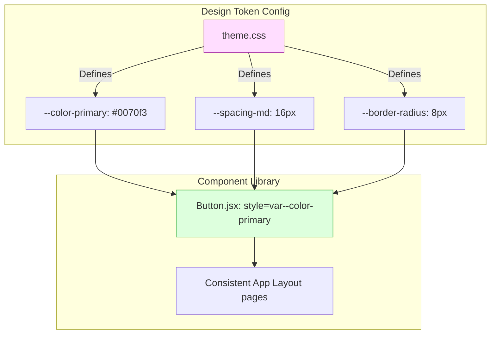
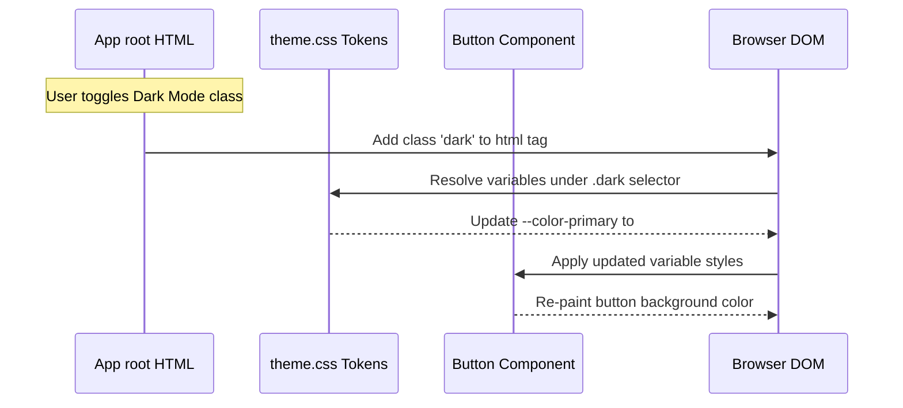
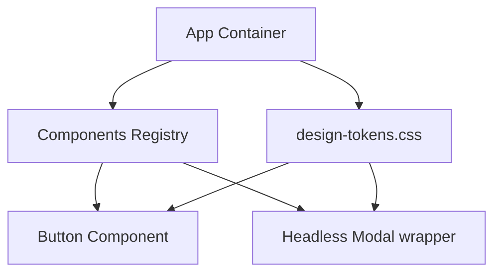
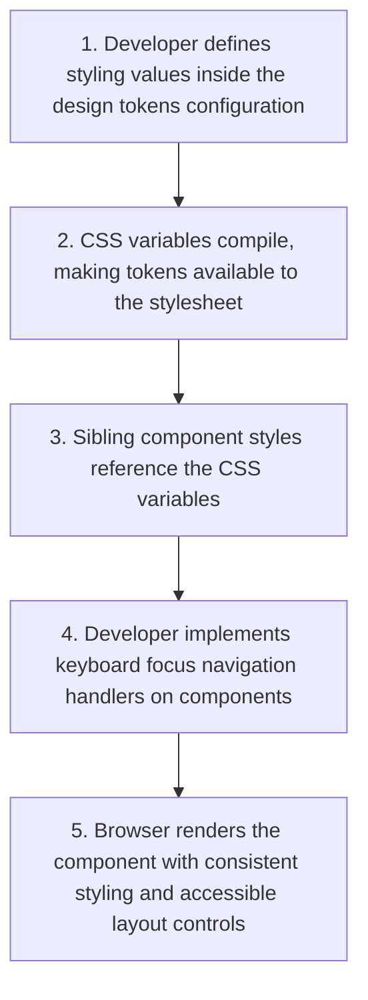

# Design Systems & Component Libraries

## Introduction

In large-scale applications, keeping a consistent look and feel (visual consistency) across pages is challenging. If different teams write custom styles for buttons, inputs, and modals, the user interface quickly becomes inconsistent and difficult to maintain. To solve this, enterprise organizations build **Design Systems** and reusable **Component Libraries**. A design system uses standardized styling values (design tokens) and accessible components to ensure visual consistency and code reuse. This module covers design tokens, custom theme configurations, CSS variables, and accessibility patterns.

---

## Why do we need this?

If visual styles (like colors, margins, fonts, and shadows) are hardcoded inside individual components, updating the application's branding requires editing hundreds of files, leading to style inconsistencies.

### Problem Statement
Consider an application that has multiple buttons styled across pages.
1. In one component, the primary button has the style `background: #0070f3` and `border-radius: 4px`.
2. In another component, a developer tries to match the style but writes `background: #0066cc` and `border-radius: 6px`.
3. This creates visual inconsistencies across the application.
4. If the marketing team decides to change the primary brand color to green, you must search and replace HEX color codes across hundreds of CSS files, leading to bugs.

We need a centralized token system that defines core styling properties as variables, allowing you to update your application's branding from a single configuration file.

---

## Real World Story

In early web development, teams built components from scratch, styling elements with custom CSS stylesheets.

This approach led to duplicated styles and visual inconsistencies across pages. In 2013, Twitter released Bootstrap, which standardized layout grids and UI components. However, customization was difficult. In the React era, companies (like Shopify with Polaris, and Adobe with React Spectrum) built custom design systems. In parallel, developers wanted to separate styling from component logic. This led to the creation of **Headless UI** libraries (like Radix UI or React Aria): by providing fully accessible, behavior-only components, developers could focus on custom styling and branding tokens without rebuilding complex accessibility controls (like keyboard focus management) from scratch.

---

## Real World Analogy

Think of design systems and design tokens like **Standardized building blocks** compared to **Casting custom concrete blocks on site**.

- **Without Design Systems (Casting Concrete on Site)**: To build a house, you cast every single concrete block manually on site. If you change your mind about the block size or mix ratio, you must demolish the walls and start over. Every wall has slight differences in texture and shape.
- **With Design Systems (Standardized Blocks)**: You order standardized, pre-tested building blocks (component library) from a factory. The blocks have standardized dimensions, connection pegs, and color tokens (design tokens). Sibling builders stack the blocks quickly, knowing they will fit together perfectly and look identical across all rooms.

---

## Visual Explanation

Below is a diagram showing how design tokens flow from a central theme config file into your UI components, ensuring visual consistency.

### Design Token Pipeline
```
[Theme Config File] ──> [CSS Custom Properties (Variables)] ──> [Reusable UI Components] ──> [Consistent UI Pages]
```



---

## Internal Working

A design system uses **Design Tokens** (represented as CSS custom properties or JS theme variables) to store key styling values.

When you render a component styled with tokens:
1. The browser reads your global token stylesheet (e.g., `theme.css`).
2. Sibling components reference these tokens using CSS variables: `background: var(--color-primary)`.
3. When you switch themes (e.g., toggling dark mode), you apply a class to the root container (`<html class="dark">`).
4. The CSS variables update their values under the root class selector, updating the visual styles of all components instantly.



---

## Architecture

A modular design system separates visual styling tokens from functional layouts, allowing you to configure themes independently.



---

## Step-by-Step Flow

When building an accessible button component using design tokens, the following steps occur:



---

## Syntax

```css
/* 1. Global Tokens Definition (theme.css) */
:root {
  --color-primary: #0070f3;
  --color-text: #333333;
  --spacing-md: 16px;
  --border-radius: 6px;
}

/* Dark theme overrides */
.dark {
  --color-primary: #00a3ff;
  --color-text: #ffffff;
}
```

```jsx
// 2. Component usage
export function Button({ label, ...props }) {
  return (
    <button
      {...props}
      style={{
        backgroundColor: 'var(--color-primary)',
        color: 'var(--color-text)',
        padding: 'var(--spacing-md)',
        borderRadius: 'var(--border-radius)'
      }}
    >
      {label}
    </button>
  );
}
```

---

## Basic Example

Here is a basic design tokens configuration using CSS variables, along with a component styled with those tokens.

```jsx
import React from 'react';

// Inline representation of global theme tokens (normally imported from theme.css)
const THEME_TOKENS = `
  :root {
    --brand-primary: #512da8;
    --neutral-dark: #212121;
    --radius-sm: 4px;
    --space-sm: 8px;
  }
`;

export function TokenButton({ label, ...props }) {
  return (
    <button
      {...props}
      style={{
        backgroundColor: 'var(--brand-primary)',
        color: '#fff',
        padding: 'var(--space-sm) 16px',
        borderRadius: 'var(--radius-sm)',
        border: 'none',
        cursor: 'pointer'
      }}
    >
      {label}
    </button>
  );
}

export default function BasicSystemApp() {
  return (
    <div style={{ padding: '16px' }}>
      <style>{THEME_TOKENS}</style>
      <h3>Design System Console</h3>
      <TokenButton label="Submit Action" />
    </div>
  );
}
```

---

## Intermediate Example

An intermediate component showing a **Theme Toggler**. It defines theme properties for light and dark modes and uses React state to toggle themes, updating CSS variables on the root container dynamically.

```jsx
import React, { useState, useEffect } from 'react';

const SYSTEM_TOKENS = `
  .theme-light {
    --bg-primary: #ffffff;
    --text-primary: #333333;
    --accent: #0070f3;
  }
  .theme-dark {
    --bg-primary: #1e1e1e;
    --text-primary: #ffffff;
    --accent: #00a3ff;
  }
`;

export default function ThemeConsole() {
  const [isDarkMode, setIsDarkMode] = useState(false);

  return (
    <div className={isDarkMode ? 'theme-dark' : 'theme-light'} style={{
      padding: '24px',
      backgroundColor: 'var(--bg-primary)',
      color: 'var(--text-primary)',
      border: '1px solid #ccc',
      transition: 'background-color 0.3s ease'
    }}>
      <style>{SYSTEM_TOKENS}</style>
      <h3>Themed Workspace</h3>
      <p>This layout uses CSS theme variables.</p>
      
      <button
        onClick={() => setIsDarkMode(!isDarkMode)}
        style={{
          backgroundColor: 'var(--accent)',
          color: '#fff',
          padding: '8px 16px',
          border: 'none',
          borderRadius: '4px',
          cursor: 'pointer'
        }}
      >
        Toggle {isDarkMode ? 'Light' : 'Dark'} Mode
      </button>
    </div>
  );
}
```

---

## Advanced Example

An advanced component illustrating the use of **Headless UI** patterns. It creates an accessible modal window utilizing Radix UI behavior controls, styled custom styled using design tokens.

```jsx
// 1. Install headless package: npm install @radix-ui/react-dialog
// 2. Custom Dialog Component using headless behaviors & tokens styling
import React from 'react';
import * as Dialog from '@radix-ui/react-dialog';

export function TokenModal({ isOpen, onClose, title, children }) {
  return (
    <Dialog.Root open={isOpen} onOpenChange={onClose}>
      <Dialog.Portal>
        {/* Overlay backdrop */}
        <Dialog.Overlay style={{
          position: 'fixed', top: 0, left: 0, right: 0, bottom: 0,
          backgroundColor: 'rgba(0,0,0,0.5)', zIndex: 1000
        }} />
        
        {/* Content Box */}
        <Dialog.Content style={{
          position: 'fixed', top: '50%', left: '50%', transform: 'translate(-50%, -50%)',
          backgroundColor: 'var(--bg-primary, #ffffff)', padding: '24px',
          borderRadius: 'var(--radius-sm, 6px)', zIndex: 1001, width: '90%', maxWidth: '450px'
        }}>
          <Dialog.Title style={{ margin: 0, fontSize: '1.25rem' }}>{title}</Dialog.Title>
          <div style={{ marginTop: '12px' }}>{children}</div>
          <Dialog.Close asChild>
            <button style={{ marginTop: '16px' }} onClick={onClose}>Close</button>
          </Dialog.Close>
        </Dialog.Content>
      </Dialog.Portal>
    </Dialog.Root>
  );
}
```

---

## Production Example

A production-ready UI component catalog showcasing customizable inputs, error validations, full ARIA accessibility roles mapping, and design token integration.

```jsx
import React, { useId } from 'react';

// Accessible Text Input Component styled with design tokens
export function AccessibleTextField({ label, error, helperText, ...props }) {
  const inputId = useId();
  const errorId = `${inputId}-error`;
  const helperId = `${inputId}-helper`;

  return (
    <div style={{ marginBottom: '16px', display: 'flex', flexDirection: 'column' }}>
      <label
        htmlFor={inputId}
        style={{
          marginBottom: '6px',
          fontSize: '0.9rem',
          fontWeight: 'bold',
          color: 'var(--text-primary, #333)'
        }}
      >
        {label}
      </label>
      
      <input
        id={inputId}
        {...props}
        style={{
          padding: '8px 12px',
          fontSize: '1rem',
          borderRadius: 'var(--radius-md, 4px)',
          border: error ? '2px solid var(--color-error, red)' : '1px solid var(--color-border, #ccc)',
          backgroundColor: 'var(--bg-input, #fff)',
          color: 'var(--text-primary, #333)',
          outline: 'none',
          transition: 'border-color 0.2s ease'
        }}
        aria-invalid={!!error}
        aria-describedby={
          [error ? errorId : null, helperText ? helperId : null]
            .filter(Boolean)
            .join(' ') || undefined
        }
      />

      {error ? (
        <span id={errorId} style={{ color: 'var(--color-error, red)', fontSize: '0.8rem', marginTop: '4px' }}>
          {error}
        </span>
      ) : helperText ? (
        <span id={helperId} style={{ color: 'var(--text-muted, #666)', fontSize: '0.8rem', marginTop: '4px' }}>
          {helperText}
        </span>
      ) : null}
    </div>
  );
}
```

---

## Folder Structure

```
design-system-catalog/
├── src/
│   ├── styles/
│   │   ├── tokens.css
│   │   └── theme.css
│   ├── components/
│   │   ├── AccessibleTextField.jsx
│   │   └── TokenButton.jsx
│   ├── App.jsx
│   └── main.jsx
├── package.json
└── vite.config.js
```

---

## Best Practices

💡 **Did You Know?**  
Using Headless UI components (such as Radix UI or React Aria) allows you to customize the styling of components completely without having to write complex focus-management or keyboard-interaction logic from scratch.

🚀 **Best Practices**
- Centralize visual styling values (colors, spacing, typography) as design tokens using CSS custom properties.
- Use headless UI component libraries to manage complex accessibility requirements (like keyboard focus management and screen reader tags) while maintaining complete styling control.
- Ensure all components have proper focus indicators styled with high contrast for keyboard users.

---

## Common Mistakes

⚠ **Common Mistakes**

### Hardcoding Style Values inside Components
Hardcoding visual values (like colors or margins) inside individual components makes updating global themes difficult. If you change a brand color, you must update the values in hundreds of files, leading to styling bugs.

```jsx
// ❌ WRONG
<button style={{ backgroundColor: '#0070f3' }}>Submit</button>

//  RIGHT
<button style={{ backgroundColor: 'var(--color-primary)' }}>Submit</button>
```

---

## Performance Notes

⚡ **Performance Tips**
CSS custom variables resolve styling variables natively in the browser. Using CSS variables instead of JavaScript-in-CSS injection frameworks (like styled-components) prevents runtime parsing overhead, keeping rendering speeds high.

---

## Accessibility Notes

♿ **Accessibility Tips**
- Ensure all interactive elements have highly visible focus outline styles. Do not use `outline: none` without providing a custom high-contrast focus indicator.
- Verify color contrast ratios (at least 4.5:1 for normal text) when styling components using design tokens, ensuring layout readability.

---

## SEO Notes

Using CSS-based theme variables helps initial page content load faster. Faster page loads directly improve Core Web Vitals scores, helping improve search engine indexing.

---

## Interview Questions

🎯 **Interview Tips**  
In an interview, define design tokens as a centralized catalog of design values (colors, padding, font weights) represented as CSS variables or JSON configurations. Explain that they ensure visual consistency and make global theme updates easier.

### Q1: What are Design Tokens, and why are they useful?
**Answer**: Design Tokens are a centralized catalog of styling values (such as color codes, padding spacing, font weights, and border-radius dimensions) represented as CSS variables or JSON objects. They ensure visual consistency across pages, simplify multi-team collaboration, and allow developers to update visual branding from a single configuration file.

### Q2: What is the main benefit of using a "Headless UI" library?
**Answer**: The main benefit is the separation of behavior from style. Headless UI libraries provide unstyled component structures that manage complex accessibility requirements (like keyboard focus management, ARIA tags, and close triggers) out of the box. This allows developers to focus on custom styling and theme configurations without rebuilding accessibility controls from scratch.

---

## MCQs

1. **What is a Design Token?**
   - A) A token for secure API authentication.
   - B) A centralized variable storing a visual styling value (e.g., color, padding size).
   - C) A type of database index.
   - D) A local storage key.
   - *Answer: B*

2. **Why is using CSS variables preferred over JavaScript-in-CSS runtimes for performance?**
   - A) CSS variables do not support layout styles.
   - B) CSS variables are resolved natively by the browser, avoiding the JavaScript execution and style-injection overhead at runtime.
   - C) CSS variables run inside background worker threads.
   - D) CSS variables bypass JSX compilations.
   - *Answer: B*

3. **What is a 'Headless' UI component library?**
   - A) A library that has no documentation.
   - B) A library providing accessible behavior-only component structures with zero default styles, letting you handle styling.
   - C) A database management system.
   - D) An animation toolkit.
   - *Answer: B*

4. **Which WCAG color contrast ratio is required for normal body text?**
   - A) 1.5:1
   - B) 3.0:1
   - C) 4.5:1
   - D) 10:1
   - *Answer: C*

5. **How do you apply dark theme styles when using CSS variables?**
   - A) By re-downloading a dark JS bundle.
   - B) By redefining CSS variable values under a `.dark` root class selector in your stylesheet.
   - C) By restarting the browser page.
   - D) By disabling React Strict Mode.
   - *Answer: B*

---

## Practice Exercise

### Exercise 1: CSS Token configuration
Add a CSS design token variable for a primary brand color `#ff3366`:
```css
:root {
  /* TODO: Define primary color token variable */
}
```

*Solution*:
```css
:root {
  --color-primary: #ff3366;
}
```

### Exercise 2: Accessible Field custom focus
Create an input component using design tokens. Add custom CSS styles that display a solid blue outline when the input is focused.

### Exercise 3: Headless Dialog Setup
Write a modal dialog wrapper component using a headless dialog package. Verify that pressing the Escape key closes the modal, and the modal dialog contains correct ARIA tags.

---

## Debugging Exercise

### The Invisible Focus Outline Bug
A developer wants to clean up the look of their form, so they removed all browser outlines on focus: `input:focus { outline: none; }`. However, keyboard users can no longer navigate the form. Identify the issue and write the fix.

```css
/* theme.css stylesheet config */
input {
  border: 1px solid #ccc;
  border-radius: 4px;
  padding: 8px;
}

/* BUG: Disables default focus outline styling without providing a custom visual focus state */
input:focus {
  outline: none;
}
```

#### Solution
Removing default browser outlines without providing a custom focus state makes the element inaccessible to keyboard users, who can no longer see which element is active. To fix this, provide a visible, high-contrast custom focus state using design tokens:

```css
/* Corrected focus indicators */
input:focus {
  outline: none; /* Safely remove browser default */
  border-color: var(--brand-primary, #512da8); /* Apply custom focus border color */
  box-shadow: 0 0 0 3px rgba(81, 45, 168, 0.25); /* Apply custom focus shadow ring */
}
```

---

## Real-world Scenario

You are building an enterprise dashboard for a multi-tenant SaaS application. Each tenant wants to apply their own branding (custom colors, logos, and fonts) to the interface. Explain how you would structure the styling.
- **Design Strategy**: Use CSS variables for all visual styling tokens (colors, fonts, borders). When a tenant logs in, load their branding values from a database and inject them as inline style variables on the root container (`<html style="--color-primary: ${tenantColor}">`), updating the dashboard branding dynamically.

---

## Interview Coding Question

### Problem Statement
Write a custom Button component that:
- Receives a `variant` prop (`'primary'`, `'secondary'`).
- Renders a button element styled using design token variables.
- Standardizes outline, padding, and focus states.

```jsx
import React from 'react';

export function UnifiedButton({ variant = 'primary', label, ...props }) {
  const getVariantStyles = () => {
    if (variant === 'secondary') {
      return {
        backgroundColor: 'var(--btn-sec-bg, #eaeaea)',
        color: 'var(--btn-sec-text, #333)',
        border: '1px solid var(--btn-sec-border, #ccc)'
      };
    }
    // Default primary style
    return {
      backgroundColor: 'var(--btn-prim-bg, #0070f3)',
      color: 'var(--btn-prim-text, #ffffff)',
      border: 'none'
    };
  };

  return (
    <button
      {...props}
      style={{
        ...getVariantStyles(),
        padding: '8px 16px',
        fontSize: '1rem',
        borderRadius: 'var(--radius-sm, 4px)',
        cursor: 'pointer',
        outline: 'none',
        transition: 'all 0.2s ease',
        // Apply focus shadow ring inside stylesheet using class selectors
      }}
      className="unified-btn"
    >
      {label}
    </button>
  );
}
```

---

## Mini Project

### Theme & Design token playground
Build a design token workbench:
- Create a reusable library containing buttons, cards, and input fields.
- Style all components using CSS variables.
- Build theme togglers to switch between light, dark, and high-contrast modes dynamically.
- Implement accessible keyboard navigation and color contrast validations, inspecting values live on screen.

---

## Summary

🧠 **Memory Tricks**  
`Tokens define, variables compile`  
- Store styling values centrally as design tokens.
- Reference tokens using CSS variables to keep styling consistent and easily updateable.

📖 **Summary**  
Design systems ensure visual consistency in React applications. By defining styling values as design tokens, using CSS variables for performance, and using headless UI components to handle accessibility, React component libraries remain clean and scalable.

---

## Cheat Sheet

```javascript
// Styling components with CSS variables
const customStyle = { backgroundColor: 'var(--brand-primary)' };
```

---

## Related Topics
- [Advanced Component Patterns](../phase-2-components-jsx/advanced-component-patterns)
- [Production React & Deployment](../phase-10-production)

---

## Further Reading
- [W3C: Design Tokens Format Specification](https://www.w3.org/community/design-tokens/)
- [Radix UI: Headless Primitives](https://www.radix-ui.com/primitives)
