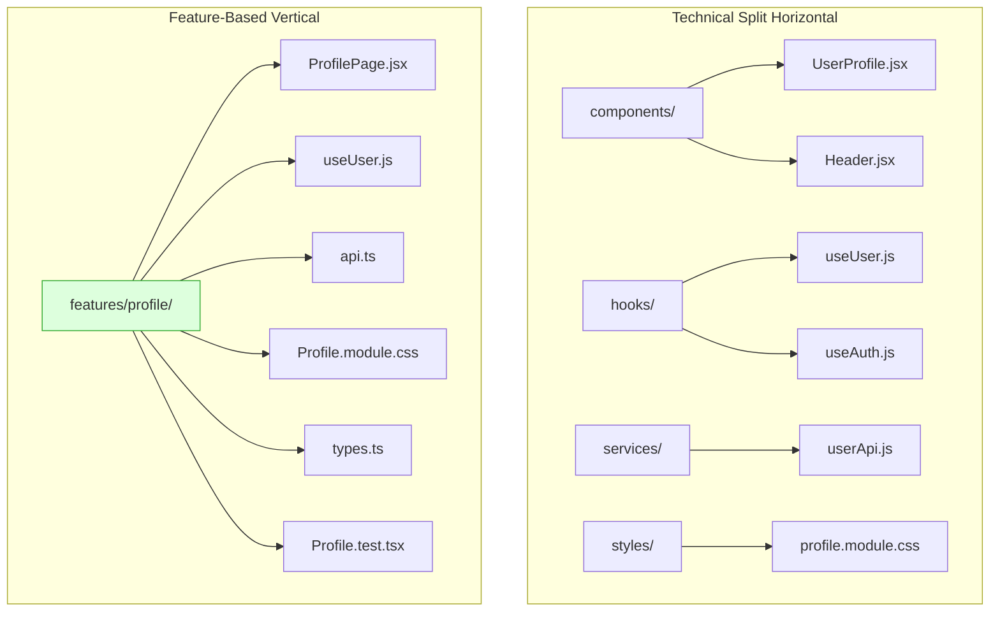
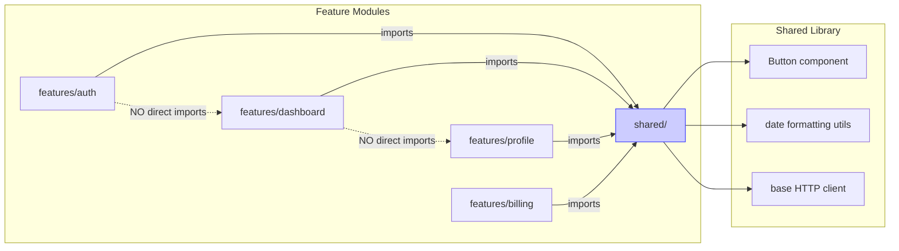
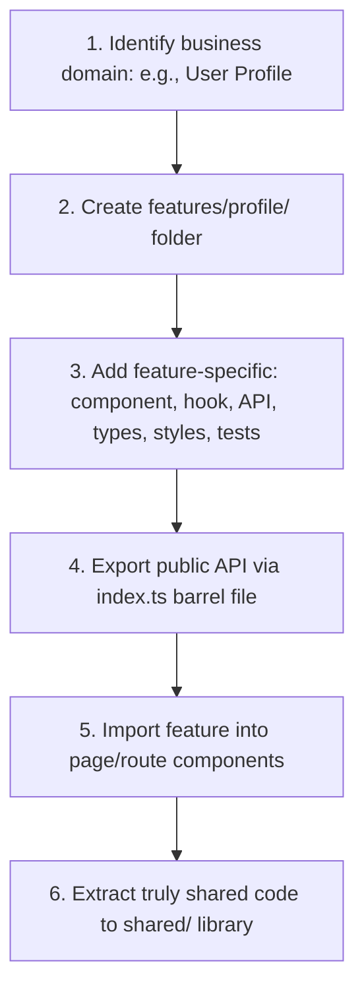

# Feature-Based Architecture

## Introduction

As React applications grow, organizing files by technical role (components, hooks, utils, styles) becomes unsustainable. Every feature touches dozens of folders across the codebase, making it hard to find related code, delete features, or onboard new engineers. **Feature-Based Architecture** solves this by grouping all files related to a single business domain or user-facing feature into a single, self-contained module. This module includes its own components, hooks, API calls, types, tests, and styles — everything needed to implement the feature. This module covers domain-driven folder structures, module boundaries, shared libraries, code-splitting by feature, and how to scale this architecture across large teams.

---

## Why do we need this?

In a traditional technical-split folder structure, adding a single feature requires touching 6-8 different folders.

### Problem Statement

Consider adding a "User Profile" feature to an existing React application organized by technical roles:

```
src/
├── components/
│   └── UserProfile.jsx           # Profile UI
├── hooks/
│   └── useUser.js                # User data hook
├── services/
│   └── userApi.js                # User API calls
├── types/
│   └── userTypes.ts              # TypeScript interfaces
├── utils/
│   └── formatDate.js             # Date formatting (used by profile)
├── styles/
│   └── profile.module.css        # Profile styles
└── tests/
    └── UserProfile.test.js       # Profile tests
```

Problems with this structure:
1. **Scattered logic**: To understand the User Profile feature, a developer must open 6 different folders and read 6 files.
2. **Hard to delete**: Removing the User Profile feature requires hunting through every folder to find related files — and you might miss one.
3. **Low cohesion**: The `formatDate.js` utility used by the profile sits in a generic utils folder, making it hard to know which features depend on it.
4. **Merge conflicts**: Multiple teams working on different features often touch the same generic folders (like `components/` or `utils/`), causing merge conflicts.

We need a structure where each feature is a self-contained module that can be developed, tested, and deleted independently.

---

## Real World Story

In 2016-2017, as React applications at companies like Uber, Airbnb, and Shopify grew beyond 500+ components, teams struggled with the common `components/`, `containers/`, `redux/` folder structure. The problem was called "Horizontal Splitting" — code was split by technical concern, not by business domain.

Dan Abramov popularized the "ducks" pattern for Redux, where reducers, actions, and action types for a feature lived in a single file. This inspired a broader movement toward **Feature Folders** (also called "Colocation" or "Vertical Splitting"). The principle was simple: "A feature should own its code from the API call to the CSS."

Tools like Nx (monorepo) and Bit (component platform) formalized this into library boundaries, where each feature is a buildable, testable, independently versioned library. Today, feature-based architecture is the recommended structure for large-scale React applications by both the React documentation and the broader engineering community.

---

## Real World Analogy

Think of feature-based architecture like **Independent Storefronts in a Shopping Mall** compared to a **Single Warehouse Store**.

- **Technical Split (Warehouse Store)**: All shirts (components) are in one aisle, all books (hooks) are in another, and all food (services) is in a third. To buy a complete "Summer Outfit" (feature), you must walk to 3 different aisles. If the store wants to remove the "Summer Outfit" section, they must reorganize every aisle.

- **Feature-Based (Storefronts)**: Each storefront (feature folder) is a complete boutique that sells everything needed for a specific purpose: "The Outdoor Shop" sells camping gear, tents, hiking boots, and maps all in one place. To remove the "Outdoor" section, the mall simply closes that storefront — no other stores are affected.

---

## Visual Explanation

Below is a comparison of technical-split vs. feature-based folder structures.

### Technical Split (Horizontal)
```
src/
├── components/  [All UI components]
├── hooks/       [All custom hooks]
├── services/    [All API calls]
├── types/       [All TypeScript types]
└── styles/      [All CSS modules]
```

### Feature-Based (Vertical)
```
src/
├── features/
│   ├── auth/         [Auth: login, signup, forgot password]
│   ├── dashboard/    [Dashboard: charts, metrics, widgets]
│   ├── profile/      [Profile: user info, avatar, settings]
│   └── billing/      [Billing: plans, invoices, payment methods]
└── shared/           [Truly shared UI and utilities]
```



---

## Internal Working

Feature-based architecture relies on three key principles:

### 1. Colocation
Code that changes together should live together. Every file related to a feature sits inside the feature's folder. This includes components, hooks, API functions, types, utils, styles, and tests.

### 2. Module Boundaries
Features communicate with each other only through a well-defined public API. A feature folder exports specific functions and components from an `index.ts` barrel file. Other features cannot import internal implementation details directly.

### 3. Shared Library
Code that is used across multiple features (like design system components, standard utilities, and common hooks) lives in a `shared/` or `common/` library. Features depend on the shared library, but the shared library should never depend on a specific feature.



---

## Step-by-Step Flow

When building a new feature using this architecture, the following steps occur:



---

## Syntax

```typescript
// ===== features/profile/index.ts (Barrel File - Public API) =====
export { ProfilePage } from './ProfilePage';
export { useUser } from './useUser';
export type { User, UserPreferences } from './types';

// ===== features/profile/ProfilePage.tsx =====
// Imports from its own module (colocated)
import { useUser } from './useUser';
import { fetchUserApi } from './api';
import styles from './Profile.module.css';
// Imports from shared library only for cross-feature code
import { Button, Card } from '@/shared/ui';
import { formatDate } from '@/shared/utils/date';

// ===== App.tsx (Root - imports features as modules) =====
import { ProfilePage } from '@/features/profile';
import { DashboardPage } from '@/features/dashboard';
```

---

## Basic Example

Here is a basic feature-based structure for a **Product Search** feature.

```tsx
// ===== Folder Structure =====
// features/product-search/
// ├── api.ts
// ├── hooks.ts
// ├── types.ts
// ├── ProductSearchPage.tsx
// ├── ProductCard.tsx
// ├── SearchFilters.tsx
// ├── ProductSearch.module.css
// ├── ProductSearch.test.tsx
// └── index.ts

// ===== types.ts =====
export interface Product {
  id: string;
  name: string;
  price: number;
  category: string;
  inStock: boolean;
}

export interface SearchFilters {
  category: string;
  minPrice: number;
  maxPrice: number;
}

// ===== api.ts =====
import type { Product, SearchFilters } from './types';

export async function fetchProducts(filters: SearchFilters): Promise<Product[]> {
  const params = new URLSearchParams({ ...filters } as any);
  const response = await fetch(`/api/products?${params}`);
  if (!response.ok) throw new Error('Failed to fetch products');
  return response.json();
}

// ===== hooks.ts =====
import { useState, useEffect } from 'react';
import { fetchProducts } from './api';
import type { Product, SearchFilters } from './types';

export function useProducts(initialFilters: SearchFilters) {
  const [products, setProducts] = useState<Product[]>([]);
  const [loading, setLoading] = useState(true);
  const [error, setError] = useState<string | null>(null);

  const loadProducts = async (filters: SearchFilters) => {
    setLoading(true);
    setError(null);
    try {
      const data = await fetchProducts(filters);
      setProducts(data);
    } catch (err) {
      setError(err instanceof Error ? err.message : 'Unknown error');
    } finally {
      setLoading(false);
    }
  };

  return { products, loading, error, reload: loadProducts };
}

// ===== index.ts (Barrel) =====
export { ProductSearchPage } from './ProductSearchPage';
export type { Product, SearchFilters } from './types';

// ===== ProductSearchPage.tsx =====
import React, { useState } from 'react';
import { useProducts } from './hooks';
import { ProductCard } from './ProductCard';
import { SearchFilters as FilterBar } from './SearchFilters';
import styles from './ProductSearch.module.css';
import type { SearchFilters } from './types';

const DEFAULT_FILTERS: SearchFilters = {
  category: 'all',
  minPrice: 0,
  maxPrice: 10000,
};

export function ProductSearchPage() {
  const [filters, setFilters] = useState(DEFAULT_FILTERS);
  const { products, loading, error } = useProducts(filters);

  return (
    <div className={styles.container}>
      <h1>Product Search</h1>
      <FilterBar filters={filters} onFilterChange={setFilters} />
      {loading && <p>Loading products...</p>}
      {error && <p className={styles.error}>Error: {error}</p>}
      <div className={styles.grid}>
        {products.map(product => (
          <ProductCard key={product.id} product={product} />
        ))}
      </div>
    </div>
  );
}
```

---

## Intermediate Example

An intermediate example showing how two features communicate through a shared event bus or context, without directly importing each other's internals.

```tsx
// ===== features/notifications/index.ts =====
export { NotificationProvider } from './NotificationProvider';
export { useNotifications } from './useNotifications';

// ===== features/notifications/NotificationProvider.tsx =====
import React, { createContext, useContext, useState, useCallback } from 'react';

interface Notification {
  id: string;
  message: string;
  type: 'success' | 'error' | 'info';
}

interface NotificationContextValue {
  notifications: Notification[];
  addNotification: (message: string, type: Notification['type']) => void;
  removeNotification: (id: string) => void;
}

const NotificationContext = createContext<NotificationContextValue | null>(null);

export function NotificationProvider({ children }: { children: React.ReactNode }) {
  const [notifications, setNotifications] = useState<Notification[]>([]);

  const addNotification = useCallback((message: string, type: Notification['type']) => {
    const id = Date.now().toString();
    setNotifications(prev => [...prev, { id, message, type }]);

    // Auto-remove after 5 seconds
    setTimeout(() => {
      setNotifications(prev => prev.filter(n => n.id !== id));
    }, 5000);
  }, []);

  const removeNotification = useCallback((id: string) => {
    setNotifications(prev => prev.filter(n => n.id !== id));
  }, []);

  return (
    <NotificationContext.Provider value={{ notifications, addNotification, removeNotification }}>
      {children}
      <div style={{ position: 'fixed', top: 16, right: 16 }}>
        {notifications.map(n => (
          <div key={n.id} className={`notification notification-${n.type}`}>
            {n.message}
            <button onClick={() => removeNotification(n.id)}>✕</button>
          </div>
        ))}
      </div>
    </NotificationContext.Provider>
  );
}

// ===== features/billing/api.ts =====
// Billing feature uses notifications without importing the notifications internals
// It only uses the public hook.
import { useNotifications } from '@/features/notifications';

export function useBilling() {
  const { addNotification } = useNotifications();

  const processPayment = async (amount: number) => {
    try {
      const response = await fetch('/api/payments', { method: 'POST' });
      if (!response.ok) throw new Error('Payment failed');
      // Cross-feature communication through shared context
      addNotification('Payment processed successfully!', 'success');
    } catch (error) {
      addNotification('Payment failed. Please try again.', 'error');
    }
  };

  return { processPayment };
}
```

---

## Advanced Example

An advanced example demonstrating **code-splitting by feature** using React Router's lazy loading. Each feature is loaded only when the user navigates to its route, reducing the initial bundle size.

```tsx
// ===== App.tsx (Root Router with Feature-Level Code Splitting) =====
import React, { lazy, Suspense } from 'react';
import { BrowserRouter, Routes, Route } from 'react-router-dom';
import { AppLayout } from '@/shared/ui/AppLayout';
import { NotificationProvider } from '@/features/notifications';

// Each feature is a separate chunk loaded on demand
const DashboardPage = lazy(() => import('@/features/dashboard/DashboardPage'));
const ProfilePage = lazy(() => import('@/features/profile/ProfilePage'));
const BillingPage = lazy(() => import('@/features/billing/BillingPage'));
const AdminPage = lazy(() => import('@/features/admin/AdminPage'));

// Loading fallback shared across all features
function PageLoader() {
  return (
    <div style={{ padding: '40px', textAlign: 'center' }}>
      <div className="spinner" />
      <p>Loading section...</p>
    </div>
  );
}

export default function App() {
  return (
    <BrowserRouter>
      <NotificationProvider>
        <Routes>
          <Route element={<AppLayout />}>
            <Route path="/" element={
              <Suspense fallback={<PageLoader />}>
                <DashboardPage />
              </Suspense>
            } />
            <Route path="/profile" element={
              <Suspense fallback={<PageLoader />}>
                <ProfilePage />
              </Suspense>
            } />
            <Route path="/billing" element={
              <Suspense fallback={<PageLoader />}>
                <BillingPage />
              </Suspense>
            } />
            <Route path="/admin" element={
              <Suspense fallback={<PageLoader />}>
                <AdminPage />
              </Suspense>
            } />
          </Route>
        </Routes>
      </NotificationProvider>
    </BrowserRouter>
  );
}

// ===== features/profile/ProfilePage.tsx =====
// This entire file (and its imports) are bundled into a separate chunk
import React from 'react';
import { ProfileForm } from './ProfileForm';
import { useUser } from './useUser';
import { AvatarUpload } from './AvatarUpload';
import styles from './Profile.module.css';

export default function ProfilePage() {
  const { user, updateUser, loading } = useUser();

  if (loading) return <PageLoader />;

  return (
    <div className={styles.container}>
      <h1>Profile Settings</h1>
      <AvatarUpload currentAvatar={user.avatar} />
      <ProfileForm user={user} onSubmit={updateUser} />
    </div>
  );
}
```

---

## Production Example

A production-grade feature module with full type safety, API layer separation, test coverage, and shared dependencies.

```tsx
// ===== features/orders/__tests__/useOrders.test.ts =====
import { renderHook, waitFor } from '@testing-library/react';
import { useOrders } from '../hooks';

// Mock the API module
jest.mock('../api', () => ({
  fetchOrders: jest.fn(),
}));

import { fetchOrders } from '../api';

describe('useOrders', () => {
  it('fetches and returns orders', async () => {
    const mockOrders = [
      { id: '1', status: 'shipped', total: 99.99 },
      { id: '2', status: 'pending', total: 49.99 },
    ];
    (fetchOrders as jest.Mock).mockResolvedValue(mockOrders);

    const { result } = renderHook(() => useOrders({ limit: 10 }));

    expect(result.current.loading).toBe(true);

    await waitFor(() => expect(result.current.loading).toBe(false));

    expect(result.current.orders).toEqual(mockOrders);
    expect(result.current.error).toBeNull();
  });
});
```

---

## Folder Structure

```
src/
├── features/                    # Feature modules
│   ├── auth/                    # Authentication
│   │   ├── api.ts
│   │   ├── hooks.ts
│   │   ├── types.ts
│   │   ├── LoginPage.tsx
│   │   ├── SignupPage.tsx
│   │   ├── AuthGuard.tsx        # Protected route wrapper
│   │   ├── Auth.module.css
│   │   ├── index.ts             # Public API barrel
│   │   └── __tests__/
│   ├── dashboard/               # Dashboard
│   ├── profile/                 # User profile
│   ├── billing/                 # Billing & subscriptions
│   ├── orders/                  # Order management
│   ├── products/                # Product catalog
│   ├── admin/                   # Admin panel
│   └── notifications/           # Global notifications
├── shared/                      # Shared across features
│   ├── ui/                      # Design system
│   │   ├── Button/
│   │   ├── Card/
│   │   ├── Modal/
│   │   └── index.ts
│   ├── hooks/                   # Generic reusable hooks
│   ├── utils/                   # Utility functions
│   ├── api/                     # Base API client
│   ├── types/                   # Global TypeScript types
│   └── config/                  # App configuration
├── app/                         # App shell
│   ├── App.tsx                  # Root with router
│   ├── main.tsx                 # Entry point
│   └── providers.tsx            # Global providers (theme, auth, notifications)
├── pages/                       # Route components (thin wrappers)
└── vite.config.ts
```

---

## Best Practices

💡 **Did You Know?**  \
Facebook's React codebase uses a feature-based architecture internally. The `react` package itself is a monorepo where each feature (like reconciliation, events, or hydration) lives in its own package folder with its own tests and types.

🚀 **Best Practices**
- Keep feature folders **flat** — no more than 2-3 levels deep. A feature with too many subfolders likely needs to be split into sub-features.
- Each feature exports only its **public API** through an `index.ts` barrel file. Internal files are prefixed with an underscore or placed in a `_internal/` folder.
- Features should **never import directly from another feature's internal files**. Cross-feature communication happens through shared context, events, or the root app layout.
- Extract code to `shared/` **only when it is used by two or more features**. Premature extraction creates unnecessary abstractions.
- Colocate **tests with their feature** — a test file for `ProfilePage.tsx` lives in `features/profile/__tests__/ProfilePage.test.tsx`.

---

## Common Mistakes

⚠ **Common Mistakes**

### Circular Dependencies Between Features

If Feature A imports from Feature B and Feature B imports from Feature A, you have a circular dependency. This causes bundle resolution issues and makes it impossible to reason about module boundaries.

```tsx
// ❌ WRONG: Circular dependency
// features/profile/hooks.ts
import { useBilling } from '@/features/billing';

// features/billing/hooks.ts
import { useUser } from '@/features/profile'; // Circular!

// ✅ RIGHT: Extract shared logic to shared/ or a common parent
// features/billing/hooks.ts
import { useNotifications } from '@/features/notifications'; // OK: unidirectional
```

### Over-Extracting to Shared

Moving code to `shared/` before it's actually reused across multiple features creates premature abstractions. Wait until at least three different features use the same hook or component before extracting it.

---

## Performance Notes

⚡ **Performance Tips**
- Feature-based architecture pairs naturally with **lazy loading** (code splitting). Each feature can be loaded on-demand when the user navigates to its route.
- Vite and Webpack can automatically create separate chunks per feature folder. Configure your build tool to treat each feature as an entry point.

---

## Accessibility Notes

♿ **Accessibility Tips**
- Each feature should own its accessibility concerns. Colocate ARIA labels, keyboard handlers, and focus management inside the feature folder.
- Use a shared `a11y/` module in `shared/` for common patterns like focus traps, skip links, and screen reader announcements.

---

## SEO Notes

Feature-based architecture improves SEO indirectly by making it easier to implement SSR per feature. You can selectively render server-critical features (like product listings) on the server while deferring less important features (like live chat) to client-side rendering.

---

## Interview Questions

🎯 **Interview Tips**  \
In an interview, explain feature-based architecture as "organizing code by business domain rather than technical role." Highlight colocation, module boundaries, and the trade-off between feature isolation and code duplication.

### Q1: What are the advantages of feature-based architecture over technical-split architecture?

**Answer**: Feature-based architecture improves code cohesion by grouping all files related to a feature together. This makes it easier to add new features (all files are in one folder), delete features (remove the folder), understand features (open one folder instead of 6), and avoid merge conflicts (different teams own different feature folders). It also enables natural code splitting, where each feature becomes a lazy-loaded chunk.

### Q2: When should you extract code from a feature into the shared library?

**Answer**: Extract code to the shared library when it is genuinely reused by 3+ features. The threshold of 3 prevents premature abstraction. A good heuristic is: "If I need to make the same change in 3+ feature folders, it's time to extract it to shared."

---

## MCQs

1. **What is the primary organizing principle of feature-based architecture?**
   - A) Organize files by file type (components, hooks, styles).
   - B) Organize files by business domain or user-facing feature.
   - C) Organize files by developer team member name.
   - D) Keep all files in a single folder for simplicity.
   - *Answer: B*

2. **What pattern should features use to expose their public API?**
   - A) A README.md file documenting all exports.
   - B) An index.ts barrel file that re-exports only the public components and hooks.
   - C) Exporting everything from every file so consumers can import directly.
   - D) A separate API endpoint for each feature.
   - *Answer: B*

3. **What is the recommended way for features to communicate with each other?**
   - A) Directly importing internal files from other features.
   - B) Through shared context providers, events, or dependency injection.
   - C) Using `eval()` to access other feature's state.
   - D) Features should never communicate with each other.
   - *Answer: B*

4. **When is the right time to extract code from a feature into the shared library?**
   - A) Immediately when writing the code, to keep features thin.
   - B) When the code is used by 3 or more different features.
   - C) Only during major refactoring releases.
   - D) Never — everything should stay in the feature folder.
   - *Answer: B*

5. **Which build tool feature pairs naturally with feature-based architecture?**
   - A) HMR (Hot Module Replacement)
   - B) Lazy loading / code splitting by feature
   - C) Tree shaking
   - D) PostCSS processing
   - *Answer: B*

---

## Practice Exercise

### Exercise 1: Refactor to Feature-Based
Given this technical-split structure, refactor it into a feature-based structure:

```
src/
├── components/CheckoutForm.jsx
├── hooks/useCheckout.js
├── services/checkoutApi.js
├── components/PaymentMethod.jsx
├── hooks/usePayment.js
└── services/paymentApi.js
```

*Solution*:
```
src/
├── features/
│   ├── checkout/
│   │   ├── CheckoutForm.jsx
│   │   ├── useCheckout.js
│   │   └── api.js
│   └── payment/
│       ├── PaymentMethod.jsx
│       ├── usePayment.js
│       └── api.js
```

### Exercise 2: Barrel File Builder
Create an index.ts barrel file for the `orders` feature that exports only: `OrderList`, `useOrders`, and `Order` type, keeping internal utilities private.

### Exercise 3: Cross-Feature Communication
Design an interface for a `search` feature that allows the `products` feature to update search results. The search feature should not import anything from the products feature.

---

## Debugging Exercise

### The Accidental Cross-Feature Import
During a code review, you find this import in `features/profile/settings.tsx`:

```tsx
import { PaymentMethod } from '@/features/billing/components/PaymentMethod';
```

The `PaymentMethod` component was only intended for internal use in the billing feature. What's the problem and how do you fix it?

#### Solution
The profile feature is importing internal implementation details from the billing feature. This creates a tight coupling between the two features. If the billing feature renames or restructures its internal files, the profile feature breaks. To fix this:

1. If the profile genuinely needs `PaymentMethod`, export it through the billing feature's barrel file (`features/billing/index.ts`).
2. If the payment method is a generic UI component, move it to `shared/ui/PaymentMethod.tsx`.
3. If the profile should not use it at all, create a composition boundary — pass the payment method as a child prop from the parent layout.

---

## Real-world Scenario

You are leading a team of 8 developers building a SaaS platform with the following domains: Authentication, Dashboard, Billing, User Management, Reports, and Notifications. Each domain is owned by 1-2 developers.

**Architecture Strategy**: Use feature-based architecture with each domain as a feature folder. Set up an Nx monorepo where each feature is a buildable library with its own `tsconfig.json`, `vite.config.ts`, and `package.json`. Use path aliases (`@acme/auth`, `@acme/billing`) to enforce module boundaries. Configure ESLint with `@nrwl/nx/enforce-module-boundaries` to prevent cross-feature imports that bypass the barrel file.

---

## Interview Coding Question

### Problem Statement

Design a feature-based architecture for a **Blog** application with the following requirements:
- Posts list, Post detail
- Author profiles
- Comments on posts
- Search
- Admin panel for managing posts

Provide the folder structure and explain the module boundaries.

```typescript
// Folder Structure
src/
├── features/
│   ├── posts/               # Posts feature
│   │   ├── api.ts           # Post CRUD API calls
│   │   ├── hooks.ts         # usePosts, usePost hooks
│   │   ├── types.ts         # Post, PostStatus types
│   │   ├── PostList.tsx     # Post list page
│   │   ├── PostDetail.tsx   # Single post view
│   │   ├── PostCard.tsx     # Post preview card
│   │   ├── PostEditor.tsx   # Create/edit post form
│   │   ├── Posts.module.css
│   │   ├── index.ts         # Exports: PostList, PostDetail, PostCard, usePosts
│   │   └── __tests__/
│   ├── authors/             # Authors feature
│   │   ├── api.ts
│   │   ├── hooks.ts
│   │   ├── types.ts
│   │   ├── AuthorProfile.tsx
│   │   ├── AuthorCard.tsx
│   │   ├── Authors.module.css
│   │   ├── index.ts
│   │   └── __tests__/
│   ├── comments/            # Comments feature
│   │   ├── api.ts
│   │   ├── hooks.ts
│   │   ├── types.ts
│   │   ├── CommentSection.tsx
│   │   ├── CommentForm.tsx
│   │   ├── index.ts
│   │   └── __tests__/
│   ├── search/              # Search feature
│   │   ├── api.ts
│   │   ├── hooks.ts
│   │   ├── SearchPage.tsx
│   │   ├── SearchBar.tsx
│   │   ├── index.ts
│   │   └── __tests__/
│   └── admin/               # Admin feature
│       ├── api.ts
│       ├── hooks.ts
│       ├── AdminDashboard.tsx
│       ├── PostManager.tsx
│       ├── UserManager.tsx
│       ├── index.ts
│       └── __tests__/
├── shared/
│   ├── ui/                  # Button, Card, Modal, Pagination
│   ├── hooks/               # useDebounce, useMediaQuery
│   ├── utils/               # formatDate, slugify, truncate
│   ├── api/                 # base HTTP client
│   └── types/               # common types (PaginatedResponse, ApiError)
└── app/
    ├── App.tsx
    ├── main.tsx
    └── router.tsx
```

---

## Mini Project

### Feature-Based CRM Dashboard

Build a mini CRM application with 3 features implemented as independent modules:

- **Contacts Feature**: Contact list, contact detail, contact form (add/edit). Include API simulation, hooks, types, and styles.
- **Deals Feature**: Deal pipeline, deal card, deal stage changer. Must be fully isolated from other features.
- **Dashboard Feature**: Overview page showing widgets from contacts and deals. Communication with contacts/deals happens through a shared context.

Requirements:
- Each feature has its own `index.ts` barrel file.
- No feature imports from another feature's internal files.
- Shared UI components (Button, Card, Badge) live in `shared/ui/`.
- Each feature is lazy-loaded via React Router.
- Write at least one test per feature.

---

## Summary

🧠 **Memory Tricks**  \
`Feature = Folder = Module` — Every user-facing feature is a self-contained folder with its own components, hooks, API, types, and tests. The folder is the module boundary.

`Shared only when X3` — Extract code to the shared library only when it's used by at least 3 features. Premature extraction is worse than duplication.

📖 **Summary**  \
Feature-based architecture organizes React code by business domain rather than technical role. Each feature is a self-contained module with a well-defined public API, enabling independent development, testing, and deployment. Cross-feature communication happens through shared contexts or the root application layout. Combined with lazy loading, feature-based architecture scales naturally from small projects to large enterprise applications with multiple teams.

---

## Cheat Sheet

```typescript
// Feature folder structure
features/your-feature/
├── api.ts              # API calls
├── hooks.ts            # Custom hooks
├── types.ts            # TypeScript types
├── Component.tsx       # UI components
├── Component.module.css
├── index.ts            # Barrel (public API only)
└── __tests__/          # Tests

// Barrel file pattern
export { FeatureComponent } from './FeatureComponent';
export { useFeature } from './hooks';
export type { FeatureType } from './types';
```

---

## Related Topics

- [Folder Structures & Modularity](folder-structure)
- [Design Systems & Components](design-systems)
- [State Management Architectures](state-management-architectures)

---

## Further Reading

- [React Docs: Project Structure](https://react.dev/learn/scaling-up-with-reducer-and-context)
- [Bulletproof React: Project Structure](https://github.com/alan2207/bulletproof-react)
- [Nx Monorepo: React Architecture](https://nx.dev/recipes/react)
- [Feature Sliced Design](https://feature-sliced.design/)
