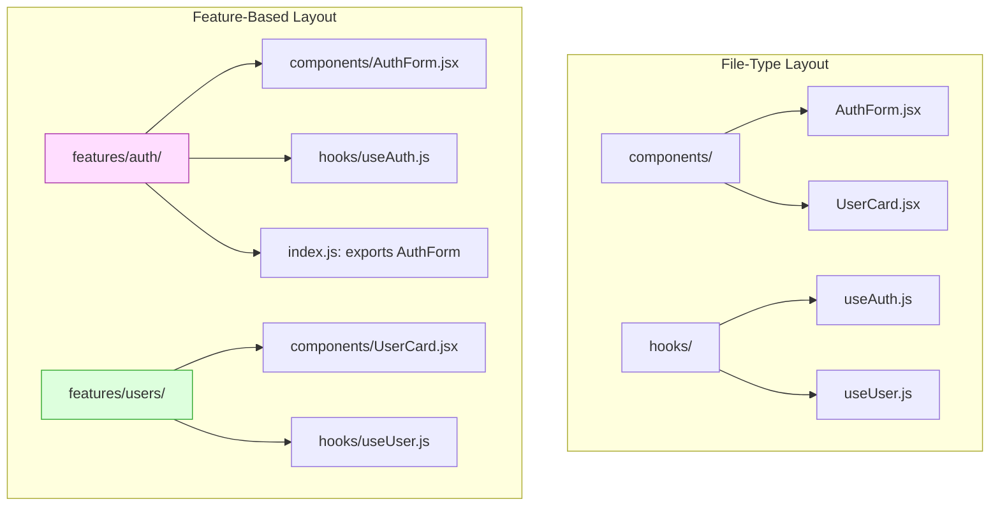
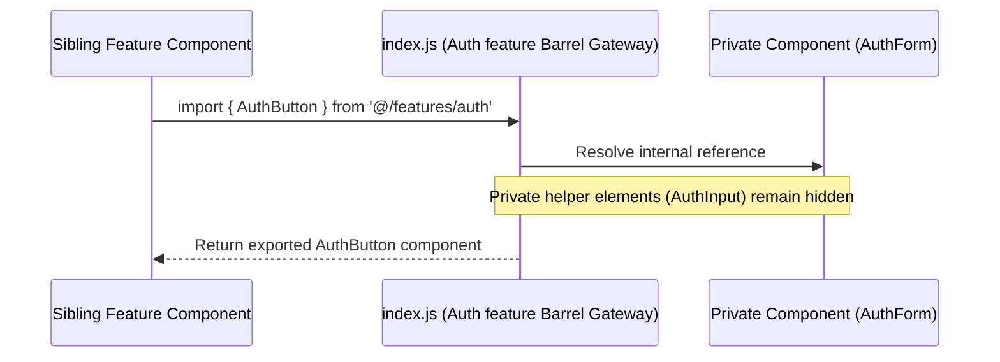
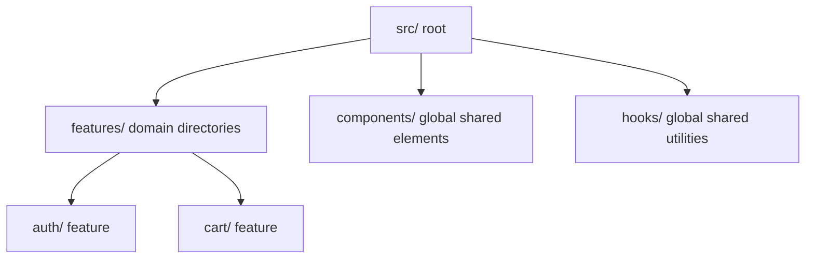
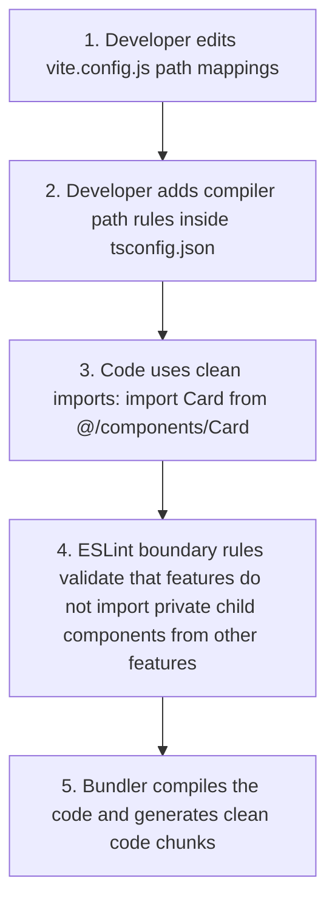

# Folder Structures & Modularity

## Introduction

As React applications scale, how you organize files and directories directly impacts team velocity and codebase maintainability. A simple folder structure that works for small projects quickly becomes unmanageable as features, routes, and engineers are added. To build scalable enterprise codebases, we use **Feature-Based Folder Structures** (inspired by patterns like Bulletproof React). This module covers organizing files by feature, defining clear import boundaries, managing shared modules, and setting up path aliases.

---

## Why do we need this?

Organizing files strictly by type (e.g., placing all hooks in a single `/hooks` folder and all components in `/components`) causes developers to jump across many folders to edit a single feature, leading to layout clutter and duplicate code.

### Problem Statement
Consider an application that has an Auth signup page, a Profile settings page, and a checkout page.
1. When you want to edit the Auth signup form, you must open:
   - `/src/components/SignupForm.jsx`
   - `/src/hooks/useSignup.js`
   - `/src/api/auth.js`
   - `/src/styles/auth.css`
2. This forces you to navigate through multiple directories.
3. Sibling features start importing private components from other features, creating tight coupling and making it difficult to refactor or delete features without breaking unrelated parts of the app.

We need a structure that colocates related components, hooks, assets, and APIs inside a single feature directory, exposing only specific items to other features.

---

## Real World Story

In the early days of React, codebases followed the Rails-style "File Type" organization: `components/`, `containers/`, `actions/`, `reducers/`.

This worked for small apps but created friction in larger codebases. In 2021, the developer community aligned around the **Bulletproof React** architecture. This pattern shifted focus from "file type" to "feature domain". By wrapping each feature (e.g., `features/auth/`, `features/comments/`) in its own self-contained directory and using **Index Entry Points** (barrel files) to control visibility, teams could develop and scale features in parallel, reducing merge conflicts and code friction.

---

## Real World Analogy

Think of feature-based folder structures like **Standardized shipping containers** compared to **Loose cargo on a ship**.

- **File Type Organization (Loose Cargo)**: You load a cargo ship by placing all tires in one pile, all steering wheels in another pile, and all seats in a third pile. When you want to assemble a car, workers must walk all over the ship to locate the matching parts. If parts shift, everything gets mixed up.
- **Feature-Based Organization (Shipping Containers)**: You pack all parts for a specific car model into a single container (Feature directory). The container has a single door with a manifest label (index entry point). You load and move containers easily, knowing the contents are isolated and will not mix with other cargo.

---

## Visual Explanation

Below is a diagram comparing traditional file-type organization with modern feature-based encapsulation.

### File Type Organization (Scattered)
```
src/
├── components/
│   ├── AuthWidget.jsx
│   └── ProfileCard.jsx
└── hooks/
    ├── useAuth.js
    └── useProfile.js
```

### Feature-Based Organization (Colocated)
```
src/
└── features/
    ├── auth/
    │   ├── components/
    │   ├── hooks/
    │   └── index.js (Exposes API only)
    └── profile/
        ├── components/
        └── index.js
```



---

## Internal Working

Feature-based architecture enforces modularity using **Barrel Files** (`index.js`).

A barrel file acts as a public gateway:
- It exports only the components, hooks, or utilities that other features are allowed to use.
- Internal helper components or private hooks remain hidden inside the feature folder.
- Vite or Webpack bundlers resolve these imports, using path aliases (like `@/features/auth`) to keep imports clean.



---

## Architecture

In an enterprise React application, the root directory separates global modules (shared hooks, layouts) from isolated feature domains.



---

## Step-by-Step Flow

When setting up a path alias boundary rule in a Vite configuration, the following steps occur:



---

## Syntax

```javascript
// 1. vite.config.js Path Alias setup
import { defineConfig } from 'vite';
import path from 'path';

export default defineConfig({
  resolve: {
    alias: {
      '@': path.resolve(__dirname, './src'),
    },
  },
});

// 2. tsconfig.json or jsconfig.json paths mapping configuration
{
  "compilerOptions": {
    "baseUrl": ".",
    "paths": {
      "@/*": ["src/*"]
    }
  }
}
```

---

## Basic Example

Here is a basic folder structure layout for an Auth feature showing colocated files and the public barrel interface.

```javascript
// File Location: src/features/auth/components/LoginForm.jsx
import React from 'react';

export function LoginForm() {
  return (
    <form style={{ padding: '12px', border: '1px solid #ccc' }}>
      <input type="text" placeholder="Username" />
      <button type="submit">Log In</button>
    </form>
  );
}

// File Location: src/features/auth/hooks/useUserSession.js
import { useState } from 'react';

export function useUserSession() {
  const [user, setUser] = useState(null);
  return { user, login: () => setUser({ name: 'Alice' }) };
}

// File Location: src/features/auth/index.js (The Barrel Gateway)
// Export only the public API, keeping internal helpers private
export { LoginForm } from './components/LoginForm.jsx';
export { useUserSession } from './hooks/useUserSession.js';
```

---

## Intermediate Example

An intermediate component illustrating how sibling features import components cleanly using path aliases, avoiding messy relative paths (like `../../../../components`).

```jsx
// File Location: src/features/dashboard/components/AnalyticsPanel.jsx
import React from 'react';

//  RIGHT: Using path aliases to import the login form from the auth feature cleanly
import { LoginForm } from '@/features/auth';

// ❌ WRONG: Confusing relative path makes code fragile and hard to move
// import { LoginForm } from '../../../auth/components/LoginForm.jsx';

export default function AnalyticsPanel() {
  return (
    <div style={{ padding: '20px' }}>
      <h3>Analytics Dashboard</h3>
      <p>Please log in to inspect financial records.</p>
      <LoginForm />
    </div>
  );
}
```

---

## Advanced Example

An advanced project architecture configuration demonstrating **Import Boundaries**. This uses ESLint rules to prevent features from importing private files from other features directly, ensuring all imports go through the public barrel file.

```javascript
// File Location: .eslintrc.json (ESLint boundary rules)
{
  "plugins": ["import"],
  "rules": {
    "no-restricted-imports": [
      "error",
      {
        "patterns": [
          {
            // Block features from importing private internals of other features
            "group": ["@/features/*/*"],
            "message": "Importing private feature internals is blocked. Import from the public index.js gateway instead: '@/features/feature-name'"
          }
        ]
      }
    ]
  }
}
```

---

## Production Example

A production-grade React folder layout template showing a scalable structure (inspired by Bulletproof React).

```
src/
├── assets/                  # Global public files (logos, images, fonts)
├── components/              # Global shared components (Button, Input, Table)
├── config/                  # Global configs (API settings, env variables)
├── context/                 # Global React Context providers (AuthContext)
├── features/                # Domain-driven feature folders
│   ├── auth/                # Auth Feature Domain
│   │   ├── api/             # Auth API handlers
│   │   ├── components/      # Auth UI elements (LoginForm, SignupForm)
│   │   ├── hooks/           # Auth React hooks (useAuth)
│   │   ├── types/           # Type definitions
│   │   └── index.js         # Public Barrel API
│   └── chat/                # Chat Feature Domain
│       ├── api/
│       ├── components/
│       └── index.js
├── hooks/                   # Global shared hooks (useWindowSize, useLocalStorage)
├── routes/                  # App routes configuration
├── services/                # API client services
└── utils/                   # Helper utility functions
```

---

## Best Practices

💡 **Did You Know?**  
Path aliases (like `@/*` mapping to `src/*`) are configured in both `vite.config.js` (for compiler resolution) and `tsconfig.json` (so editors like VS Code can resolve imports and provide autocomplete).

🚀 **Best Practices**
- Colocate components, hooks, assets, and APIs inside their respective feature folders.
- Use barrel files (`index.js`) to export only the public elements of a feature, keeping internal helpers hidden.
- Use path aliases (e.g., `@/components/Button`) to prevent confusing, relative imports.
- Configure ESLint boundary rules to prevent features from importing private files from other features directly.

---

## Common Mistakes

⚠ **Common Mistakes**

### Importing Private Internals of Sibling Features
Importing private components directly from another feature (e.g., `import LoginInput from '@/features/auth/components/LoginInput.jsx'`) creates tight coupling. If the auth feature renames or deletes `LoginInput`, it breaks the importing feature unexpectedly.

```jsx
// ❌ WRONG (Imports private component directly)
import LoginInput from '@/features/auth/components/LoginInput.jsx';

//  RIGHT (Imports from public barrel file)
import { LoginForm } from '@/features/auth';
```

---

## Performance Notes

⚡ **Performance Tips**
Organizing components cleanly by feature makes it easier to implement route-based code splitting, allowing the build compiler to bundle and load feature chunks on demand.

---

## Accessibility Notes

♿ **Accessibility Tips**
Organize accessibility test specs alongside your feature components (e.g., `/features/auth/components/__tests__/LoginForm.spec.js`), ensuring ARIA roles are verified during feature development.

---

## SEO Notes

Modularity does not affect SEO indexing directly, but clean code organization helps developers optimize performance, which directly improves Core Web Vitals rankings.

---

## Interview Questions

🎯 **Interview Tips**  
In an interview, explain feature-based folder organization as colocating components, hooks, assets, and APIs inside self-contained feature directories. Explain that barrel files (`index.js`) act as gateways to control visibility and prevent tight coupling.

### Q1: What is a Barrel File (`index.js`), and why is it useful in a feature-based structure?
**Answer**: A barrel file is an entry point file (`index.js`) located at the root of a feature directory. It acts as a public gateway: it exports only the components, hooks, and utilities that sibling features are allowed to use. This hides internal helper components, prevents tight coupling, and makes refactoring easier.

### Q2: What are Path Aliases, and what problem do they solve?
**Answer**: Path Aliases are custom import path mappings (e.g. `@/*` mapping to `src/*`) configured in build tools. They remove messy relative import paths (like `../../../../components/Button`) with clean absolute paths (like `@/components/Button`), making files easier to move and refactor.

---

## MCQs

1. **Which file acts as the public entry point gateway for a feature?**
   - A) `App.jsx`
   - B) `index.js` (Barrel file)
   - C) `vite.config.js`
   - D) `style.css`
   - *Answer: B*

2. **Why isRails-style folder organization (by file type) discouraged for large codebases?**
   - A) It is not supported in React.
   - B) It scatters related code across many folders, forcing developers to search through multiple directories to edit a single feature.
   - C) It disables CSS.
   - D) It locks variables in memory.
   - *Answer: B*

3. **Where are path alias mappings configured to ensure editor autocomplete works correctly?**
   - A) `index.html`
   - B) `tsconfig.json` or `jsconfig.json`
   - C) `.eslintrc.json`
   - D) `package.json`
   - *Answer: B*

4. **What occurs when a developer imports a private component directly from another feature?**
   - A) It triggers compilation errors in CSS.
   - B) It creates tight coupling, making features fragile and difficult to refactor independently.
   - C) It exposes secret environment variables.
   - D) It resets local storage variables.
   - *Answer: B*

5. **Which tool is used to enforce import boundary rules during development?**
   - A) Babel CLI
   - B) ESLint compiler
   - C) Webpack Dev Server
   - D) serviceWorker
   - *Answer: B*

---

## Practice Exercise

### Exercise 1: Barrel export configurator
Create a barrel file (`index.js`) for a comments feature that exports the public `CommentsWidget` component and hides private helper items:
```javascript
// comments/components/CommentsWidget.jsx
export function CommentsWidget() { return <p>Comments</p>; }

// comments/components/PrivateInput.jsx
export function PrivateInput() { return <input />; }

// TODO: Create index.js exports
```

*Solution*:
```javascript
export { CommentsWidget } from './components/CommentsWidget.jsx';
```

### Exercise 2: Alias import refactoring
Refactor this fragile relative import to use the `@` path alias:
```javascript
import Button from '../../../../components/Button.jsx';
```

*Solution*:
```javascript
import Button from '@/components/Button.jsx';
```

### Exercise 3: ESLint boundary configuration
Write an ESLint restriction pattern rule that blocks components in `/features/chat` from importing private files from `/features/auth` directly.

---

## Debugging Exercise

### The Fragile Relative path Bug
A developer moves their dashboard stats chart file to a new folder, but the build crashes immediately, throwing a file resolution error. Identify the cause and write the fix.

```jsx
// File Location: src/features/dashboard/components/panels/StatsPanel.jsx
import React from 'react';

// BUG: Using nested relative pathing breaks immediately if the file is moved to another folder.
import { CustomButton } from '../../../../components/Button.jsx';

export default function StatsPanel() {
  return <CustomButton label="Print Records" />;
}
```

#### Solution
Using relative paths (like `../../../../components/Button`) is fragile because the path depends on the file's exact location. If you move the file to another folder, the path breaks. To fix this, use a path alias:

```jsx
// Corrected
import React from 'react';

// Use path alias so the import path remains correct even if the file is moved
import { CustomButton } from '@/components/Button.jsx';

export default function StatsPanel() {
  return <CustomButton label="Print Records" />;
}
```

---

## Real-world Scenario

You are leading a team building a modular dashboard application. Different teams own different features (e.g., auth, chat, billing). To avoid merge conflicts and keep the codebase clean, you must define the folder structure guidelines. Explain your strategy.
- **Design Strategy**: Implement a feature-based folder structure (Bulletproof React layout). Wrap each team's feature in its own directory under `src/features/`. Use barrel files (`index.js`) to expose only public APIs, and set up ESLint boundary rules to prevent teams from importing private files from other features directly.

---

## Interview Coding Question

### Problem Statement
Write a mock configuration layout for:
- A Vite configuration resolving `@/*` aliases to `./src/*`.
- A matching JSON config showing editor paths mappings.

```javascript
// 1. vite.config.js Configuration setup
import { defineConfig } from 'vite';
import path from 'path';

export const viteAliasConfig = defineConfig({
  resolve: {
    alias: {
      '@': path.resolve(__dirname, './src')
    }
  }
});

// 2. jsconfig.json Editor resolution mapping
export const jsConfigMapping = {
  "compilerOptions": {
    "baseUrl": ".",
    "paths": {
      "@/*": ["src/*"]
    }
  }
};
```

---

## Mini Project

### Feature-Based Catalog Studio
Build a modular catalog application using a feature-based folder structure:
- Create separate feature directories: `/features/catalog` and `/features/cart`.
- Colocate components, hooks, and APIs inside their respective features.
- Export only public APIs from the feature barrel files (`index.js`).
- Set up path aliases and verify in the build logs that all features resolve imports cleanly.

---

## Summary

🧠 **Memory Tricks**  
`Colocate features, barrel gateways`  
- Colocate related files inside self-contained feature folders.
- Use index barrel files (`index.js`) as public gateways to control component visibility.

📖 **Summary**  
Feature-based folder structures colocate related components, hooks, assets, and APIs inside self-contained feature folders. By using index barrel files to control public APIs and path aliases to simplify imports, React codebases remain scalable and maintainable.

---

## Cheat Sheet

```javascript
// Exposing public APIs in index.js
export { FeatureWidget } from './components/FeatureWidget.jsx';
```

---

## Related Topics
- [Advanced Component Patterns](../phase-2-components-jsx/advanced-component-patterns)
- [State Management Architectures (Next Module)](state-management-architectures)

---

## Further Reading
- [Bulletproof React Folder Structure](https://github.com/alan2207/bulletproof-react/blob/master/docs/project-structure.md)
- [Vite resolves path aliases](https://vite.dev/config/shared-options.html#resolve-alias)
