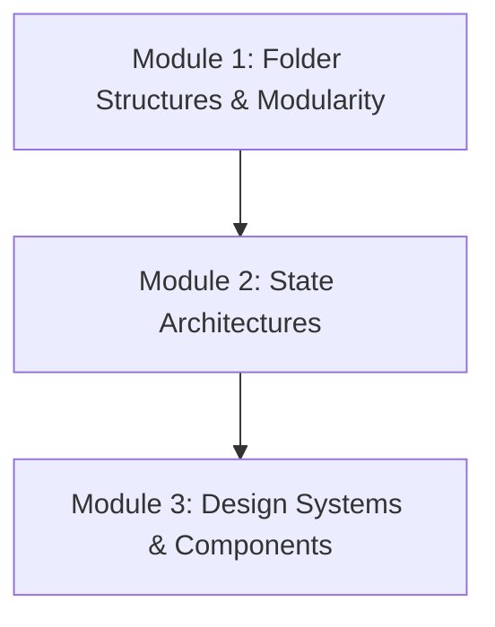

# Phase 9: Architecture & Enterprise Patterns

Welcome to the **Architecture & Enterprise Patterns** phase of the React Engineering Academy. This phase covers how to design and organize large-scale, production-ready React applications: clean folder structures (like feature-based or monorepo layouts), choosing and scaling global state management architectures (like Zustand or Redux Toolkit), and building custom, reusable design systems.

## Why this topic exists

As projects scale and teams grow, a lack of strict architectural patterns leads to codebase decay (spaghetti code).
- Without a consistent **Folder Structure** (like feature-based encapsulation), developers spend hours locating files, leading to duplicate components and logic leaks.
- Without a clear **State Management Architecture**, global context becomes bloated, triggering performance issues and state sync bugs across pages.
- Without a unified **Design System**, UI styling becomes inconsistent, leading to visual differences and duplicating CSS across features.

Establishing solid architectural patterns is critical for building maintainable, scalable, and enterprise-grade applications.

---

## Learning Objectives

By the end of this phase, you will be able to:
- Design feature-based and domain-driven folder structures to scale large codebases.
- Choose, configure, and scale global state libraries (Zustand, Redux Toolkit) based on application requirements.
- Structure global state stores to optimize rendering and prevent redundant re-renders.
- Build customizable, accessible, and reusable component libraries (design systems) using tokens.
- Enforce architectural boundaries and clean import patterns using ESLint and boundary rules.

---

## Prerequisites

Before starting this phase, you should have completed:
1. **[Phase 1: React Fundamentals](../phase-1-fundamentals)**
2. **[Phase 2: Components & JSX](../phase-2-components-jsx)**
3. **[Phase 3: State Management](../phase-3-state-management)**
4. **[Phase 4: React Hooks](../phase-4-hooks)**
5. **[Phase 5: Routing & Data Fetching](../phase-5-routing-fetching)**
6. **[Phase 6: Performance Optimization](../phase-6-performance)**
7. **[Phase 7: Advanced React](../phase-7-advanced)**
8. **[Phase 8: Modern React](../phase-8-modern)**

---

## Learning Roadmap & Topics Covered

This phase is broken down into three comprehensive modules:

1. **[Module 1: Folder Structures & Modularity](folder-structure)**  
   Feature-based structures (bulletproof React), domain boundaries, monorepo architectures, and clean import rules.
2. **[Module 2: State Architectures (Zustand & Redux)](state-management-architectures)**  
   Comparing global state libraries, Zustand store configurations, Redux Toolkit, and rendering optimization.
3. **[Module 3: Design Systems & Components](design-systems)**  
   Building UI component libraries, styling tokens, theme configs, headless UI component wrappers, and accessibility.

---

## Estimated Learning Time

- **Total Time**: 10 - 12 Hours
- **Module 1**: 3 Hours
- **Module 2**: 5 Hours
- **Module 3**: 4 Hours
- **Exercises & Projects**: 2 Hours

---

## Real-World Applications

- **SaaS Enterprise Panels**: Structuring multi-team dashboards using feature-based encapsulation to avoid merge conflicts.
- **Financial Transaction Apps**: Managing global balances, user sessions, and logs using optimized Zustand stores.
- **Corporate Branding Sites**: Deploying unified design systems to enforce brand guidelines across multiple web projects.

---

## Practice Exercises

- **Feature directory refactoring**: Restructuring a messy folder structure into clean feature folders.
- **Zustand selector optimization**: Writing a Zustand store select query that prevents sibling rendering cycles.
- **Custom Design token system**: Creating a button component styled with custom design tokens.

---

## Mini Projects

- **Enterprise Workspace Portal**: A workspace console dashboard utilizing feature-based folder organization, Zustand for state management, and a custom design system token system to build a clean, scalable application.

---

## Related Topics

- [Managing Global State with Context API](../phase-3-state-management/context-api)
- [Production React & Deployment](../phase-10-production)

---

## Further Reading

- **Bulletproof React**: [Official Folder Architecture Guide](https://github.com/alan2207/bulletproof-react)
- **Zustand**: [Official Documentation](https://zustand-demo.pmnd.rs/)
