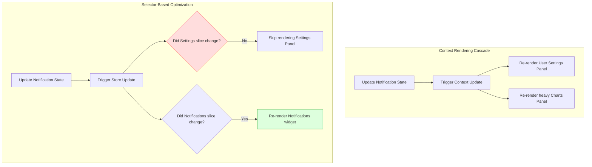
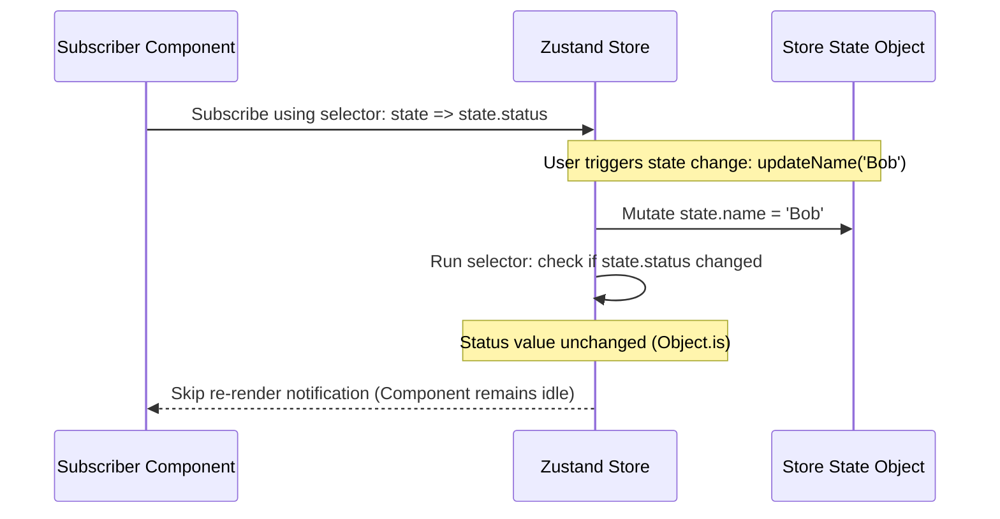
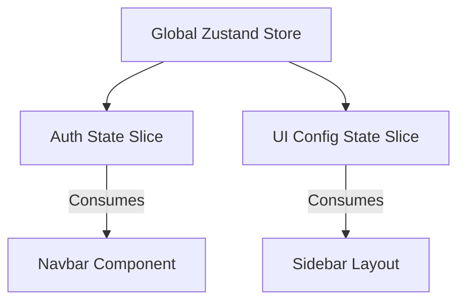
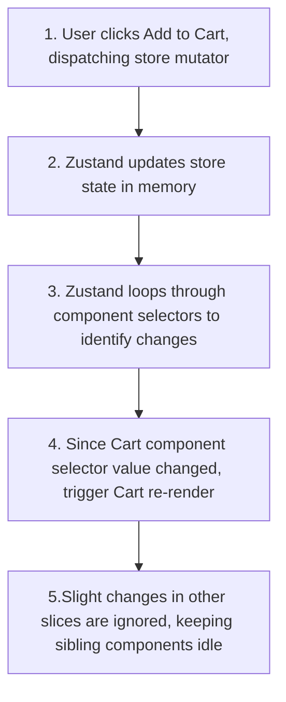

# State Management Architectures

## Introduction

As applications grow, managing state across multiple components becomes challenging. While local state (`useState`) and Context work well for small apps, they can lead to prop-drilling, complex configurations, and performance issues in larger applications. To handle global state efficiently, modern React applications use specialized state libraries: **Zustand** (lightweight and selector-driven) or **Redux Toolkit** (structured and action-driven). This module covers comparing global state options, configuring optimized stores, and using selectors to prevent unnecessary re-renders.

---

## Why do we need this?

Using the React Context API for high-frequency global state updates (like active search filters, shopping carts, or dashboard grids) can trigger severe performance bottlenecks.

### Problem Statement
Consider an analytics dashboard where multiple components consume a global Context containing user settings, notifications feed, and transaction logs.
1. A background process updates the notifications feed state.
2. Because React Context does not support selector-based subscription optimization, **every component** consuming the Context re-renders automatically when any part of the Context state changes.
3. The heavy transaction chart and user settings panel re-render, even though they only care about settings, freezing browser layout threads and lagging the UI.

We need a global state manager that allows components to subscribe to specific segments of state (using selectors) and skip re-rendering when unrelated parts of the state change.

---

## Real World Story

In 2015, Dan Abramov created Redux, introducing the Flux architecture to the React ecosystem.

Redux solved state sharing by establishing a single source of truth (the Store), but it required writing massive amounts of boilerplate code (Actions, Reducers, Dispatchers, Middleware). In 2019, the Redux team simplified this by releasing **Redux Toolkit (RTK)**. In parallel, developers wanted a simpler, hook-based alternative. This led to the creation of **Zustand** by Daishi Kato and the Poimandres community. Zustand removed the need for boilerplate code and context wrappers: by using simple hooks and selectors, developers could declare global stores and subscribe to state changes with zero boilerplate, making it a popular choice for modern applications.

---

## Real World Analogy

Think of state management libraries like a **Company Paging Announcement System** compared to a **Global Office Broadcast**.

- **Without Selectors (Global Office Broadcast)**: The receptionist uses a megaphone to announce: "Alice has a new email!" (React Context state update). Every employee in the building stops working, stands up, reads the announcement, realizes it is not for them, and sits back down (Context re-renders all consumers). It disrupts everyone's productivity.
- **With Selectors (Paging Announcement System)**: The receptionist page-calls only Alice's desk phone: "Alice, you have an email" (Zustand/Redux selector subscription). Alice answers the phone and handles the email, while all other employees continue working undisturbed.

---

## Visual Explanation

Below is a diagram comparing React Context rendering cascades with Zustand/Redux selector-based rendering optimizations.

### React Context Rendering Cascade (Slow)
```
[Context State Change] ──> [Re-render Parent Container] ──> [Re-render all consumer components]
```

### Selector-Based Rendering Optimization (Fast)
```
[Store State Change] ──> [Selector checks target slices]
                               ├── (Slice Changed) ───> [Re-render Subscriber Component]
                               └── (Slice Unchanged) ──> [Skip Render]
```



---

## Internal Working

Zustand uses a closure-based state coordinator outside React's reconciler pipeline.

When you create a Zustand store:
1. State values are stored inside a plain JavaScript object in memory.
2. Sibling components subscribe to specific state slices using **State Selectors**: `const count = useStore(state => state.count)`.
3. When you trigger a state update, Zustand compares the selected slice using a strict comparison (`===`).
4. If the selected slice value has not changed, Zustand skips notifying the component, preventing a re-render.
5. If the value has changed, Zustand triggers a local update inside the subscribed component only, keeping updates localized.



---

## Architecture

In an enterprise global store, state is divided into slices (e.g., Auth slice, UI slice), which are merged into a single client store accessible via hooks.



---

## Step-by-Step Flow

When a user triggers an action in a selector-optimized Zustand store, the following steps occur:



---

## Syntax

```javascript
// Zustand Store creation syntax
import { create } from 'zustand';

const useCounterStore = create((set) => ({
  count: 0,
  increment: () => set((state) => ({ count: state.count + 1 })),
  decrement: () => set((state) => ({ count: state.count - 1 })),
}));

// Component usage
const count = useCounterStore((state) => state.count);
const increment = useCounterStore((state) => state.increment);
```

---

## Basic Example

Here is a basic Zustand configuration managing a simple counter, along with a component that consumes the store using selectors.

```jsx
import React from 'react';
import { create } from 'zustand';

// 1. Create Zustand Store
const useVoteStore = create((set) => ({
  votes: 0,
  upvote: () => set((state) => ({ votes: state.votes + 1 })),
  reset: () => set({ votes: 0 })
}));

// 2. Component Consuming the Store
export default function VoteConsole() {
  // Use state selectors to subscribe to specific values
  const votes = useVoteStore((state) => state.votes);
  const upvote = useVoteStore((state) => state.upvote);
  const reset = useVoteStore((state) => state.reset);

  return (
    <div style={{ padding: '16px', border: '1px solid #ccc', maxWidth: '300px' }}>
      <h3>Community Votes</h3>
      <p>Total Votes registered: <strong>{votes}</strong></p>
      <div style={{ display: 'flex', gap: '8px' }}>
        <button onClick={upvote}>Upvote</button>
        <button onClick={reset}>Reset</button>
      </div>
    </div>
  );
}
```

---

## Intermediate Example

An intermediate component showing how to configure Zustand stores that persist state automatically to the browser's `localStorage` using middleware.

```jsx
import React from 'react';
import { create } from 'zustand';
import { persist } from 'zustand/middleware';

// Create a persisted Zustand store
const useThemeStore = create(
  persist(
    (set) => ({
      theme: 'light',
      toggleTheme: () => set((state) => ({ theme: state.theme === 'light' ? 'dark' : 'light' })),
    }),
    {
      name: 'app-theme-storage', // Key name in localStorage
    }
  )
);

export default function PersistedThemeConsole() {
  const theme = useThemeStore((state) => state.theme);
  const toggleTheme = useThemeStore((state) => state.toggleTheme);

  return (
    <div style={{
      padding: '20px',
      backgroundColor: theme === 'light' ? '#fff' : '#333',
      color: theme === 'light' ? '#000' : '#fff'
    }}>
      <h3>Persisted Theme Preferences</h3>
      <p>Active Theme: <strong>{theme.toUpperCase()}</strong></p>
      <button onClick={toggleTheme}>Toggle Theme Preference</button>
    </div>
  );
}
```

---

## Advanced Example

An advanced component illustrating the use of **Redux Toolkit (RTK)** to manage complex, action-driven global state configurations.

```jsx
// 1. store.js (Redux Toolkit Store Configuration)
import { configureStore, createSlice } from '@reduxjs/toolkit';

// Create a state slice
const cartSlice = createSlice({
  name: 'cart',
  initialState: { items: [] },
  reducers: {
    addItem: (state, action) => {
      // Immer library allows safe 'mutable' state updates in RTK
      state.items.push(action.payload);
    },
    clearCart: (state) => {
      state.items = [];
    }
  }
});

export const { addItem, clearCart } = cartSlice.actions;

// Configure global store
export const store = configureStore({
  reducer: {
    cart: cartSlice.reducer
  }
});

// 2. CartAppConsole.jsx (Client Component consuming Redux Store)
import React from 'react';
import { Provider, useSelector, useDispatch } from 'react-redux';
import { addItem, clearCart, store } from './store.js';

function CartPanel() {
  // Select items slice
  const items = useSelector(state => state.cart.items);
  const dispatch = useDispatch();

  return (
    <div>
      <h4>Items in Cart: {items.length}</h4>
      <button onClick={() => dispatch(addItem('Product Record'))}>Add Item</button>
      <button onClick={() => dispatch(clearCart())}>Clear Cart</button>
      <ul>
        {items.map((item, index) => <li key={index}>{item} #{index + 1}</li>)}
      </ul>
    </div>
  );
}

export default function ReduxAppWrapper() {
  return (
    <Provider store={store}>
      <div style={{ padding: '20px', border: '1px solid #ccc' }}>
        <h3>Redux Toolkit Cart System</h3>
        <CartPanel />
      </div>
    </Provider>
  );
}
```

---

## Production Example

A production-ready Zustand store configuration using slices patterns, DevTools debug logger middlewares, and shallow hooks comparisons to prevent rendering stutters on large datasets.

```jsx
import React from 'react';
import { create } from 'zustand';
import { devtools } from 'zustand/middleware';
import { shallow } from 'zustand/shallow'; // Optimizes array comparisons

// 1. Define slices pattern
const createAuthSlice = (set) => ({
  user: null,
  setUser: (user) => set({ user }),
  logout: () => set({ user: null }),
});

const createUiSlice = (set) => ({
  sidebarOpen: false,
  toggleSidebar: () => set((state) => ({ sidebarOpen: !state.sidebarOpen })),
});

// 2. Merge slices into a single store with Devtools middleware
const useRootStore = create(
  devtools((...a) => ({
    ...createAuthSlice(...a),
    ...createUiSlice(...a),
  }))
);

export default function ProductionStorePanel() {
  //  RIGHT: Using shallow comparison checks for object destructurings
  const { user, logout } = useRootStore(
    (state) => ({ user: state.user, logout: state.logout }),
    shallow
  );
  
  const sidebarOpen = useRootStore((state) => state.sidebarOpen);
  const toggleSidebar = useRootStore((state) => state.toggleSidebar);

  return (
    <div style={{ padding: '16px', border: '1px solid #bbb', borderRadius: '8px' }}>
      <h3>Corporate Store Console</h3>
      <p>Sidebar status: <strong>{sidebarOpen ? 'Open' : 'Closed'}</strong></p>
      <button onClick={toggleSidebar}>Toggle Sidebar</button>
      
      {user ? (
        <div>
          <p>Logged in as: {user.name}</p>
          <button onClick={logout}>Log Out</button>
        </div>
      ) : (
        <button onClick={() => useRootStore.getState().setUser({ name: 'Alice' })}>
          Log In as Alice
        </button>
      )}
    </div>
  );
}
```

---

## Folder Structure

```
state-architectures-demo/
├── src/
│   ├── store/
│   │   ├── authSlice.js
│   │   ├── uiSlice.js
│   │   └── useRootStore.js
│   ├── components/
│   │   └── ProductionStorePanel.jsx
│   ├── App.jsx
│   └── main.jsx
├── package.json
└── vite.config.js
```

---

## Best Practices

💡 **Did You Know?**  
Zustand does not wrap your component tree in Context Providers. This means components can consume Zustand stores without triggering re-renders in their parent components, keeping rendering performance high.

🚀 **Best Practices**
- Use state selectors when subscribing to Zustand or Redux stores to prevent unnecessary component re-renders: `const count = useStore(s => s.count)`.
- Use the **Slices Pattern** to divide a large global store into smaller, feature-specific modules, keeping state organized.
- Wrap Zustand stores in the `persist` middleware to save and restore state automatically to browser storage.

---

## Common Mistakes

⚠ **Common Mistakes**

### Destructuring Store Hooks without Selectors
Destructuring state values directly from a store hook without using selector functions is a common mistake. This causes the component to subscribe to the entire store, triggering re-renders on every single state update.

```jsx
// ❌ WRONG (Re-renders when ANY store state updates)
const { count } = useStore();

//  RIGHT (Only re-renders when count updates)
const count = useStore((state) => state.count);
```

---

## Performance Notes

⚡ **Performance Tips**
When selecting multiple primitive values from a store, wrap the selector in a shallow comparison check (e.g. `shallow` from `zustand/shallow`) to prevent unnecessary rendering cycles when references change.

---

## Accessibility Notes

♿ **Accessibility Tips**
When updating global states dynamically (like displaying a notifications badge or cart count), announce the updates using `aria-live="polite"` elements so screen reader users are notified.

---

## SEO Notes

State libraries run client-side. Keep key metadata and header text static in the HTML layout so search engine crawlers can index the page contents immediately on load.

---

## Interview Questions

🎯 **Interview Tips**  
In an interview, define Zustand as a lightweight, selector-driven state library that does not wrap your app in Context Providers. Explain that selectors check for changes using strict equality checks (`===`), preventing unnecessary component re-renders.

### Q1: Compare React Context and Zustand.
**Answer**: React Context triggers re-renders in all consumer components when the Context value changes, which can cause performance bottlenecks during frequent updates. Zustand stores state outside the component tree in memory; components subscribe to specific slices of state using selectors and only re-render when those specific values change.

### Q2: Why does Zustand not require a Context Provider?
**Answer**: Zustand stores state inside a plain JavaScript object closure outside React's reconciler pipeline. Since it does not rely on React's Context Provider mechanism, components subscribe to changes directly using hooks and selectors, skipping parent layout rendering cycles.

---

## MCQs

1. **How does Zustand determine if a component should re-render?**
   - A) By checking if the DOM has updated.
   - B) By running the component's state selector and checking for changes using strict equality (`===`).
   - C) By checking cookies.
   - D) By measuring the CPU temperature.
   - *Answer: B*

2. **What occurs when you destructure state directly: `const { x } = useStore()`?**
   - A) React throws compile warnings.
   - B) The component subscribes to the entire store, re-rendering on every single state update.
   - C) State variables are deleted.
   - D) Local storage is cleared.
   - *Answer: B*

3. **Which middleware is used to persist Zustand store state in browser storage?**
   - A) `devtools`
   - B) `persist`
   - C) `logger`
   - D) `redux`
   - *Answer: B*

4. **What library helper does Redux Toolkit use under the hood to allow safe 'mutable' state modifications inside reducers?**
   - A) Axios
   - B) Immer
   - C) lodash
   - D) react-router
   - *Answer: B*

5. **Where does Zustand store its state?**
   - A) In indexDB.
   - B) In a plain JavaScript object closure outside React's reconciler pipeline.
   - C) Inside parent layout Context Providers.
   - D) In session cookies.
   - *Answer: B*

---

## Practice Exercise

### Exercise 1: Zustand Selector Configuration
Configure this hook subscription to only listen to the `user` property of the store:
```jsx
// TODO: Write state selector function
const user = useUserStore();
```

*Solution*:
```jsx
const user = useUserStore((state) => state.user);
```

### Exercise 2: Persisted store settings
Create a Zustand store managing a user layout config. Wrap the store in `persist` middleware to save state preferences in `sessionStorage` instead of `localStorage`.

### Exercise 3: Slice merger pattern
Create two Zustand slices: `createChatSlice` and `createAuthSlice`. Merge them into a single global `useRootStore` hook.

---

## Debugging Exercise

### The Render Loop selector Bug
A developer wants to subscribe to multiple values from their store. They write a selector that returns an object, but notice that the component re-renders infinitely. Identify the bug and write the fix.

```jsx
import React from 'react';
import { create } from 'zustand';

const useAuthStore = create((set) => ({
  user: 'Alice',
  role: 'User'
}));

export default function UserWidget() {
  // BUG: Selector returns a new object reference on every render,
  // causing Zustand to check it as changed and trigger infinite re-renders.
  const { user, role } = useAuthStore((state) => ({ user: state.user, role: state.role }));

  return <div>{user} - {role}</div>;
}
```

#### Solution
The selector returns a new inline object: `{ user: state.user, role: state.role }` on every render. Because a new object has a different reference in memory, the strict comparison check fails, triggering infinite re-renders. To fix this, write separate selector hooks for each value, or use a shallow comparison check:

```jsx
// Corrected (Using separate selectors)
export default function UserWidget() {
  const user = useAuthStore((state) => state.user);
  const role = useAuthStore((state) => state.role);

  return <div>{user} - {role}</div>;
}

// Alternative Correction (Using shallow comparison)
import { shallow } from 'zustand/shallow';

export default function UserWidget() {
  const { user, role } = useAuthStore(
    (state) => ({ user: state.user, role: state.role }),
    shallow // Checks object properties shallowly instead of comparing object references
  );

  return <div>{user} - {role}</div>;
}
```

---

## Real-world Scenario

You are building a collaborative drawing whiteboard app where cursor coordinates are updated every 50ms. Sibling components must display these coordinates instantly. Explain how you would manage this coordinate state.
- **Design Strategy**: Avoid using React Context or global Redux stores for high-frequency coordinate state updates, as this triggers heavy rendering loops. Use a lightweight Zustand store. Components subscribe to coordinate updates using selectors, or skip rendering cycles entirely by editing elements directly using refs inside store subscriptions (`subscribe` API).

---

## Interview Coding Question

### Problem Statement
Write a Zustand store that:
- Manages an array of `tasks`.
- Exposes `addTask` and `removeTask` actions.
- Exposes a selector helper called `getCompletedCount` that returns the count of completed tasks.
- Ensure that the store updates and updates components correctly.

```jsx
import { create } from 'zustand';

export const useTodoStore = create((set) => ({
  tasks: [
    { id: '1', title: 'Code app', completed: true },
    { id: '2', title: 'Test code', completed: false }
  ],
  addTask: (title) => set((state) => ({
    tasks: [...state.tasks, { id: Date.now().toString(), title, completed: false }]
  })),
  removeTask: (id) => set((state) => ({
    tasks: state.tasks.filter(t => t.id !== id)
  })),
  toggleTask: (id) => set((state) => ({
    tasks: state.tasks.map(t => t.id === id ? { ...t, completed: !t.completed } : t)
  }))
}));
```

---

## Mini Project

### Collaborative Workspace Board
Build a collaborative workspace board:
- Implement a global Zustand store managing user lists, configuration properties, and activity logs.
- Use state selectors and shallow comparisons to optimize component rendering.
- Verify in your dev console logs that updates in one component do not trigger re-renders in unrelated sibling components.

---

## Summary

🧠 **Memory Tricks**  
`Selector filters updates`  
- Selectors act as subscription filters.
- Components only re-render when the specific selected slice value changes, keeping updates localized.

📖 **Summary**  
State management libraries handle global state efficiently. Zustand stores state outside the component tree and uses selectors to prevent unnecessary component re-renders, simplifying codebases compared to legacy frameworks.

---

## Cheat Sheet

```javascript
// Reading slice state using selectors
const count = useStore((state) => state.count);
```

---

## Related Topics
- [Managing Global State with Context API](../phase-3-state-management/context-api)
- [Design Systems & Component Styling (Next Module)](design-systems)

---

## Further Reading
- [Zustand Github: Slices Pattern Guide](https://github.com/pmndrs/zustand/blob/main/docs/guides/slices-pattern.md)
- [Redux Toolkit: Quick Start Guide](https://redux-toolkit.js.org/introduction/quick-start)
