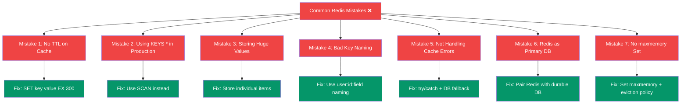

## 19. Common Beginner Mistakes

### Bad vs Good: A Quick Reference



> **Themes:** Every mistake comes from treating Redis like a traditional database or forgetting it's an in-memory cache with finite RAM.

---

### Mistake 1: No Expiration on Cache Keys

```bash
# ❌ BAD — key lives forever
SET cache:products '{"items": [...]}'

# ✅ GOOD — expires in 5 minutes
SET cache:products '{"items": [...]}' EX 300
```

**Why it matters:** Without TTL, cache entries pile up indefinitely. Redis will eventually hit its memory limit and start evicting random keys or refusing writes.

---

### Mistake 2: Using KEYS * in Production

```bash
# ❌ NEVER do this in production
KEYS *          # Scans ALL keys — blocks Redis!
KEYS user:*

# ✅ Use SCAN instead (non-blocking, cursor-based)
SCAN 0 MATCH user:* COUNT 100
```

**Why it matters:** `KEYS` is O(n) and blocks all other commands while running. On a database with millions of keys, this can freeze Redis for seconds.

---

### Mistake 3: Storing Huge Values

```bash
# ❌ BAD — storing entire catalog as one key
SET catalog:all '{...10MB of data...}'

# ✅ GOOD — store individual items
HSET product:1001 name "Laptop" price "45000"
HSET product:1002 name "Mouse" price "1500"
```

**Why it matters:** Large values slow down serialization, network transfer, and consume more memory per key.

---

### Mistake 4: Bad Key Naming

```bash
# ❌ BAD — unclear, may conflict
SET u42 "Prathamesh"
SET p9001 "Laptop"
SET x "temp"

# ✅ GOOD — structured, readable
SET user:42:name "Prathamesh"
SET product:9001:name "Laptop"
SET cache:homepage:v2 "..."
```

---

### Mistake 5: Not Handling Cache Errors Gracefully

```javascript
// ❌ BAD — crashes the app if Redis is down
const data = JSON.parse(await redis.get('cache:key'));
return res.json(data);

// ✅ GOOD — fallback to database if Redis fails
try {
  const cached = await redis.get('cache:key');
  if (cached) return res.json(JSON.parse(cached));
} catch (err) {
  console.warn('Redis unavailable, using DB fallback:', err.message);
}
const data = await db.query('...');
return res.json(data);
```

---

### Mistake 6: Using Redis as a Primary Database

Redis is not designed to replace your primary relational or document database. It is a complementary tool for:
- Caching
- Session management
- Rate limiting
- Real-time data

Always keep your primary data in a durable database (MySQL, PostgreSQL, MongoDB).

---

### Mistake 7: Not Setting maxmemory

Without a memory limit, Redis will consume all available RAM and potentially crash your server.

```bash
# In redis.conf
maxmemory 512mb
maxmemory-policy allkeys-lru

# Or via CLI
CONFIG SET maxmemory 512mb
CONFIG SET maxmemory-policy allkeys-lru
```

**Eviction policies:**

| Policy | Behavior |
|---|---|
| `noeviction` | Return error when memory full |
| `allkeys-lru` | Evict least recently used keys |
| `volatile-lru` | Evict LRU keys with TTL only |
| `allkeys-random` | Evict random keys |
| `volatile-ttl` | Evict keys with shortest TTL |

---
