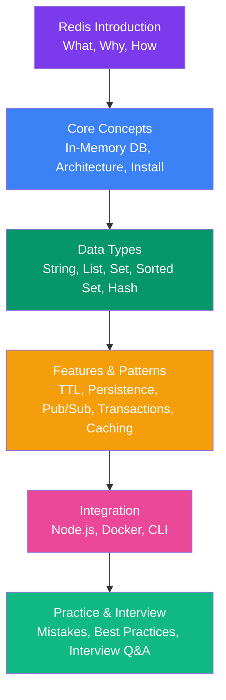

# Redis Fundamentals

Complete Redis guide split into section-wise notes covering core concepts, architecture, data types, TTL, persistence, Pub/Sub, transactions, caching patterns, integrations, best practices, and interview preparation.

## Learning Path

## Core Concepts

- [Introduction to Redis](/DSA-Notes-Problems/redis/introduction-to-redis)
- [What is an In-Memory Database](/DSA-Notes-Problems/redis/what-is-an-in-memory-database)
- [Redis Architecture](/DSA-Notes-Problems/redis/redis-architecture)
- [Installing Redis](/DSA-Notes-Problems/redis/installing-redis)
- [Redis Data Types Overview](/DSA-Notes-Problems/redis/redis-data-types-overview)

## Data Types

- [Redis Strings](/DSA-Notes-Problems/redis/redis-strings)
- [Redis Lists](/DSA-Notes-Problems/redis/redis-lists)
- [Redis Sets](/DSA-Notes-Problems/redis/redis-sets)
- [Redis Sorted Sets](/DSA-Notes-Problems/redis/redis-sorted-sets)
- [Redis Hashes](/DSA-Notes-Problems/redis/redis-hashes)

## Redis Features

- [Key Expiration & TTL](/DSA-Notes-Problems/redis/key-expiration-and-ttl)
- [Redis Persistence](/DSA-Notes-Problems/redis/redis-persistence)
- [Redis Pub/Sub](/DSA-Notes-Problems/redis/redis-pub-sub)
- [Redis Transactions](/DSA-Notes-Problems/redis/redis-transactions)
- [Redis Caching Patterns](/DSA-Notes-Problems/redis/redis-caching-patterns)

## Integration & Commands

- [Redis with Node.js](/DSA-Notes-Problems/redis/redis-with-node-js)
- [Redis with Docker](/DSA-Notes-Problems/redis/redis-with-docker)
- [Common Redis Commands Cheat Sheet](/DSA-Notes-Problems/redis/common-redis-commands-cheat-sheet)

## Practice & Interview

- [Common Beginner Mistakes](/DSA-Notes-Problems/redis/common-beginner-mistakes)
- [Redis Best Practices](/DSA-Notes-Problems/redis/redis-best-practices)
- [Redis Interview Questions](/DSA-Notes-Problems/redis/redis-interview-questions)
- [Summary & Learning Roadmap](/DSA-Notes-Problems/redis/summary-and-learning-roadmap)
