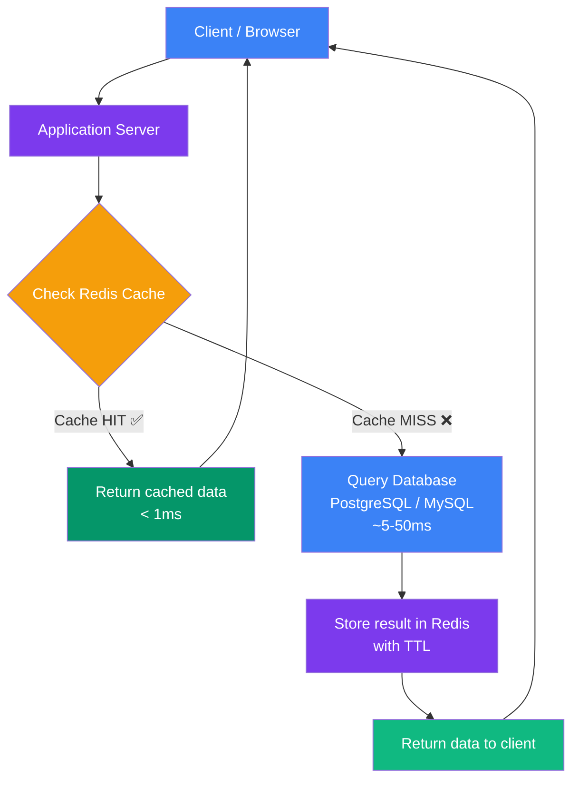

## 1. Introduction to Redis

### What is Redis?

**Redis** stands for **Re**mote **Di**ctionary **S**erver. It is an open-source, in-memory data store used as a database, cache, message broker, and streaming engine.

Think of Redis as an **ultra-fast notepad** that lives in your computer's RAM. When you need to remember something quickly, instead of going to a library (your database on disk), you look at your notepad (Redis in RAM). It is almost instantaneous.

> **Analogy:** Imagine you are a cashier at a supermarket. You have a drawer next to you with the prices of the 50 most common items — you don't need to look them up in a catalog every time. That drawer is Redis. The catalog is your database.

---

### History of Redis

| Year | Milestone |
|------|-----------|
| 2009 | Created by Salvatore Sanfilippo (antirez) to solve performance problems in his startup LLOOGG |
| 2010 | VMware sponsored the project |
| 2013 | Redis Labs (now Redis Inc.) founded |
| 2015 | Redis Cluster (horizontal scaling) released |
| 2018 | Redis Streams introduced |
| 2022 | Redis 7.0 released with major performance improvements |

---

### Why Redis Was Created

Salvatore Sanfilippo was building a real-time analytics tool. His PostgreSQL database could not handle thousands of reads and writes per second fast enough. He needed something that could respond in **microseconds**, not milliseconds.

He realized:
- Disk I/O (reading from a hard drive) is the bottleneck
- RAM is orders of magnitude faster than disk
- Most frequently accessed data is a small subset of the total data

So he built Redis — a data store that lives entirely in RAM.

---

### Problems Redis Solves

| Problem | Without Redis | With Redis |
|---------|--------------|------------|
| Slow repeated database queries | Every request hits the database | Cache results in Redis, serve instantly |
| Session management | Store sessions in DB (slow) | Store sessions in Redis (fast) |
| Rate limiting | Complex DB queries | Simple counters with INCR |
| Real-time leaderboards | Sort millions of rows | Sorted Sets handle it natively |
| Message queues | Third-party services | Redis Lists or Streams |
| Pub/Sub messaging | External broker required | Built into Redis |

---

### Traditional Database Limitations

Traditional relational databases (MySQL, PostgreSQL) store data on **disk**. Every query involves:

1. Parsing the SQL query
2. Planning the query execution
3. Reading data from disk (HDD/SSD)
4. Joining tables if needed
5. Returning the result

This process can take **5–50 milliseconds** or more for complex queries. Under high load (thousands of requests per second), this becomes a serious bottleneck.

---

### Why Caching is Important

Caching stores the result of an expensive operation so you can reuse it without recomputing it. It is the single most impactful optimization in web application performance.

**Example:** You have a news website. The homepage shows the top 10 trending articles. This query joins 3 tables, sorts by views, and takes 200ms. With 10,000 users per minute requesting the homepage:

- **Without cache:** 10,000 × 200ms = database is overwhelmed
- **With Redis cache:** Query runs once, result cached for 60 seconds, 10,000 requests served from RAM in < 1ms each

---

### Why Redis is Fast

1. **In-Memory Storage** — All data lives in RAM, no disk I/O
2. **Single-threaded Event Loop** — No context switching overhead between threads
3. **Efficient Data Structures** — Internally optimized (skip lists, hash tables, zip lists)
4. **Non-blocking I/O** — Uses multiplexing to handle thousands of connections
5. **Simple Protocol (RESP)** — Lightweight binary-safe protocol

> Redis can handle **1,000,000+ operations per second** on a single server.

---

### Architecture Diagram: Application with Cache Layer

> **Flow:** Client requests data → App checks Redis cache → HIT: serve instantly from RAM (0.1ms) → MISS: query slow database, store result in Redis for next time, then return.

---
