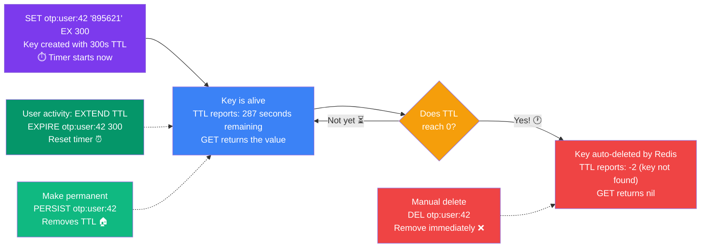

## 11. Key Expiration & TTL

### What is TTL?

**TTL (Time To Live)** defines how long a key exists in Redis before it is automatically deleted. This is one of Redis's most powerful features for cache management.

> **Analogy:** TTL is like a best-before date on food. Once expired, Redis automatically throws it away — you don't have to clean it up manually.

### TTL Lifecycle



> **Warning:** Keys without TTL will accumulate in memory indefinitely and eventually cause Redis to run out of RAM.

---

### Core Commands

```bash
# Set a key with TTL in SECONDS
SET otp:user:42 "895621" EX 300      # Expires in 5 minutes

# Set a key with TTL in MILLISECONDS
SET temp:token "abc123" PX 10000     # Expires in 10 seconds

# Check remaining TTL (in seconds)
TTL otp:user:42
# Output: (integer) 287  (287 seconds remaining)
# Output: -1  (key exists, no expiry set)
# Output: -2  (key does not exist)

# Check remaining TTL in milliseconds
PTTL otp:user:42

# Add expiry to an existing key
SET api:response:home '{"data": [...]}'
EXPIRE api:response:home 60         # Expire in 60 seconds

# Make a key permanent (remove expiry)
PERSIST api:response:home

# Set with exact Unix timestamp expiry
EXPIREAT notification:123 1800000000
```

---

### Real-World Examples

**Example 1: OTP (One-Time Password)**
```bash
# Store OTP valid for 10 minutes
SET otp:user:42 "293847" EX 600

# Verify OTP
GET otp:user:42
# Returns nil if expired, value if valid

# After verification, delete immediately
DEL otp:user:42
```

**Example 2: API Response Caching**
```bash
# Cache API response for 5 minutes
SET cache:api:products '{"items": [...]}' EX 300

# Check how fresh the cache is
TTL cache:api:products
```

**Example 3: Session Management**
```bash
# Create session with 24-hour expiry
SET session:abc123 '{"userId": 42, "role": "admin"}' EX 86400

# Refresh session on user activity (extend TTL)
EXPIRE session:abc123 86400
```

---

> **Warning:** Always set TTL on cache keys. Keys without TTL will accumulate in memory indefinitely and eventually cause Redis to run out of RAM.

---
