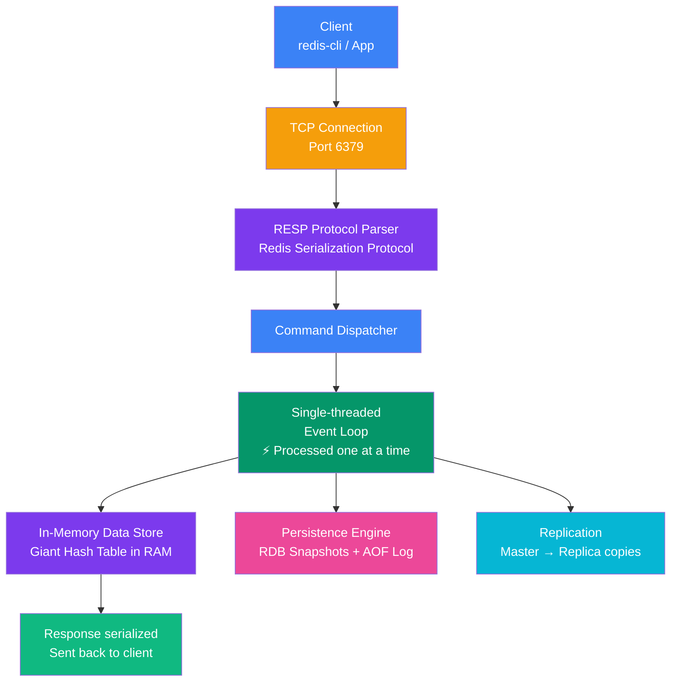

## 3. Redis Architecture

### How Redis Works Internally

Redis is designed for simplicity and speed. Here is what happens under the hood:

```
Client Request
      ↓
TCP Connection (port 6379)
      ↓
RESP Protocol Parser
      ↓
Command Dispatcher
      ↓
Single-threaded Event Loop
      ↓
In-Memory Data Store (Hash Table)
      ↓
Response serialized → sent back to client
```

---

### Key Architectural Components

| Component | Role |
|---|---|
| **Redis Server** | Core process, handles all commands |
| **Event Loop** | Single-threaded loop that processes commands one at a time |
| **In-Memory Store** | Giant hash table in RAM holding all key-value data |
| **RESP Protocol** | Redis Serialization Protocol — simple, fast wire format |
| **Persistence Engine** | RDB / AOF for writing data to disk |
| **Replication** | Master-Replica copies for high availability |

---

### Single-Threaded Architecture Explained

> **Common misconception:** People think single-threaded means slow. It does not.

Redis is single-threaded for **command processing**. This means:
- No locks or mutexes needed
- No race conditions
- No thread context switching overhead

The I/O is handled with non-blocking **epoll/kqueue** multiplexing. Redis can serve thousands of clients simultaneously through the event loop.

> **Analogy:** A highly efficient chef who can work on multiple dishes at once (prepping one while another is cooking), rather than having multiple chefs who bump into each other constantly.

---

### Redis Architecture Diagram



> **Core insight:** The single-threaded event loop is key — no locks, no race conditions, no context switching. Redis uses non-blocking I/O (epoll/kqueue) to handle thousands of concurrent clients on a single thread.

---
