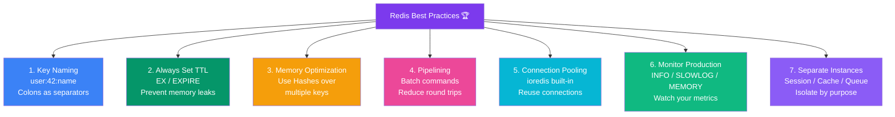

## 20. Redis Best Practices

### 7 Pillars of Redis Best Practices



> **Golden rule:** Redis is an in-memory cache, not a primary database. Design your architecture around that.

---

### 1. Key Naming Conventions

Use a consistent hierarchy separated by colons (`:`):

```
{app}:{resource}:{id}:{attribute}

Examples:
  myapp:user:42:session
  myapp:product:SKU-9001:cache
  myapp:ratelimit:user:42:2024-01-15
  myapp:leaderboard:game:season3
```

**Rules:**
- Use lowercase
- Use colons as separators
- Be descriptive but concise
- Include version if needed: `cache:products:v2`

---

### 2. Always Set TTL on Cache Keys

```javascript
// Set TTL based on data volatility:
// Frequently changing data (prices, stock) → 60–300 seconds
// Stable data (product descriptions) → 3600–86400 seconds
// Session data → match your session timeout

redis.setex('cache:prices', 60, JSON.stringify(prices));
redis.setex('cache:products', 3600, JSON.stringify(products));
redis.setex('session:user:42', 86400, token);
```

---

### 3. Memory Optimization

```bash
# Use Hash for objects with many fields (more memory-efficient than multiple keys)
# ❌ Inefficient — 4 separate keys
SET user:42:name "Alice"
SET user:42:age "30"
SET user:42:city "Pune"
SET user:42:role "admin"

# ✅ Efficient — 1 Hash with 4 fields
HSET user:42 name "Alice" age "30" city "Pune" role "admin"
```

---

### 4. Use Pipelining for Bulk Operations

```javascript
// ❌ BAD — 1000 round trips to Redis
for (const user of users) {
  await redis.set(`user:${user.id}`, JSON.stringify(user));
}

// ✅ GOOD — 1 round trip with pipeline
const pipeline = redis.pipeline();
for (const user of users) {
  pipeline.set(`user:${user.id}`, JSON.stringify(user), 'EX', 3600);
}
await pipeline.exec();
```

---

### 5. Connection Pooling

```javascript
// ioredis handles connection pooling internally
// For cluster mode:
const Redis = require('ioredis');
const cluster = new Redis.Cluster([
  { host: '127.0.0.1', port: 7000 },
  { host: '127.0.0.1', port: 7001 },
  { host: '127.0.0.1', port: 7002 },
]);
```

---

### 6. Monitor Redis in Production

```bash
# Real-time command monitoring (development only)
redis-cli MONITOR

# Check memory usage
redis-cli INFO memory

# Check connected clients
redis-cli INFO clients

# Check slow queries (commands taking > 10ms)
redis-cli SLOWLOG GET 10

# Memory usage of a specific key
redis-cli MEMORY USAGE user:42
```

---

### 7. Separate Redis Instances by Purpose

```
Redis Instance 1 → Session storage (db: 0)
Redis Instance 2 → API cache (db: 0)
Redis Instance 3 → Rate limiting (db: 0)
```

Or use Redis databases (0–15) for logical separation:

```javascript
const sessionRedis = new Redis({ db: 0 });
const cacheRedis   = new Redis({ db: 1 });
const queueRedis   = new Redis({ db: 2 });
```

---
