## 5. Redis Data Types Overview

Redis is not just a simple key-value store. It supports multiple rich data structures, each designed for specific use cases.

| Data Type | Best Used For | Real-World Example |
|---|---|---|
| **String** | Simple values, counters, cached HTML | Page view counter, session token |
| **List** | Ordered collections, queues, timelines | Task queue, activity feed |
| **Set** | Unique collections, memberships | Unique visitors, user tags |
| **Sorted Set** | Ranked collections with scores | Leaderboard, trending topics |
| **Hash** | Object-like storage with fields | User profile, product details |
| **Bitmap** | Bit-level operations | Daily active users tracking |
| **HyperLogLog** | Approximate unique count | Unique website visitors (approximate) |
| **Stream** | Append-only log, event sourcing | IoT sensor data, event logs |

---

### Data Type Hierarchy Diagram

```mermaid
flowchart TB
    Core[Core Data Types] --> String["🔤 String<br/>Counters, tokens<br/>SET / GET / INCR"]
    Core --> List["📋 List<br/>Queues, timelines<br/>LPUSH / RPOP / LRANGE"]
    Core --> Set["🔢 Set<br/>Unique members, tags<br/>SADD / SINTER / SUNION"]
    Core --> SortedSet["🏆 Sorted Set<br/>Leaderboards, rankings<br/>ZADD / ZRANGE / ZREVRANK"]
    Core --> Hash["🗂️ Hash<br/>Objects, profiles<br/>HSET / HGET / HGETALL"]
    
    Advanced[Advanced Data Types] --> Stream["📡 Stream<br/>Event logs, messaging<br/>XADD / XREAD / XREADGROUP"]
    Advanced --> Bitmap["🟩 Bitmap<br/>Flags, DAU tracking<br/>SETBIT / GETBIT / BITCOUNT"]
    Advanced --> HLL["📊 HyperLogLog<br/>Approx unique counts<br/>PFADD / PFCOUNT"]
    Advanced --> Geo["📍 Geospatial<br/>Nearby places<br/>GEOADD / GEOSEARCH"]
    
    style Core fill:#7c3aed,color:#fff
    style String fill:#3b82f6,color:#fff
    style List fill:#3b82f6,color:#fff
    style Set fill:#3b82f6,color:#fff
    style SortedSet fill:#3b82f6,color:#fff
    style Hash fill:#3b82f6,color:#fff
    style Advanced fill:#059669,color:#fff
    style Stream fill:#059669,color:#fff
    style Bitmap fill:#059669,color:#fff
    style HLL fill:#059669,color:#fff
    style Geo fill:#059669,color:#fff
```

> **Tip:** Strings, Lists, Sets, Sorted Sets, and Hashes are the 5 core types you'll use daily. Streams, Bitmaps, HyperLogLog, and Geospatial are advanced types for specific use cases.

---
