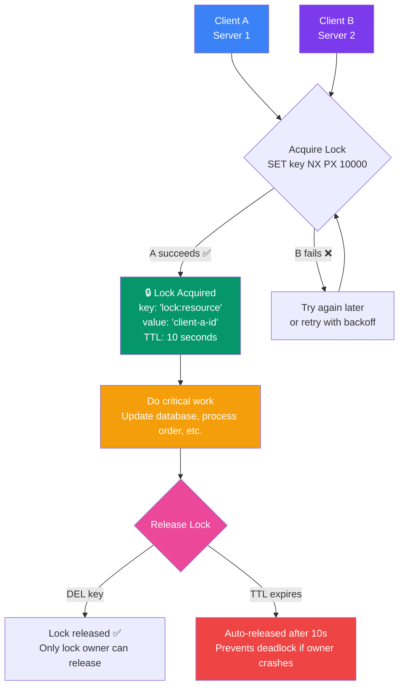

## 17. Redis Distributed Locks

### What is a Distributed Lock?

A **distributed lock** ensures that only one process (across multiple servers) can access a shared resource at a time. Redis provides a simple, fast way to implement distributed locks.

> **Analogy:** A distributed lock is like a single restroom key in a building with many people — only the person holding the key can enter. Everyone else must wait or try later.

### Lock Flow



---

### Basic Lock with SET NX PX

```bash
# Acquire lock (NX = only set if not exists, PX = expiry in ms)
SET lock:resource "client-42" NX PX 10000

# If key doesn't exist → SET succeeds, you have the lock ✅
# If key exists → SET returns nil, someone else has the lock ❌

# Do critical work here...

# Release lock (only if you own it!)
if redis.call("GET", KEYS[1]) == ARGV[1] then
    return redis.call("DEL", KEYS[1])
else
    return 0
end
```

---

### Why You Need a Unique Lock ID

Always use a **unique identifier** (like a UUID or process ID) as the lock value. This prevents releasing a lock you don't own:

```bash
# Client A acquires lock
SET lock:resource "uuid-a" NX PX 30000

# Client A's work takes too long, lock expires
# Client B acquires the same lock
SET lock:resource "uuid-b" NX PX 30000

# Client A finally finishes and tries to release
# Without check: DEL lock:resource → WRONG! Releases B's lock!
# With check: GET lock:resource → "uuid-b" → not mine → don't delete ✅
```

---

### Lua Script for Safe Release

```lua
-- safe-release.lua
-- ARGV[1] = lock key, ARGV[2] = unique identifier
if redis.call("GET", KEYS[1]) == ARGV[1] then
    return redis.call("DEL", KEYS[1])
else
    return 0
end
```

```bash
# Use with EVAL
EVAL "if redis.call('GET', KEYS[1]) == ARGV[1] then return redis.call('DEL', KEYS[1]) else return 0 end" 1 lock:resource "uuid-a"
```

---

### The Redlock Algorithm

For **highly critical** locks (financial transactions, etc.), a single Redis instance might fail. **Redlock** uses multiple independent Redis nodes (typically 5):

```text
1. Get current timestamp (milliseconds)
2. Try to acquire lock on ALL N nodes (same key, same ID, short TTL)
3. If acquired on majority (N/2 + 1) within the TTL → lock successful
4. If lock failed (not enough nodes, or took too long) → release all partial locks
```

> **Note:** Redlock is controversial and complex. For most applications, a single Redis instance with `SET NX PX` is sufficient. Use Redlock only when you need strict correctness across multiple independent Redis nodes.

---

### Real-World Examples

**Example 1: Scheduled Job (Cron)**
```bash
# Only one server should run the daily report
SET lock:daily-report "server-1" NX PX 3600000

# If succeeded → run the report
# If failed → another server is already running it
```

**Example 2: Inventory Deduction**
```bash
# Prevent overselling during checkout
SET lock:product:9001 "order-1042" NX PX 5000

# If acquired → check stock, deduct, release lock
# If not acquired → another user is checking out, retry
```

---

### Common Mistakes

| Mistake | Why | Fix |
|---------|-----|-----|
| No TTL on lock | If owner crashes, lock is held forever | Always use `PX` with a timeout |
| No unique ID | Can release another client's lock | Use UUID as lock value |
| Too long TTL | Lock held too long if owner crashes | Use short TTL + extend if needed |
| Not using Lua for release | Race condition in check-then-delete | Use Lua `EVAL` for atomic release |

---

### In Simple Words

- **SET key value NX PX milliseconds** is the standard way to acquire a lock
- NX = "only set if key doesn't exist" (the lock check)
- PX = auto-expiry to prevent deadlocks
- Always verify you own the lock before releasing (compare value)
- Use **Lua scripts** or the **Redlock** library for safe release
- For most apps, a single Redis instance lock is enough
