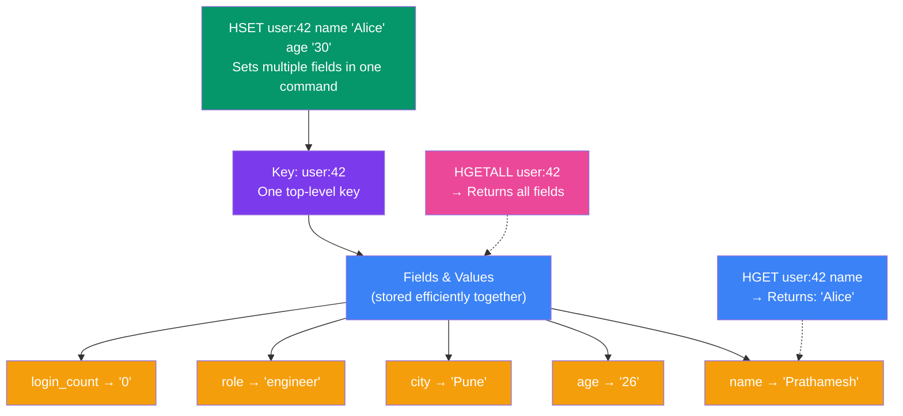

## 10. Redis Hashes

### What is a Redis Hash?

A Redis Hash stores a mapping of **fields to values** within a single key. It is perfect for storing object-like data.

> **Analogy:** A Hash is like a row in a spreadsheet — the key is the row ID, and the fields are column names with their values.

### How Hashes Structure Data



---

### Core Commands

```bash
# Set multiple fields at once
HSET user:42 name "Prathamesh" age "26" city "Pune" role "engineer"

# Get a single field
HGET user:42 name
# Output: "Prathamesh"

# Get all fields and values
HGETALL user:42
# Output:
# 1) "name"
# 2) "Prathamesh"
# 3) "age"
# 4) "26"
# 5) "city"
# 6) "Pune"
# 7) "role"
# 8) "engineer"

# Get multiple fields at once
HMGET user:42 name city
# Output: 1) "Prathamesh" 2) "Pune"

# Get just field names
HKEYS user:42
# Output: name, age, city, role

# Get just values
HVALS user:42

# Check if a field exists
HEXISTS user:42 email
# Output: (integer) 0

# Delete a field
HDEL user:42 age

# Increment a numeric field
HSET product:10 stock 100
HINCRBY product:10 stock -5
# Output: (integer) 95
```

---

### Real-World Examples

**Example 1: User Profile**
```bash
HSET user:profile:101 \
  username "john_doe" \
  email "john@example.com" \
  plan "pro" \
  login_count 0

# Update login count on each login
HINCRBY user:profile:101 login_count 1
```

**Example 2: Product Catalog**
```bash
HSET product:SKU-9001 \
  name "Mechanical Keyboard" \
  price "4500" \
  stock "50" \
  category "electronics"

# Update stock after sale
HINCRBY product:SKU-9001 stock -1
```

---

### Hash vs Storing JSON as a String

| Approach | Pros | Cons |
|---|---|---|
| **Hash** (`HSET`) | Update individual fields without reading all data | More commands to manage |
| **JSON String** (`SET`) | Single command to store/retrieve | Must deserialize entire object to update one field |

> **Best practice:** Use Hashes when you need to update individual fields frequently. Use JSON strings when you always read/write the entire object.

---
