## 21. Redis Interview Questions

### Interview Topics Overview

```mermaid
flowchart TB
    Interview[Redis Interview Topics 🎯] --> Beginner[Beginner Level<br/>Core concepts] --> Q1[Q1: What is Redis?<br/>In-memory, fast, key-value]
    Beginner --> Q2[Q2: In-memory trade-offs<br/>Speed vs volatility]
    Beginner --> Q3[Q3: LPUSH vs RPUSH<br/>FIFO vs LIFO]
    Beginner --> Q4[Q4: TTL & Expiration<br/>Auto-cleanup]
    Beginner --> Q5[Q5: Set vs Sorted Set<br/>Unique vs scored]
    
    Interview --> Inter[Intermediate Level<br/>Patterns & Architecture]
    Inter --> Q6[Q6: Cache-Aside Pattern
Lazy loading cache]
    Inter --> Q7[Q7: RDB vs AOF
Snapshot vs append-log]
    Inter --> Q8[Q8: Single-threaded perf
Event loop + epoll]
    Inter --> Q9[Q9: WATCH & Optimistic Lock
Transaction safety]
    Inter --> Q10[Q10: Rate Limiting
INCR + TTL pattern]
    Inter --> Q11[Q11: Eviction Policies
LRU / LFU / TTL]
    Inter --> Q12[Q12: Pub/Sub vs Streams
Fire & forget vs persisted]
    
    style Interview fill:#7c3aed,color:#fff
    style Beginner fill:#3b82f6,color:#fff
    style Inter fill:#059669,color:#fff
    style Q1 fill:#3b82f6,color:#fff
    style Q2 fill:#3b82f6,color:#fff
    style Q3 fill:#3b82f6,color:#fff
    style Q4 fill:#3b82f6,color:#fff
    style Q5 fill:#3b82f6,color:#fff
    style Q6 fill:#059669,color:#fff
    style Q7 fill:#059669,color:#fff
    style Q8 fill:#059669,color:#fff
    style Q9 fill:#059669,color:#fff
    style Q10 fill:#059669,color:#fff
    style Q11 fill:#059669,color:#fff
    style Q12 fill:#059669,color:#fff
```



---

### Beginner Level

**Q1: What is Redis and what makes it different from traditional databases?**

> Redis is an in-memory data store that keeps all data in RAM, making it 100–1000x faster than disk-based databases like MySQL. Unlike traditional databases designed for complex queries and relationships, Redis is optimized for simple, fast key-value operations. It supports rich data structures (Strings, Lists, Sets, Sorted Sets, Hashes) and is primarily used for caching, session management, and real-time features.

---

**Q2: What does "in-memory" mean and what are the trade-offs?**

> In-memory means all data is stored in RAM instead of disk. The advantage is extreme speed (nanosecond access times). The trade-off is that RAM is volatile — data is lost on restart unless persistence (RDB/AOF) is configured. RAM is also more expensive and limited in size compared to disk.

---

**Q3: What is the difference between LPUSH and RPUSH?**

> Both push values into a Redis List, but from different ends:  
> `LPUSH` inserts at the **left (head)** of the list.  
> `RPUSH` inserts at the **right (tail)** of the list.  
> Use `RPUSH` + `LPOP` for FIFO queue behavior. Use `LPUSH` + `LPOP` for LIFO stack behavior.

---

**Q4: What is TTL and why is it important?**

> TTL (Time To Live) is the number of seconds a key will exist before Redis automatically deletes it. It is critical for cache management to prevent stale data from accumulating indefinitely in memory. Use `EXPIRE key seconds` to set TTL and `TTL key` to check the remaining time.

---

**Q5: What is the difference between a Set and a Sorted Set?**

> A **Set** stores unique strings in no particular order.  
> A **Sorted Set** stores unique strings where each member has an associated numeric **score**. Members are automatically sorted by score. Sorted Sets are ideal for leaderboards, rankings, and priority queues.

---

### Intermediate Level

**Q6: What is Cache-Aside pattern and when do you use it?**

> Cache-Aside (lazy loading) is the most common caching pattern. The application checks Redis first. On a cache miss, it queries the database, stores the result in Redis with a TTL, then returns it. It is used when you want to cache only data that is actually requested, keeping the cache lean. The downside is that the first request after a cache miss (or expiry) is slower.

---

**Q7: What is the difference between RDB and AOF persistence?**

> **RDB** creates periodic binary snapshots of the entire dataset. It is compact and fast to restore but may lose data between snapshots.  
> **AOF** logs every write command. It is more durable (loses at most 1 second of data with `everysec` sync) but files are larger and slower to replay on restart.  
> Best practice is to enable both.

---

**Q8: Redis is single-threaded. How does it handle thousands of concurrent connections?**

> Redis uses a **non-blocking, event-driven architecture** with OS-level I/O multiplexing (epoll on Linux, kqueue on macOS). The single thread runs an event loop that handles multiple client connections simultaneously without blocking. Since most Redis operations are in-memory and microsecond-fast, the event loop rarely waits. This means single-threaded Redis outperforms multi-threaded databases that suffer from lock contention and context switching.

---

**Q9: What is the WATCH command used for in Redis?**

> `WATCH` implements optimistic locking for Redis transactions. You watch one or more keys before starting a `MULTI` block. If any watched key is modified by another client before your `EXEC` runs, the entire transaction is aborted (returns nil). Your application should then retry the transaction. It is used to prevent race conditions in concurrent scenarios like "read-modify-write" operations.

---

**Q10: How would you implement rate limiting using Redis?**

> Use a String counter with TTL:
> ```javascript
> const key = `ratelimit:${userId}`;
> const count = await redis.incr(key);
> if (count === 1) await redis.expire(key, 60); // Reset every minute
> if (count > 100) throw new Error('Rate limit exceeded');
> ```
> The `INCR` command is atomic so no race conditions occur. The key expires automatically, resetting the counter each minute.

---

**Q11: What are Redis eviction policies and when does eviction occur?**

> Eviction occurs when Redis reaches its `maxmemory` limit. Common policies:  
> - `allkeys-lru`: Evict the least recently used key (most common for caching)  
> - `volatile-lru`: Evict LRU key only among keys with TTL set  
> - `noeviction`: Return an error — never evict (used when Redis is a primary store)  
> For caching scenarios, `allkeys-lru` is recommended.

---

**Q12: When would you use Redis Pub/Sub vs Redis Streams?**

> **Pub/Sub** is fire-and-forget. If a subscriber is offline, it misses messages. Suitable for real-time notifications where missing a message is acceptable (e.g., live chat, presence updates).  
> **Redis Streams** are persistent, append-only logs. Subscribers can read from any position and resume after a disconnect. Suitable for event sourcing, audit logs, and guaranteed message delivery.

---
