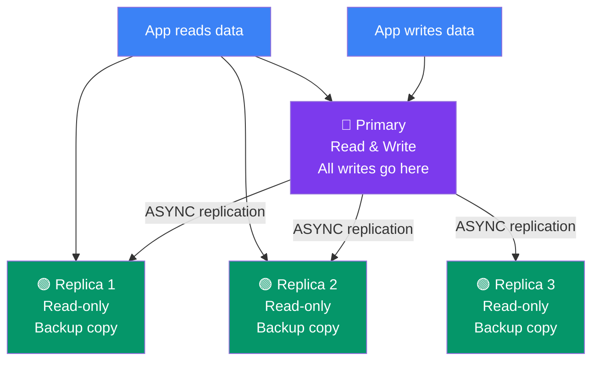

## 18. Redis Replication

### What is Replication?

**Replication** creates exact copies of a Redis primary (master) on one or more **replica** servers. The primary handles all writes and sends updates to replicas, which can serve read requests.

> **Analogy:** Replication is like a teacher (primary) writing notes on a whiteboard while students (replicas) copy everything down. If the teacher is absent, one student can take over.

### Replication Architecture



---

### How Replication Works

1. Replica connects to primary and sends `REPLICAOF`
2. Primary **forks** a child process to run `BGSAVE` (RDB snapshot)
3. Primary sends the RDB file to the replica
4. Replica loads the RDB file (catches up to sync point)
5. After initial sync, primary streams every write command to replica (replication buffer)
6. If replication link breaks, replica reconnects and does a **partial resync** (not full sync)

```bash
# Set up a replica (run on replica server)
REPLICAOF 192.168.1.100 6379

# Check replication status
INFO replication

# Make a replica primary again (stop replicating)
REPLICAOF NO ONE
```

---

### Configure in redis.conf

```bash
# On replica server
replicaof 192.168.1.100 6379

# If primary has password set
masterauth your_redis_password

# Replica is read-only by default (recommended)
replica-read-only yes
```

---

### Benefits

| Benefit | Explanation |
|---------|-------------|
| **Read scaling** | Distribute read queries across replicas |
| **Data redundancy** | Multiple copies of your data |
| **Backup safety** | Run backups on a replica (no performance impact on primary) |
| **High availability base** | Foundation for Sentinel (automatic failover) |

---

### Replication vs Other Solutions

| Feature | Replication | Sentinel | Cluster |
|---------|-------------|----------|---------|
| Read scaling | ✅ Yes | ✅ Yes | ✅ Yes |
| Write scaling | ❌ No | ❌ No | ✅ Yes (sharding) |
| Auto failover | ❌ Manual only | ✅ Automatic | ✅ Automatic |
| Complexity | Low | Medium | High |
| Typical nodes | 1 primary + 1-3 replicas | 1 primary + 2 replicas + 3 sentinels | 3+ primaries with replicas |

---

### In Simple Words

- **Replication** copies data from one primary to one or more replicas
- **Replicas are read-only** — all writes go to the primary
- The primary pushes updates **asynchronously** to replicas
- Use replicas for **read scaling** and **backup safety**
- Replication is the foundation for **Sentinel** (auto-failover) and **Cluster** (sharding)
- If a replica disconnects, it only syncs the missed commands — not a full resync
