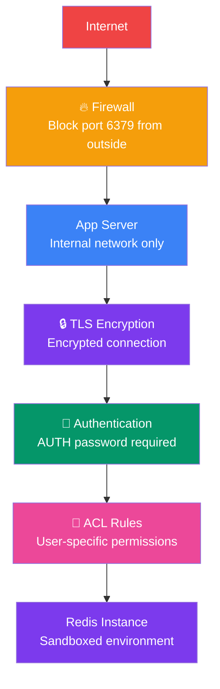

## 21. Redis Security

### Why Redis Security Matters

Redis is designed for **fast internal use** — by default it has no authentication and listens on all interfaces. In production, you must secure it to prevent data breaches and unauthorized access.

> **Analogy:** A default Redis install is like leaving your front door wide open with a sign saying "come in." Security is adding locks, an alarm system, and a peephole.

### Security Layers



---

### 1. Network Security

```bash
# In redis.conf — bind to specific interface (not 0.0.0.0!)
bind 127.0.0.1  # Local only
bind 192.168.1.100  # Internal network only

# Change default port (obscurity — not real security)
port 6379  # Consider changing

# Disable dangerous commands
rename-command FLUSHALL ""
rename-command FLUSHDB ""
rename-command CONFIG ""
rename-command SHUTDOWN ""
rename-command DEBUG ""
```

---

### 2. Authentication with AUTH

```bash
# In redis.conf — set a strong password
requirepass your_very_strong_password_here

# Connect with password
redis-cli -a your_very_strong_password_here

# Or authenticate after connecting
AUTH your_very_strong_password_here
```

> **Warning:** The `-a` flag exposes the password in process listings. Use `AUTH` command or environment variables instead.

---

### 3. ACL Users (Redis 6+)

ACL (Access Control Lists) let you create **specific users** with limited permissions:

```bash
# In redis.conf
aclfile /etc/redis/users.acl
```

```bash
# users.acl — define users
user default off  # Disable default user
user alice on >password_123 ~cached:* +get +set  # Only GET/SET on cached:*
user bob on >secure_pass ~orders:* +@all -@dangerous  # All except dangerous commands
user admin on >admin_pass ~* +@all  # Full access
```

```bash
# Create users via CLI
ACL SETUSER reader on >readonly_pass ~cache:* +get +exists

# List all users
ACL LIST

# Who am I?
ACL WHOAMI

# See user's permissions
ACL GETUSER reader
```

**ACL Categories:**
- `+@all` — all commands
- `+@read` — read commands (GET, MGET, EXISTS, etc.)
- `+@write` — write commands (SET, DEL, etc.)
- `+@admin` — admin commands (CONFIG, SHUTDOWN, etc.)
- `+@dangerous` — dangerous commands (FLUSHALL, DEBUG, etc.)
- `+get` `+set` — individual commands
- `~*` — all keys
- `~cache:*` — keys matching pattern
- `>password` — user's password

---

### 4. TLS Encryption

```bash
# In redis.conf — enable TLS
tls-port 6379
port 0  # Disable non-TLS port

tls-cert-file /path/to/redis.crt
tls-key-file /path/to/redis.key
tls-ca-cert-file /path/to/ca.crt

# Require TLS for replication
tls-replication yes

# Require TLS for cluster bus
tls-cluster yes
```

---

### 5. Operating System Hardening

```bash
# Run Redis as non-root user
sudo useradd --system redis
sudo chown -R redis:redis /var/lib/redis
sudo chown -R redis:redis /var/log/redis

# Restrict access to configuration
chmod 640 /etc/redis/redis.conf
chown redis:redis /etc/redis/redis.conf

# Linux kernel hardening
echo "vm.overcommit_memory = 1" >> /etc/sysctl.conf
echo "net.core.somaxconn = 65535" >> /etc/sysctl.conf
```

---

### Common Security Mistakes

| Mistake | Why | Fix |
|---------|-----|-----|
| Default config (no password) | Anyone with network access can control Redis | Set `requirepass` |
| Binding to `0.0.0.0` | Exposes Redis to the entire internet | Bind to internal IP only |
| Using `FLUSHALL` in production | Deletes ALL data instantly | Disable or rename the command |
| Running as root | Security breach gives root access | Run as `redis` user |
| Disabled password in config files | Hardcoded passwords in git history | Use environment variables |

---

### In Simple Words

- **Firewall** Redis — never expose port 6379 to the internet
- **Set a strong password** with `requirepass` in redis.conf
- Use **ACL users** (Redis 6+) to give each app/user only the permissions it needs
- Enable **TLS** for encrypted connections in production
- **Rename dangerous commands** like `FLUSHALL` and `CONFIG`
- Run Redis as a **non-root user** with restricted file permissions
- Security is layered — use all layers, not just one
