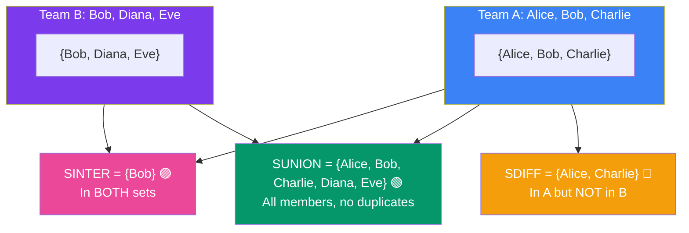

## 8. Redis Sets

### What is a Redis Set?

A Redis Set is an **unordered collection of unique strings**. Duplicates are automatically ignored.

> **Analogy:** A bag of tickets where each ticket has a unique number. You can add tickets, check if a ticket exists, or remove a ticket. No duplicates allowed.

### Set Operations at a Glance



---

### Core Commands

```bash
# Add members to a set
SADD tags:post:101 "redis" "database" "caching" "backend"

# Try adding a duplicate (ignored silently)
SADD tags:post:101 "redis"
# Output: (integer) 0  (nothing was added)

# Get all members (order not guaranteed)
SMEMBERS tags:post:101
# Output: {"redis", "database", "caching", "backend"}

# Check if a member exists
SISMEMBER tags:post:101 "redis"
# Output: (integer) 1 (yes)

SISMEMBER tags:post:101 "python"
# Output: (integer) 0 (no)

# Count members
SCARD tags:post:101
# Output: (integer) 4

# Remove a member
SREM tags:post:101 "caching"

# Pop a random member (removes it)
SPOP tags:post:101
```

---

### Set Operations

Redis sets support powerful mathematical operations:

```bash
SADD devs:teamA "Alice" "Bob" "Charlie"
SADD devs:teamB "Bob" "Diana" "Eve"

# INTERSECTION — members in BOTH sets
SINTER devs:teamA devs:teamB
# Output: {"Bob"}

# UNION — all members from both sets (no duplicates)
SUNION devs:teamA devs:teamB
# Output: {"Alice", "Bob", "Charlie", "Diana", "Eve"}

# DIFFERENCE — in A but NOT in B
SDIFF devs:teamA devs:teamB
# Output: {"Alice", "Charlie"}
```

---

### Real-World Examples

**Example 1: Unique Visitors Per Day**
```bash
# Track unique visitors by user ID
SADD visitors:2024-01-15 "user:101" "user:202" "user:303"
SADD visitors:2024-01-15 "user:101"   # Duplicate, ignored

# Count unique visitors
SCARD visitors:2024-01-15
# Output: (integer) 3
```

**Example 2: Online Users**
```bash
# User goes online
SADD online:users "user:42"

# User goes offline
SREM online:users "user:42"

# Who is online?
SMEMBERS online:users
```

---
