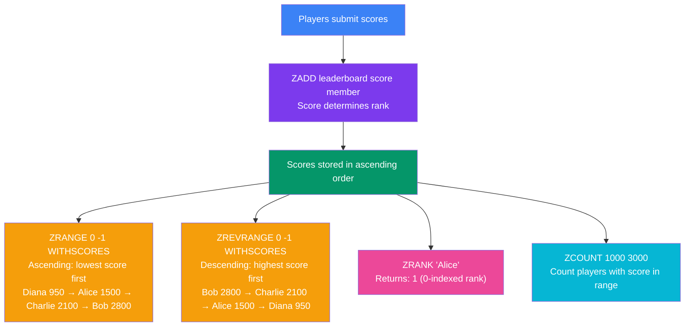

## 9. Redis Sorted Sets

### What is a Sorted Set?

A Sorted Set is like a Set, but every member has an associated **numeric score**. Members are stored in **ascending order by score**, and duplicate members are not allowed (but duplicate scores are fine).

> **Analogy:** A competition scoreboard where each player has a unique name and a score. The board is always sorted from lowest to highest score.

---

### Core Commands

```bash
# ZADD <key> <score> <member>
ZADD leaderboard 1500 "Alice"
ZADD leaderboard 2800 "Bob"
ZADD leaderboard 2100 "Charlie"
ZADD leaderboard 950  "Diana"

# Get members sorted ascending (lowest score first)
ZRANGE leaderboard 0 -1
# Output: 1) "Diana" 2) "Alice" 3) "Charlie" 4) "Bob"

# Get with scores
ZRANGE leaderboard 0 -1 WITHSCORES
# Output: "Diana" 950, "Alice" 1500, "Charlie" 2100, "Bob" 2800

# Get top 3 (highest scores — descending)
ZREVRANGE leaderboard 0 2 WITHSCORES
# Output: "Bob" 2800, "Charlie" 2100, "Alice" 1500

# Get rank of a member (0-indexed, ascending)
ZRANK leaderboard "Alice"
# Output: (integer) 1

# Get rank from highest (descending)
ZREVRANK leaderboard "Bob"
# Output: (integer) 0  (Bob is #1)

# Get the score of a specific member
ZSCORE leaderboard "Charlie"
# Output: "2100"

# Update a score
ZADD leaderboard 3200 "Alice"

# Remove a member
ZREM leaderboard "Diana"

# Count members in a score range
ZCOUNT leaderboard 1000 3000
```

---

### Leaderboard Diagram



> **Real-time leaderboard:** Sorted sets keep the order as scores change. Use `ZADD` to update a score, and the member automatically moves to its correct position. Perfect for gaming, trending topics, and real-time rankings.

---

### Real-World Examples

**Example: Gaming Leaderboard**
```bash
# Players complete a round
ZADD game:scores 4500 "player:alice"
ZADD game:scores 7200 "player:bob"
ZADD game:scores 6100 "player:charlie"

# Show top 10
ZREVRANGE game:scores 0 9 WITHSCORES

# Player's rank
ZREVRANK game:scores "player:alice"
```

**Example: Trending Topics (Time-based scoring)**
```bash
# Use timestamp as score
ZADD trending 1700000000 "redis"
ZADD trending 1700000100 "nodejs"

# Get most recently added (latest trending)
ZREVRANGE trending 0 4
```

---
