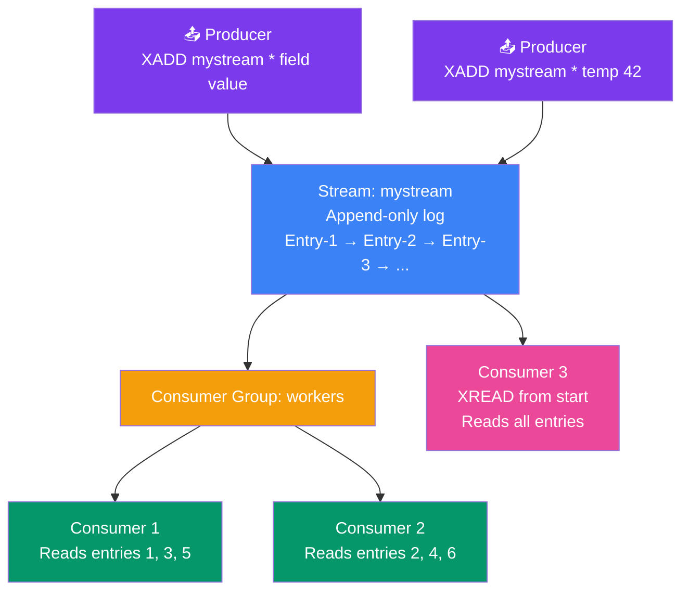

## 10. Redis Streams

### What is a Stream?

A **Stream** is an append-only log data structure. Think of it as a **timeline of events** — new entries go to the end, and each entry has a unique ID (timestamp-based).

> **Analogy:** A Stream is like a Twitter timeline — tweets (messages) are added in order, each has a timestamp, and you can read from any point in history.

### Streams vs Pub/Sub

| Feature | Pub/Sub | Streams |
|---------|---------|---------|
| Message persistence | Lost if no subscribers | Stored on disk (persistent) |
| Replay history | ❌ No | ✅ Yes, from any point |
| Consumer groups | ❌ No | ✅ Yes |
| Acknowledgment | Fire and forget | Consumers must acknowledge |
| Use case | Real-time notifications | Event sourcing, job queues |



---

### Core Commands

```bash
# Add an entry to a stream (auto-generates ID)
XADD mystream * name "Alice" age "30"
# Output: "1712345678000-0"  (timestamp-counter)

# Add with custom ID
XADD mystream 0-1 name "Bob"

# Read from stream (oldest first)
XRANGE mystream - +
# Output: 1) 1) "1712345678000-0" 2) "name" "Alice" "age" "30"

# Read new entries only (blocking — like tail -f)
XREAD BLOCK 0 STREAMS mystream $

# Get stream length
XLEN mystream
# Output: (integer) 2
```

---

### Consumer Groups

Consumer groups let you **divide work** across multiple consumers:

```bash
# Create a consumer group
XGROUP CREATE mystream mygroup $  # $ = start from new entries only

# Consumer reads an entry (not yet acknowledged)
XREADGROUP GROUP mygroup consumer1 COUNT 1 STREAMS mystream >

# Acknowledge processing is complete
XACK mystream mygroup 1712345678000-0

# Check pending (unacknowledged) entries
XPENDING mystream mygroup
```

---

### Real-World Examples

**Example 1: Event Sourcing**
```bash
# Order service emits events
XADD orders * event "order.created" orderId "1042" userId "42"
XADD orders * event "order.paid" orderId "1042" amount "99.99"
XADD orders * event "order.shipped" orderId "1042" carrier "UPS"

# Analytics service reads all events
XRANGE orders - +
```

**Example 2: Job Queue with Consumer Groups**
```bash
# Create consumer group for workers
XGROUP CREATE jobs processors $

# Worker 1 picks up a job
XREADGROUP GROUP processors worker1 COUNT 1 STREAMS jobs >

# After processing
XACK jobs processors job-id-1
```

---

### In Simple Words

- **Streams** are append-only logs — perfect for event history, job queues, and messaging
- Uses **XADD** to add, **XRANGE** to read, **XREAD** to listen for new entries
- **Consumer groups** let multiple workers divide and process messages without duplicates
- Unlike Pub/Sub, streams persist to disk and can be replayed from any point
- Each entry has an auto-generated **timestamp-based ID** (milliseconds.counter)
