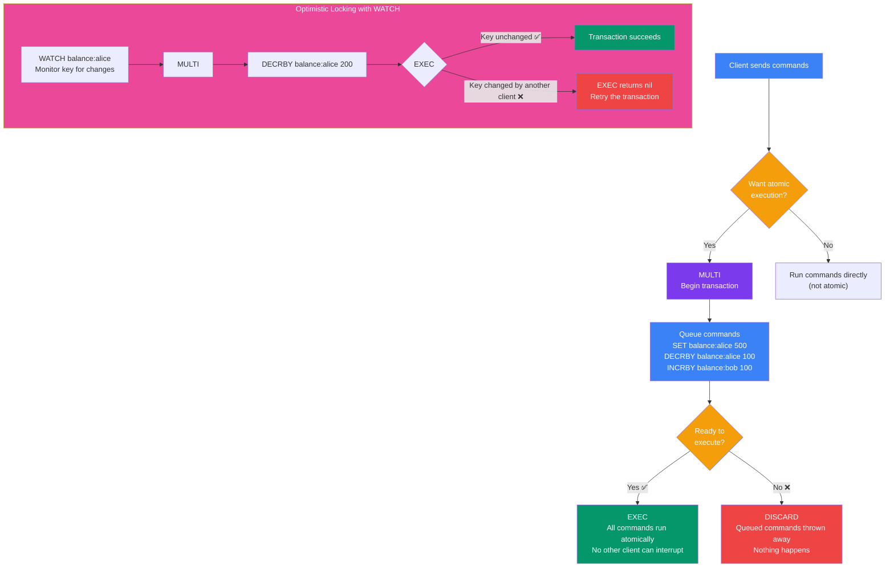

## 14. Redis Transactions

### What is a Redis Transaction?

A Redis transaction ensures a **group of commands executes atomically** — either all commands run, or none do (in case of a DISCARD). No other client can interrupt the sequence.

### MULTI / EXEC / DISCARD Flow



---

### MULTI / EXEC / DISCARD

```bash
# Begin transaction
MULTI

# Queue commands (they don't execute yet)
SET balance:alice 500
SET balance:bob 300
DECRBY balance:alice 100
INCRBY balance:bob 100

# Execute all queued commands atomically
EXEC
# Output:
# 1) OK
# 2) OK
# 3) (integer) 400
# 4) (integer) 400

# To cancel a transaction before EXEC
MULTI
SET key "value"
DISCARD   # All queued commands are thrown away
```

---

### WATCH — Optimistic Locking

`WATCH` monitors keys for changes. If a watched key is modified by another client before `EXEC`, the transaction is aborted (returns nil).

```bash
# Watch the balance key
WATCH balance:alice

# Begin transaction
MULTI

# Queue operations
DECRBY balance:alice 200

# EXEC will fail (return nil) if balance:alice was changed by another client
EXEC
# If successful: returns array of results
# If watched key changed: returns nil → retry the transaction
```

---

### Important Notes

> **Note:** Redis transactions are NOT like database transactions. They do not support rollbacks on runtime errors. If one command fails during EXEC (e.g., wrong type), other commands still run.

| Concept | Redis Transactions | SQL Transactions |
|---|---|---|
| Atomicity | Commands execute as a group | Full ACID atomicity |
| Rollback on error | No | Yes |
| Isolation | No other client interrupts | Yes |
| Durability | Depends on persistence config | Yes |

---
