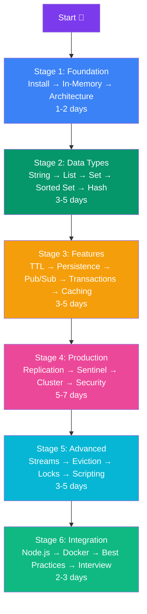
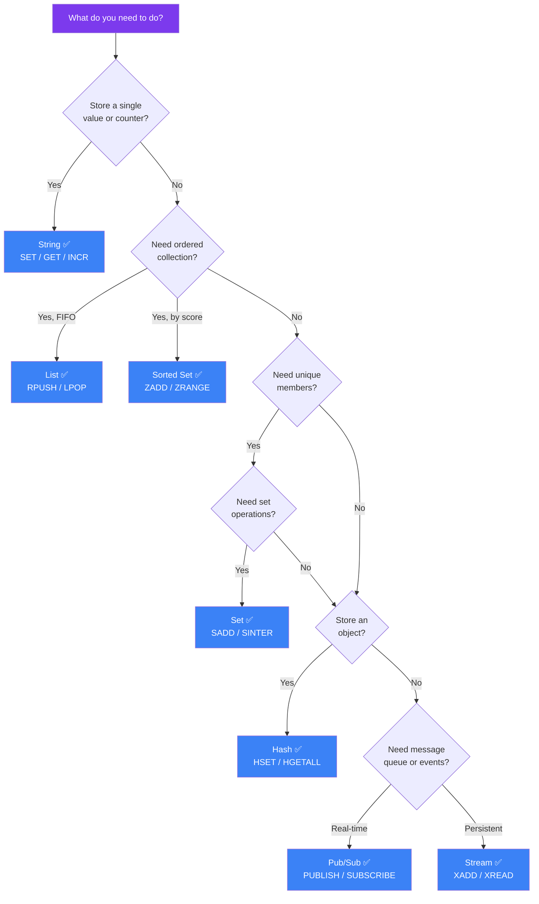

## 22. Summary & Learning Roadmap

### What You Have Learned

| Topic | Covered |
|---|---|
| What Redis is and why it exists | ✅ |
| In-memory vs disk storage | ✅ |
| Redis architecture | ✅ |
| Installing Redis | ✅ |
| All major data types | ✅ |
| Key expiration and TTL | ✅ |
| Persistence (RDB & AOF) | ✅ |
| Pub/Sub messaging | ✅ |
| Transactions | ✅ |
| Caching patterns | ✅ |
| Redis with Node.js | ✅ |
| Redis with Docker | ✅ |
| Best practices & mistakes | ✅ |

---

### Learning Roadmap

> **Estimated total:** 2–4 weeks to go from zero to production-ready Redis knowledge.

---

### Quick Reference Cards

**When to use each data type:**

| You need to… | Use |
|---|---|
| Store a value with TTL | String |
| Count something atomically | String + INCR |
| Implement a queue | List |
| Store an activity feed | List |
| Track unique items | Set |
| Compute overlaps between groups | Set (SINTER/SUNION) |
| Build a leaderboard | Sorted Set |
| Store object attributes | Hash |
| Real-time broadcasting | Pub/Sub |
| Durable message queue | Stream |

---

### Data Type Decision Guide

---

### Final Tips

**When to use each data type:**

| You need to… | Use |
|---|---|
| Store a value with TTL | String |
| Count something atomically | String + INCR |
| Implement a queue | List |
| Store an activity feed | List |
| Track unique items | Set |
| Compute overlaps between groups | Set (SINTER/SUNION) |
| Build a leaderboard | Sorted Set |
| Store object attributes | Hash |
| Real-time broadcasting | Pub/Sub |
| Durable message queue | Stream |

---

### Final Tips

> 🎯 **Start small.** Add Redis caching to one slow API endpoint and measure the improvement.

> 🔑 **Key naming is everything.** Establish a naming convention before you write a single line of code.

> ⏰ **TTL everywhere.** If you are not sure, set a TTL. You can always adjust it later.

> 📊 **Monitor in production.** Use `INFO`, `MONITOR`, and `SLOWLOG` to understand real-world Redis behavior.

> 🔄 **Redis is not a replacement.** Use Redis alongside your primary database, not instead of it.

---

*Documentation version: 1.0 | Last updated: 2024 | Based on Redis 7.x*
