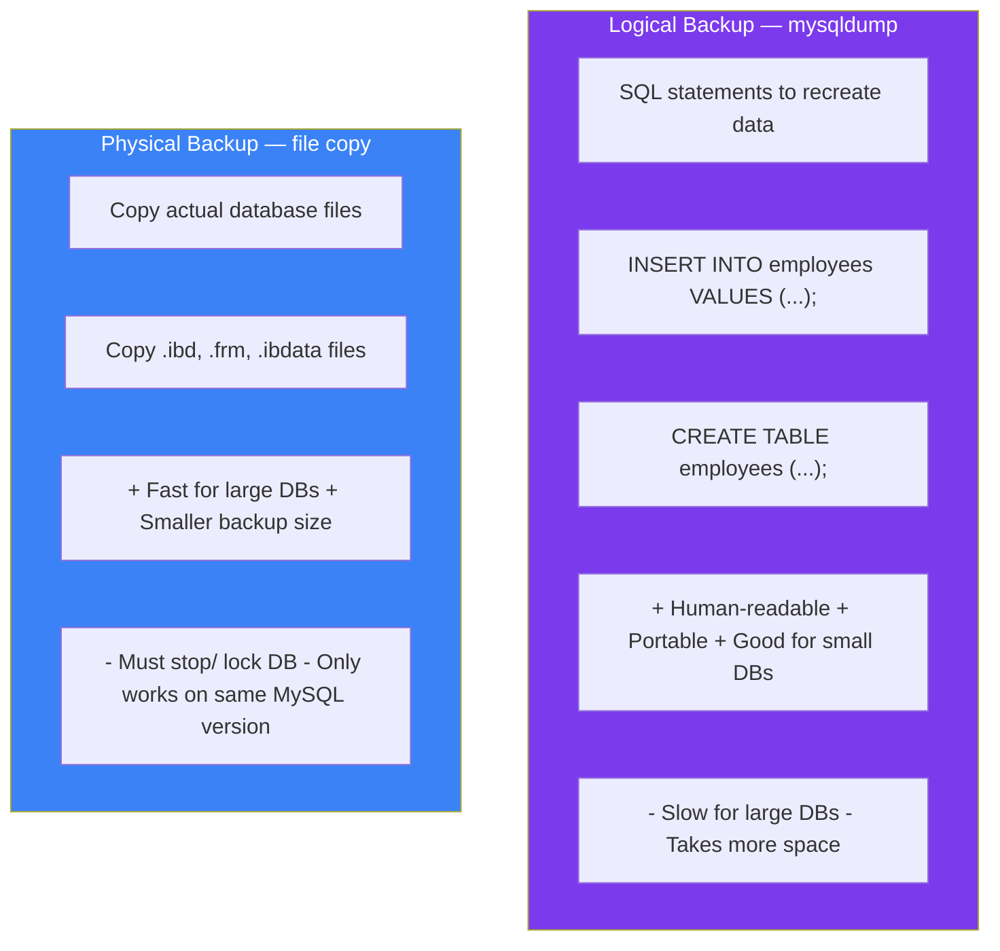

## Backup & Restore

Backups are your **safety net**. Without them, a crashed server means lost data. Let's look at the main tools and strategies.

### Real-World Analogy

Think of **saving a document**:

- **Logical backup** (mysqldump) = Copy-paste the text into a new file
- **Physical backup** = Save the entire document file with formatting, images, everything
- **Binary log** = The "undo/redo" history — every change ever made

### mysqldump — The Most Common Tool

```bash
# Backup a single database
mysqldump -u root -p company_db > company_db_backup.sql

# Backup multiple databases
mysqldump -u root -p --databases db1 db2 > multi_db_backup.sql

# Backup all databases
mysqldump -u root -p --all-databases > full_backup.sql

# Backup with specific options
mysqldump -u root -p \
    --single-transaction \     # consistent backup without locking (InnoDB)
    --routines \               # include stored procedures
    --triggers \               # include triggers
    --events \                 # include events
    --hex-blob \               # backup binary data safely
    company_db > backup.sql

# Compress the backup (saves disk space)
mysqldump -u root -p company_db | gzip > company_db_backup.sql.gz

# Backup with timestamp
mysqldump -u root -p company_db > backup_$(date +%Y%m%d_%H%M%S).sql
```

### Restoring from mysqldump

```bash
# Restore a database
mysql -u root -p company_db < company_db_backup.sql

# Restore from compressed backup
gunzip < company_db_backup.sql.gz | mysql -u root -p company_db

# Restore an entire dump (with CREATE DATABASE statements)
mysql -u root -p < full_backup.sql
```

### Logical vs Physical Backup



### Backup Strategies

```text
Small databases (< 1GB):
  mysqldump daily, keep 7 days
  Command: mysqldump -u root -p company_db | gzip > daily_$(date +%Y%m%d).sql.gz

Medium databases (1-50 GB):
  mysqldump daily + binary logs for point-in-time recovery
  Keep weekly full + daily incremental

Large databases (> 50 GB):
  Use MySQL Enterprise Backup or Percona XtraBackup (physical)
  Keep weekly full + daily incremental

Critical databases (production):
  Automated daily backups + binary logs (every 5 minutes)
  Off-site storage (cloud/S3)
  Regular restore testing!
```

### Point-in-Time Recovery

```bash
# Step 1: Take a full backup
mysqldump -u root -p --all-databases --flush-logs > full_backup.sql

# Step 2: Binary logs record all changes since backup
# Binary log location (check my.cnf):
# log_bin = /var/log/mysql/mysql-bin.log

# Step 3: Restore to a specific point in time
mysql -u root -p < full_backup.sql
mysqlbinlog --stop-datetime="2024-12-25 10:30:00" mysql-bin.000001 | mysql -u root -p
```

### mysqlcheck — Check and Repair

```bash
# Check all tables in a database
mysqlcheck -u root -p company_db

# Check all databases
mysqlcheck -u root -p --all-databases

# Repair damaged tables
mysqlcheck -u root -p --repair company_db
```

### Backup Best Practices

```text
✅ Automate backups with cron/scheduler
✅ Store backups off-site (different server/cloud)
✅ Test restore process regularly (backup is useless if you can't restore!)
✅ Monitor backup size and completion
✅ Encrypt sensitive backups
✅ Keep multiple backup versions (not just the latest)
✅ Document the restore procedure

Backup Schedule Template:
  Hourly:      binary log backup (for point-in-time recovery)
  Daily:       incremental backup
  Weekly:      full backup
  Monthly:     full backup stored for 12 months
```

---

### In Simple Words

- **mysqldump** creates a text file with SQL commands — great for small/medium databases
- **Physical backup** copies the actual database files — faster for large databases
- **Binary logs** record every change — enables point-in-time recovery
- Your backup is only as good as your **last successful restore test**
- **3-2-1 rule**: 3 copies, 2 different media, 1 off-site
