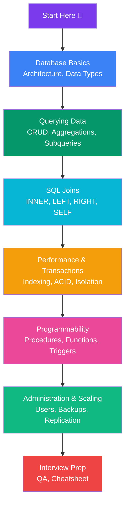

# SQL / MySQL

Complete MySQL preparation notes covering queries, joins, schema design, indexing, and interview questions.

## Learning Path

## Sections

### 🏗️ Database Basics
- [Database & RDBMS Basics](/DSA-Notes-Problems/sql/database-rdbms-basics) — What is a database, SQL sublanguages
- [MySQL Architecture](/DSA-Notes-Problems/sql/mysql-architecture) — Client-server, InnoDB vs MyISAM
- [Data Types](/DSA-Notes-Problems/sql/data-types) — Numeric, string, date types
- [Keys & Constraints](/DSA-Notes-Problems/sql/keys-constraints) — PK, FK, unique, composite keys, ON DELETE/UPDATE
- [Normalization](/DSA-Notes-Problems/sql/normalization) — 1NF, 2NF, 3NF, BCNF with examples

### 🔍 Querying Data
- [CRUD Operations](/DSA-Notes-Problems/sql/crud-operations) — INSERT, SELECT, UPDATE, DELETE
- [Aggregations & Functions](/DSA-Notes-Problems/sql/aggregations-functions) — COUNT, SUM, AVG, string/date functions
- [Subqueries & CTEs](/DSA-Notes-Problems/sql/subqueries-ctes) — Scalar, correlated, recursive CTEs
- [Views](/DSA-Notes-Problems/sql/views) — Virtual tables, updatable views, WITH CHECK OPTION
- [Window Functions](/DSA-Notes-Problems/sql/window-functions) — ROW_NUMBER, RANK, DENSE_RANK, LAG/LEAD
- [Set Operations](/DSA-Notes-Problems/sql/set-operations) — UNION, INTERSECT, EXCEPT
- [CASE & Conditional Logic](/DSA-Notes-Problems/sql/case-and-conditional-logic) — CASE WHEN, COALESCE, NULLIF
- [Query Execution Order](/DSA-Notes-Problems/sql/query-execution-order) — FROM → WHERE → GROUP BY → HAVING → SELECT
- [NULL Handling](/DSA-Notes-Problems/sql/null-handling) — NULL traps, comparisons, aggregates, NOT IN

### 🔗 Joins
- [Joins Overview](/DSA-Notes-Problems/sql/joins) — Visual guide to all join types
- [INNER JOIN](/DSA-Notes-Problems/sql/inner-join) — Only matched rows from both tables
- [LEFT JOIN](/DSA-Notes-Problems/sql/left-join-left-outer-join) — All left rows + matched right
- [RIGHT JOIN](/DSA-Notes-Problems/sql/right-join-right-outer-join) — All right rows + matched left
- [FULL OUTER JOIN](/DSA-Notes-Problems/sql/full-outer-join) — All rows from both (MySQL UNION workaround)
- [CROSS JOIN](/DSA-Notes-Problems/sql/cross-join) — Every combination (Cartesian product)
- [SELF JOIN](/DSA-Notes-Problems/sql/self-join) — Table joined to itself
- [Exclusion Joins](/DSA-Notes-Problems/sql/exclusion-joins-anti-joins) — Anti-join patterns (NOT IN, NOT EXISTS)
- [JOIN Conditions & Pitfalls](/DSA-Notes-Problems/sql/join-conditions-pitfalls) — Common JOIN mistakes

### ⚡ Performance & Transactions
- [Indexing](/DSA-Notes-Problems/sql/indexing) — B-Tree, clustered vs non-clustered, covering indexes
- [EXPLAIN & Query Optimization](/DSA-Notes-Problems/sql/explain-query-optimization) — Reading EXPLAIN, access types
- [Performance Optimization](/DSA-Notes-Problems/sql/performance-optimization) — Query, schema, and config optimization
- [Transactions & ACID](/DSA-Notes-Problems/sql/transactions-acid-properties) — ACID, COMMIT, ROLLBACK, SAVEPOINT
- [Isolation Levels & Deadlocks](/DSA-Notes-Problems/sql/isolation-levels-and-deadlocks) — 4 levels, anomalies, deadlock prevention
- [Locks](/DSA-Notes-Problems/sql/locks) — Shared/exclusive, row-level vs table-level

### ⚙️ Programmability
- [Stored Procedures & Functions](/DSA-Notes-Problems/sql/stored-procedures-functions) — CREATE PROCEDURE, control flow, functions
- [Triggers](/DSA-Notes-Problems/sql/triggers) — BEFORE/AFTER INSERT/UPDATE/DELETE

### 🛠️ Administration & Scaling
- [Users & Privileges](/DSA-Notes-Problems/sql/users-and-privileges) — CREATE USER, GRANT/REVOKE, roles
- [Backup & Restore](/DSA-Notes-Problems/sql/backup-and-restore) — mysqldump, logical vs physical backups
- [Replication](/DSA-Notes-Problems/sql/replication) — Primary → replica, read scaling, binary logs
- [Partitioning & Sharding](/DSA-Notes-Problems/sql/partitioning-and-sharding) — Table partitioning, horizontal sharding
- [JSON & Full-Text Search](/DSA-Notes-Problems/sql/json-and-fulltext) — JSON columns, FULLTEXT indexes, MATCH AGAINST

### 📖 Interview & Revision
- [MySQL Interview Prep](/DSA-Notes-Problems/sql/interview-prep) — Comprehensive Q&A with visuals
- [Common Interview Questions](/DSA-Notes-Problems/sql/common-interview-questions-answers) — Top interview questions with solutions
- [Quick Revision Cheat Sheet](/DSA-Notes-Problems/sql/quick-revision-cheat-sheet) — Quick reference for revision
- [Quick Reference Summary](/DSA-Notes-Problems/sql/quick-reference-summary) — Summary of key SQL concepts
- [Choosing the Right Join](/DSA-Notes-Problems/sql/choosing-the-right-join-decision-guide) — Decision guide for join types
- [JOIN Conditions & Pitfalls](/DSA-Notes-Problems/sql/join-conditions-pitfalls) — Common JOIN mistakes and fixes
