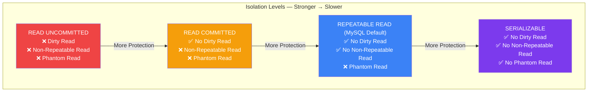
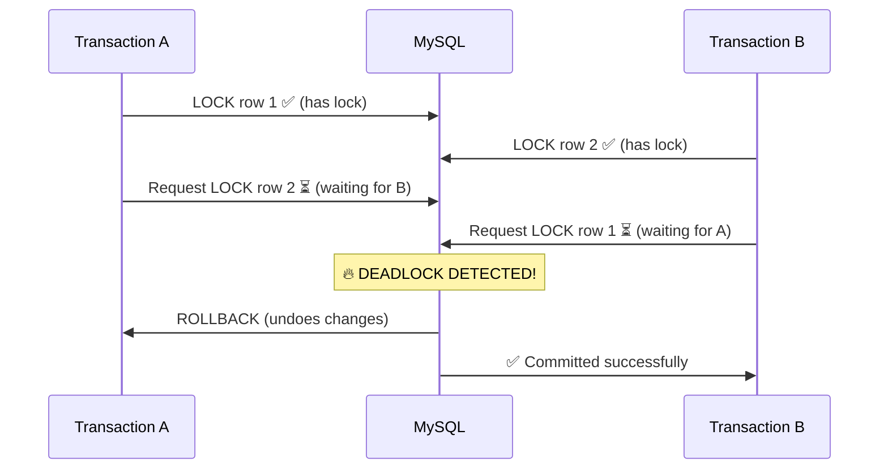

## Isolation Levels & Deadlocks

Isolation levels control **how much transactions can see each other's changes**. Deadlocks happen when **two transactions wait on each other's locks**.

### Real-World Analogy

Imagine a **shared whiteboard** in an office:

| Level | What You Can See | Problem |
|-------|-----------------|---------|
| **Read Uncommitted** | See someone's rough sketches before they're final | They might erase it! |
| **Read Committed** | Only see final drawings | Someone might update it later |
| **Repeatable Read** | Everything looks the same throughout your meeting | New items might appear |
| **Serializable** | One person at a time — no surprises! | Everyone must wait their turn |

### The 4 Isolation Levels



### What the Anomalies Look Like

**Dirty Read — Reading Uncommitted Data:**

```text
Transaction A:              Transaction B:
1. UPDATE salary = 90000    
2.                           SELECT salary → 90000 (reads uncommitted!)
3. ROLLBACK (salary back to 50000)
                            → B used data that never existed! ❌
```

**Non-Repeatable Read — Same Row, Different Values:**

```text
Transaction A:              Transaction B:
1. SELECT salary → 50000    
2.                           UPDATE salary = 90000
3.                           COMMIT
4. SELECT salary → 90000 (different from step 1!)
                            → Inconsistent read within same transaction ❌
```

**Phantom Read — New Rows Appear:**

```text
Transaction A:              Transaction B:
1. SELECT * FROM employees
   WHERE dept = 'IT' → 5 rows
2.                           INSERT new employee in IT
3.                           COMMIT
4. SELECT * FROM employees
   WHERE dept = 'IT' → 6 rows (phantom!)
                            → New row appeared! ❌
```

### Isolation Level Comparison

| Level | Dirty Read | Non-Repeatable Read | Phantom Read | Performance |
|-------|-----------|---------------------|--------------|-------------|
| READ UNCOMMITTED | ✅ Possible | ✅ Possible | ✅ Possible | ⚡ Fastest |
| READ COMMITTED | ❌ Prevented | ✅ Possible | ✅ Possible | ⚡ Fast |
| REPEATABLE READ (default) | ❌ Prevented | ❌ Prevented | ✅ Possible | 🐢 Slower |
| SERIALIZABLE | ❌ Prevented | ❌ Prevented | ❌ Prevented | 🐌 Slowest |

```sql
-- Set isolation level for a session
SET TRANSACTION ISOLATION LEVEL READ COMMITTED;

-- Set globally (careful!)
SET GLOBAL TRANSACTION ISOLATION LEVEL READ COMMITTED;

-- Check current isolation level
SELECT @@transaction_isolation;
-- MySQL default: REPEATABLE READ
```

### Deadlocks

A **deadlock** occurs when two transactions each hold a lock the other needs.

**The Deadlock Scenario:**



```sql
-- Transaction A:
START TRANSACTION;
UPDATE accounts SET balance = balance - 500 WHERE id = 1;  -- locks row 1
-- ... some work ...
UPDATE accounts SET balance = balance + 500 WHERE id = 2;  -- waits for row 2
COMMIT;

-- Transaction B (running at the same time):
START TRANSACTION;
UPDATE accounts SET balance = balance - 300 WHERE id = 2;  -- locks row 2
-- ... some work ...
UPDATE accounts SET balance = balance + 300 WHERE id = 1;  -- waits for row 1
COMMIT;

-- Result: DEADLOCK 🚫
-- MySQL automatically detects and rolls back the transaction that did less work
```

### How MySQL Handles Deadlocks

```sql
-- Check for deadlock information
SHOW ENGINE INNODB STATUS;
-- Look for: "LATEST DETECTED DEADLOCK" section

-- MySQL's response:
-- 1. Detects deadlock automatically (every ~1ms)
-- 2. Chooses the "victim" (transaction with less work done)
-- 3. Rolls back the victim transaction
-- 4. Returns error: "Deadlock found when trying to get lock"
-- 5. The other transaction completes normally
```

### Preventing Deadlocks

```text
✅ Always lock tables in the SAME ORDER:
   ❌ Bad:  TxA locks A then B, TxB locks B then A
   ✅ Good: Both lock A then B

✅ Keep transactions SHORT:
   ❌ Bad: Start transaction, go make coffee, then commit
   ✅ Good: Start → work → commit immediately

✅ Use appropriate isolation level:
   READ COMMITTED has fewer locks than REPEATABLE READ

✅ Use indexes:
   Without indexes, MySQL locks more rows than necessary

✅ Avoid user interaction inside transactions:
   Don't prompt for input — that keeps locks open!

// Example of safe locking order:
START TRANSACTION;
-- Always lock accounts in ID order
UPDATE accounts SET balance = balance - 500 WHERE id = 1;
UPDATE accounts SET balance = balance + 500 WHERE id = 2;
COMMIT;
```

### Error Handling for Deadlocks

```python
# Application-level retry logic
max_retries = 3
for attempt in range(max_retries):
    try:
        cursor.execute("START TRANSACTION")
        cursor.execute("UPDATE accounts ...")
        cursor.execute("UPDATE accounts ...")
        connection.commit()
        break  # success!
    except MySQLdb.Error as e:
        if e.args[0] == 1213:  # Deadlock error code
            connection.rollback()
            time.sleep(0.5 * (attempt + 1))  # wait before retry
            continue
        else:
            raise
```

---

### In Simple Words

- **Isolation levels** control how transactions interfere with each other — stronger = slower but safer
- **READ UNCOMMITTED** = no protection; **READ COMMITTED** = no dirty reads; **REPEATABLE READ** (default) = consistent reads; **SERIALIZABLE** = full protection, slowest
- A **deadlock** is two transactions waiting on each other's locks — MySQL detects and kills one
- **Prevent deadlocks** by locking resources in the same order, keeping transactions short, and using indexes
- Always implement **retry logic** in your application for deadlock errors
