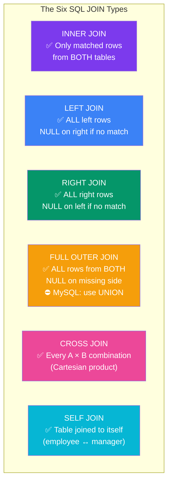
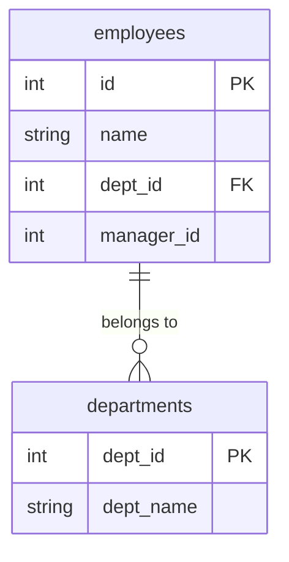

## 6. Joins

# SQL Joins — Complete Visual Guide

---

## Setup: The Sample Data

Before diving in, here are the two tables used throughout all examples. Refer back here whenever you need to trace a result.

### The Six Joins at a Glance



---

### Sample Data Setup



```
Table A — employees                    Table B — departments
┌────┬────────┬─────────┬────────────┐  ┌─────────┬────────────┐
│ id │  name  │ dept_id │ manager_id │  │ dept_id │  dept_name │
├────┼────────┼─────────┼────────────┤  ├─────────┼────────────┤
│  1 │ Alice  │    1    │    NULL    │  │    1    │ Engineering│
│  2 │ Bob    │    2    │      1     │  │    2    │  Marketing │
│  3 │ Carol  │   NULL  │      1     │  │    3    │   Finance  │
│  4 │ David  │    4    │      2     │  └─────────┴────────────┘
└────┴────────┴─────────┴────────────┘
```

**Three edge cases that matter:**
- `Carol` has `dept_id = NULL` — she has no department assigned
- `David` has `dept_id = 4` — that department does not exist in the departments table
- `Finance` (dept_id 3) has no employees assigned to it

These three cases determine what each join type includes or excludes.

---