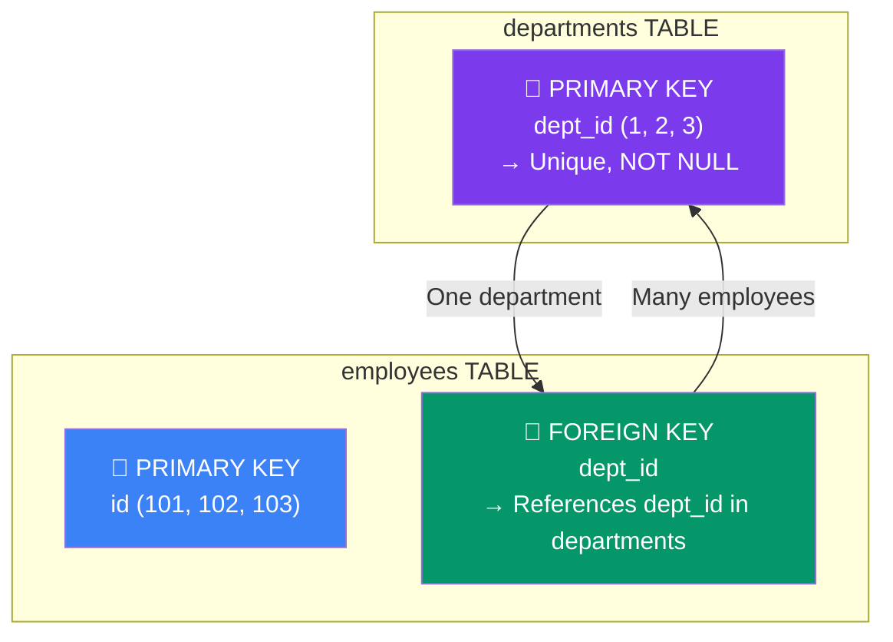

## 5. Keys & Constraints

### Types of Keys

### Primary Key ↔ Foreign Key Relationship



---

```
PRIMARY KEY
├── Uniquely identifies each row
├── Cannot be NULL
├── Only ONE per table
└── Creates a Clustered Index automatically

UNIQUE KEY
├── Ensures all values in column are unique
├── Can be NULL (multiple NULLs allowed)
└── Multiple per table allowed

FOREIGN KEY
├── Links to PRIMARY KEY in another table
├── Enforces referential integrity
└── Can be NULL (optional relationship)

COMPOSITE KEY
├── Primary key made of multiple columns
└── Combination must be unique

CANDIDATE KEY
└── Any column(s) that COULD be a primary key

SURROGATE KEY
└── Artificial PK (AUTO_INCREMENT id) — no business meaning

NATURAL KEY
└── PK derived from real-world data (e.g., SSN, email)
```

### Defining Keys

```sql
-- Primary Key
CREATE TABLE departments (
    dept_id   INT AUTO_INCREMENT PRIMARY KEY,
    dept_name VARCHAR(100) NOT NULL
);

-- Foreign Key
CREATE TABLE employees (
    id      INT AUTO_INCREMENT PRIMARY KEY,
    name    VARCHAR(100),
    dept_id INT,
    CONSTRAINT fk_dept
        FOREIGN KEY (dept_id)
        REFERENCES departments(dept_id)
        ON DELETE SET NULL    -- options: CASCADE, SET NULL, RESTRICT, NO ACTION
        ON UPDATE CASCADE
);

-- Composite Primary Key
CREATE TABLE order_items (
    order_id   INT,
    product_id INT,
    quantity   INT,
    PRIMARY KEY (order_id, product_id)  -- composite
);

-- Unique Key
ALTER TABLE employees ADD CONSTRAINT uq_email UNIQUE (email);
```

### ON DELETE / ON UPDATE Options

| Option | Behavior |
|---|---|
| `CASCADE` | Delete/update child rows automatically |
| `SET NULL` | Set FK column to NULL in child |
| `RESTRICT` | Prevent delete/update if child rows exist |
| `NO ACTION` | Same as RESTRICT (default) |
| `SET DEFAULT` | Set FK to default value (rarely used) |

### Constraints

```sql
CREATE TABLE products (
    id          INT AUTO_INCREMENT PRIMARY KEY,
    name        VARCHAR(100) NOT NULL,              -- NOT NULL
    price       DECIMAL(10,2) NOT NULL,
    stock       INT DEFAULT 0,                      -- DEFAULT
    category    ENUM('electronics','clothing','food'),
    sku         VARCHAR(50) UNIQUE,                 -- UNIQUE
    discount    DECIMAL(5,2) CHECK (discount >= 0 AND discount <= 100), -- CHECK (MySQL 8.0.16+)
    created_at  TIMESTAMP DEFAULT CURRENT_TIMESTAMP
);
```

---