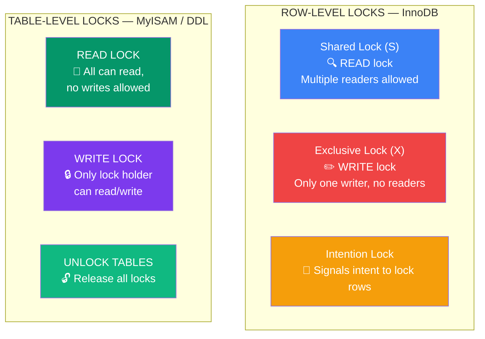

## 10. Locks

### Lock Types



```
ROW-LEVEL LOCK (InnoDB)
├── Shared Lock (S)     → READ lock — multiple readers allowed
├── Exclusive Lock (X)  → WRITE lock — only one writer, no readers
└── Intention Lock      → signals intent to lock rows in a table

TABLE-LEVEL LOCK (MyISAM / InnoDB DDL)
├── READ LOCK  → all sessions can read, no writes
└── WRITE LOCK → only lock holder can read/write
```

```sql
-- Shared lock (read lock)
SELECT * FROM accounts WHERE id = 1 LOCK IN SHARE MODE;
-- Other sessions can also read, but cannot write

-- Exclusive lock (write lock)
SELECT * FROM accounts WHERE id = 1 FOR UPDATE;
-- Only this session can read/write this row

-- Table lock (manual)
LOCK TABLES employees READ;
LOCK TABLES employees WRITE;
UNLOCK TABLES;
```

> 📖 **Deadlocks are covered in detail on the [Isolation Levels & Deadlocks page →](/DSA-Notes-Problems/sql/isolation-levels-and-deadlocks)**

---