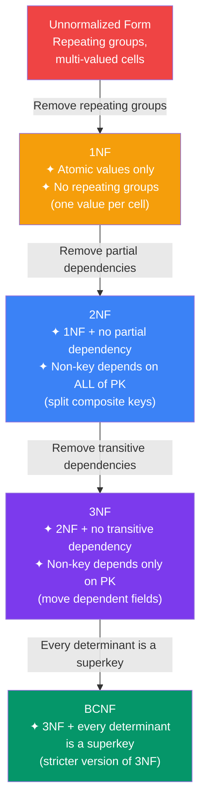

## 8. Normalization

### What is Normalization?
The process of organizing a database to **reduce redundancy** and **improve data integrity** by dividing tables and defining relationships.

### Normalization Steps



---

### Unnormalized Table (Example)

```
┌────┬──────────┬───────────────────────┬──────────────────────────────┐
│ id │ student  │        courses        │          teachers            │
├────┼──────────┼───────────────────────┼──────────────────────────────┤
│  1 │ Alice    │ Math, Physics         │ Mr. Roy, Dr. Singh           │
│  2 │ Bob      │ Math, Chemistry       │ Mr. Roy, Dr. Mehta           │
│  3 │ Alice    │ Chemistry             │ Dr. Mehta                    │
└────┴──────────┴───────────────────────┴──────────────────────────────┘
Problems: Multi-valued cells, data duplication
```

---

### 1NF — First Normal Form
**Rule:** Each column must contain **atomic (indivisible) values**. No repeating groups.

```sql
-- ❌ Violates 1NF (multi-valued column)
┌────┬─────────┬──────────────────────┐
│ id │ student │       courses        │
├────┼─────────┼──────────────────────┤
│  1 │ Alice   │ Math, Physics        │  ← not atomic!

-- ✅ 1NF compliant
┌────┬─────────┬───────────┐
│ id │ student │  course   │
├────┼─────────┼───────────┤
│  1 │ Alice   │ Math      │
│  2 │ Alice   │ Physics   │
│  3 │ Bob     │ Math      │
│  4 │ Bob     │ Chemistry │
```

---

### 2NF — Second Normal Form
**Rule:** Must be in 1NF + **no partial dependency** (non-key column depends on part of composite key).

```
-- ❌ Violates 2NF
Table: enrollment(student_id, course_id, student_name, course_name, grade)
                  [─────────── composite PK ──────────]
student_name depends only on student_id   ← partial dependency!
course_name  depends only on course_id    ← partial dependency!

-- ✅ 2NF compliant
students(student_id PK, student_name)
courses(course_id PK, course_name)
enrollment(student_id FK, course_id FK, grade)  ← only grade depends on full PK
```

---

### 3NF — Third Normal Form
**Rule:** Must be in 2NF + **no transitive dependency** (non-key column depends on another non-key column).

```
-- ❌ Violates 3NF
employees(emp_id PK, name, dept_id, dept_name)
dept_name depends on dept_id, which is not the PK ← transitive dependency!

-- ✅ 3NF compliant
employees(emp_id PK, name, dept_id FK)
departments(dept_id PK, dept_name)
```

---

### BCNF — Boyce-Codd Normal Form
**Rule:** Stricter version of 3NF — for every dependency X → Y, X must be a **superkey**.

```
-- ❌ Violates BCNF
course_teacher(student, course, teacher)
  Dependency: teacher → course (teacher teaches only one course)
  But teacher is NOT a superkey

-- ✅ BCNF compliant
teacher_course(teacher PK, course)
student_teacher(student, teacher FK)
```

### Normalization Summary

| Form | Rule |
|---|---|
| 1NF | Atomic values, no repeating groups |
| 2NF | 1NF + no partial dependencies |
| 3NF | 2NF + no transitive dependencies |
| BCNF | 3NF + every determinant is a superkey |

> **Interview Tip:** In practice, most production databases target **3NF**. Sometimes you **denormalize** intentionally for read performance (e.g., data warehouses use star schema).

---