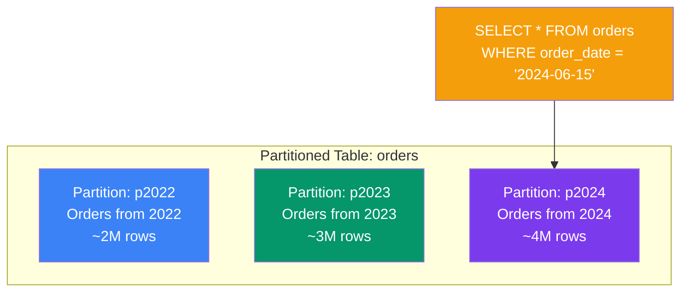

## Partitioning & Sharding

When a single table gets **too big** (millions or billions of rows), you can split it. **Partitioning** splits within one server; **sharding** splits across multiple servers.

### Real-World Analogy

Think of a **huge filing cabinet**:

- **No partitioning**: All papers in one giant drawer. Finding anything is slow.
- **Partitioning**: Papers split by year into labeled drawers. Still one cabinet.
- **Sharding**: Papers split across multiple cabinets in different rooms. Each cabinet has its own drawers.

### Partitioning (Splitting a Table on One Server)



### Range Partitioning

```sql
-- Split orders by year
CREATE TABLE orders (
    id          BIGINT AUTO_INCREMENT,
    order_date  DATE,
    customer_id INT,
    amount      DECIMAL(10,2),
    PRIMARY KEY (id, order_date)  -- partition key must be in PK!
)
PARTITION BY RANGE (YEAR(order_date)) (
    PARTITION p2022 VALUES LESS THAN (2023),
    PARTITION p2023 VALUES LESS THAN (2024),
    PARTITION p2024 VALUES LESS THAN (2025),
    PARTITION p_future VALUES LESS THAN MAXVALUE
);
```

### Other Partitioning Types

```sql
-- LIST Partitioning (by specific values)
CREATE TABLE employees (
    id INT,
    name VARCHAR(50),
    department VARCHAR(20)
)
PARTITION BY LIST COLUMNS(department) (
    PARTITION p_tech VALUES IN ('Engineering', 'IT'),
    PARTITION p_biz VALUES IN ('Sales', 'Marketing'),
    PARTITION p_ops VALUES IN ('HR', 'Finance', 'Legal')
);

-- HASH Partitioning (even distribution)
CREATE TABLE logs (
    id INT AUTO_INCREMENT,
    created_at DATETIME,
    message TEXT
)
PARTITION BY HASH(id) PARTITIONS 4;
-- Data is distributed evenly across 4 partitions

-- KEY Partitioning (similar to HASH but uses MySQL's internal hash)
CREATE TABLE sessions (
    session_id VARCHAR(128),
    user_id INT,
    data JSON
)
PARTITION BY KEY(session_id) PARTITIONS 4;
```

### When to Partition

```text
✅ Partitioning helps when:
   - Table has > 10M rows
   - Queries filter by the partition key (e.g., date range)
   - Old data needs to be purged easily
   - You need to archive old partitions

❌ Partitioning doesn't help when:
   - Queries don't include the partition key
   - Table is small (< 1M rows)
   - You can solve the problem with indexes alone

Partition pruning:
  MySQL automatically skips irrelevant partitions
  E.g., querying only 2024 data → scans only p2024, not p2022/p2023
```

### Sharding (Splitting Across Servers)

```text
Sharding goes beyond partitioning — each shard is a separate MySQL server.

                    Application
                        │
            ┌───────────┴───────────┐
            │                       │
        Proxy/ Router           Proxy/ Router
            │                       │
    ┌───────┴───────┐       ┌───────┴───────┐
    │   Shard 1     │       │   Shard 2     │
    │  Users A-M     │       │  Users N-Z     │
    │  (Server 1)   │       │  (Server 2)   │
    └───────────────┘       └───────────────┘
```

| Feature | Partitioning | Sharding |
|---------|-------------|----------|
| Location | Single server | Multiple servers |
| Complexity | Low (built into MySQL) | High (application logic needed) |
| Query across all data | Still works | Very complex |
| When to use | Table > 10M rows | Dataset > 1TB or write throughput too high |

```text
Sharding approaches:
  1. Application-level sharding — code routes queries to the right shard
  2. Proxy-based sharding — tools like Vitess, ProxySQL, MySQL Router
  3. Vitess or other DB clusters — automate shard management

⚠️ Sharding adds significant complexity.
   Try indexing, partitioning, and replication before sharding!
```

### Partition Maintenance

```sql
-- Add a new partition
ALTER TABLE orders ADD PARTITION (
    PARTITION p2025 VALUES LESS THAN (2026)
);

-- Drop an old partition (super fast — no row-by-row DELETE!)
ALTER TABLE orders DROP PARTITION p2022;

-- Truncate a partition
ALTER TABLE orders TRUNCATE PARTITION p2023;

-- Split a partition
ALTER TABLE orders REORGANIZE PARTITION p_future INTO (
    PARTITION p2025 VALUES LESS THAN (2026),
    PARTITION p_future VALUES LESS THAN MAXVALUE
);

-- Check partition info
SELECT * FROM INFORMATION_SCHEMA.PARTITIONS
WHERE TABLE_NAME = 'orders';
```

---

### In Simple Words

- **Partitioning** splits a big table into smaller pieces on the **same server** — built into MySQL
- **Sharding** splits data across **multiple servers** — requires application changes
- **Range partitioning** by date is the most common — easy to add/drop partitions
- Partitioning helps when queries **filter by the partition key** (otherwise no benefit)
- Try **indexing → partitioning → replication → sharding** in that order before adding complexity
