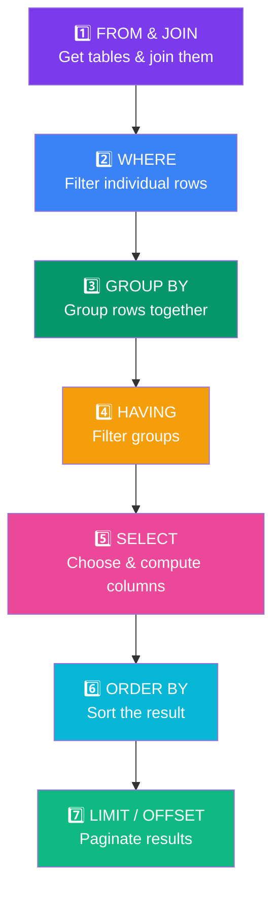

## Query Execution Order

SQL looks like it runs top-to-bottom, but it doesn't! The **logical execution order** is different from the **written order**.

### Real-World Analogy

Think of a **recipe assembly line**:

1. **FROM** — Get all ingredients from the pantry (tables)
2. **JOIN** — Combine ingredients from different shelves
3. **WHERE** — Remove ingredients you don't need (filter rows)
4. **GROUP BY** — Sort ingredients into bowls by type
5. **HAVING** — Remove bowls that don't meet criteria (filter groups)
6. **SELECT** — Decide what goes on the final plate (choose columns)
7. **ORDER BY** — Arrange the plate nicely (sort)
8. **LIMIT** — Only serve a few plates

### The Order



### Why This Matters

Understanding execution order helps you avoid common mistakes:

```sql
SELECT name, salary * 1.1 AS raised_salary
FROM employees
WHERE raised_salary > 80000;
-- ❌ ERROR! raised_salary is defined in SELECT (step 5)
--           but WHERE runs BEFORE SELECT (step 2)
--           WHERE can't see column aliases from SELECT!

-- ✅ Correct: use the original expression
SELECT name, salary * 1.1 AS raised_salary
FROM employees
WHERE salary * 1.1 > 80000;
```

### Written vs Actual Order

```text
Written Order (what you type):          Actual Execution Order:
──────────────────────────────          ──────────────────────
SELECT ...                              FROM / JOIN
FROM ...                                WHERE
JOIN ...                                GROUP BY
WHERE ...                               HAVING
GROUP BY ...                            SELECT
HAVING ...                              ORDER BY
ORDER BY ...                            LIMIT / OFFSET
LIMIT ...
```

### Key Takeaways by Example

```sql
-- 1. WHERE can't use aliases from SELECT
SELECT salary * 1.1 AS raised
FROM employees
WHERE raised > 80000;  -- ❌ ERROR (WHERE before SELECT)

-- 2. HAVING can use aliases from SELECT
SELECT department, AVG(salary) AS avg_sal
FROM employees
GROUP BY department
HAVING avg_sal > 70000;  -- ✅ OK (HAVING runs after SELECT)

-- 3. ORDER BY can use aliases (runs after SELECT)
SELECT name, salary * 1.1 AS raised
FROM employees
ORDER BY raised DESC;  -- ✅ OK (ORDER BY after SELECT)

-- 4. WHERE filters BEFORE GROUP BY
SELECT dept_id, COUNT(*) AS emp_count
FROM employees
WHERE salary > 50000       -- ← filters rows first
GROUP BY dept_id;           -- ← then groups remaining rows

-- 5. HAVING filters AFTER GROUP BY
SELECT dept_id, AVG(salary) AS avg_sal
FROM employees
GROUP BY dept_id
HAVING avg_sal > 70000;    -- ← filters groups
```

### Common Mistakes

| Mistake | Why It Fails |
|---------|-------------|
| `WHERE alias = value` | WHERE runs before SELECT, so aliases don't exist yet |
| `HAVING without GROUP BY` | HAVING is for filtering groups — use WHERE instead |
| `SELECT * ... LIMIT 1` works but `SELECT * ... GROUP BY` might not | Without aggregation, GROUP BY picks arbitrary rows |
| Using aggregate in WHERE | `WHERE AVG(salary) > 50000` — aggregates can only be in HAVING |

---

### In Simple Words

- SQL doesn't run **top-to-bottom** like you read it
- **FROM/JOIN** come first, **WHERE** filters rows, **GROUP BY** groups, **HAVING** filters groups, **SELECT** picks columns, **ORDER BY** sorts, **LIMIT** paginates
- **WHERE cannot use column aliases** from SELECT — use the original expression
- **HAVING can use aliases** — it runs after SELECT
- This is a **very common interview question**!
