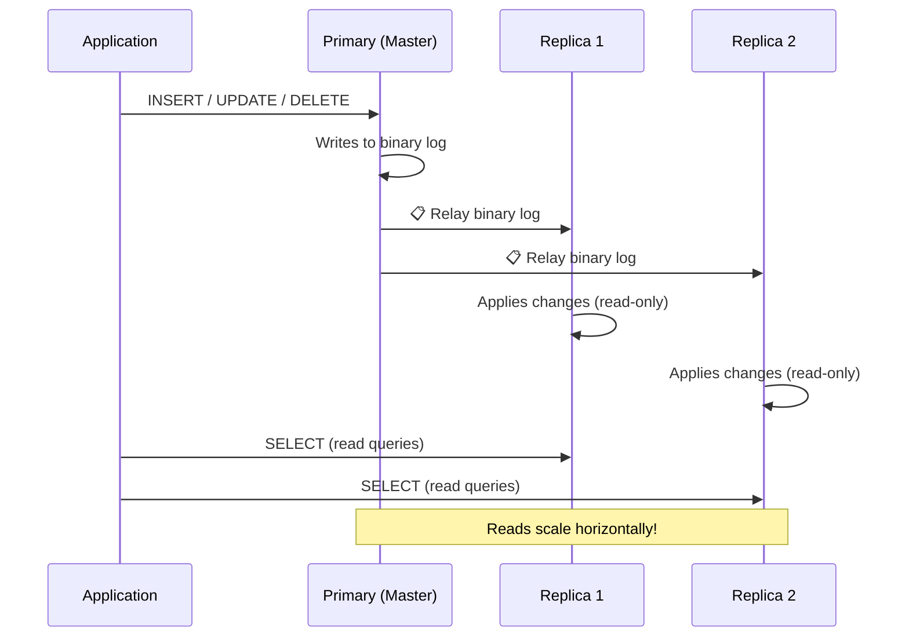

## Replication

Replication **copies data from one MySQL server (primary) to one or more servers (replicas)**. It's the foundation of high availability and read scaling.

### Real-World Analogy

Think of a **library with a master copy and photocopies**:

- **Primary (Master)**: The original reference book. All edits go here.
- **Replicas (Slaves)**: Photocopies of the book. Anyone can read them.
- If the original book gets destroyed, promote a photocopy to become the new original.

### How Replication Works



### Why Use Replication?

```text
1. READ SCALING 🚀
   Primary handles writes, replicas handle reads
   → More replicas = more read capacity

2. HIGH AVAILABILITY ✅
   If Primary fails, promote a Replica to become new Primary
   → Zero application downtime (with proper failover)

3. BACKUP ISOLATION 🔒
   Run backups on a replica instead of the primary
   → No performance impact on production

4. GEO-DISTRIBUTION 🌍
   Replicas in different regions → faster reads for global users
```

### Setting Up Replication

**Step 1: Configure the Primary**

```ini
# /etc/mysql/my.cnf (Primary)
[mysqld]
server-id = 1
log_bin = /var/log/mysql/mysql-bin.log
binlog_do_db = company_db  # database to replicate
```

```sql
-- Create a replication user on the primary
CREATE USER 'replicator'@'%' IDENTIFIED BY 'replica_password';
GRANT REPLICATION SLAVE ON *.* TO 'replicator'@'%';

-- Get primary's binary log position
SHOW MASTER STATUS;
-- File: mysql-bin.000001, Position: 12345
```

**Step 2: Configure the Replica**

```ini
# /etc/mysql/my.cnf (Replica)
[mysqld]
server-id = 2
relay-log = /var/log/mysql/mysql-relay-bin.log
read_only = 1  # prevent accidental writes on replica
```

```sql
-- On the replica, connect to the primary
CHANGE REPLICATION SOURCE TO
    SOURCE_HOST='primary_host',
    SOURCE_USER='replicator',
    SOURCE_PASSWORD='replica_password',
    SOURCE_LOG_FILE='mysql-bin.000001',
    SOURCE_LOG_POS=12345;

-- Start replication
START REPLICA;

-- Check replication status
SHOW REPLICA STATUS\G
-- Look for:
--   Replica_IO_Running: Yes
--   Replica_SQL_Running: Yes
--   Seconds_Behind_Source: 0
```

### Types of Replication

| Type | How It Works | Use Case |
|------|-------------|----------|
| **Async** (default) | Primary doesn't wait for replica | Best performance, slight lag |
| **Semi-sync** | Primary waits for at least one replica | Balance of speed and safety |
| **Group Replication** | Multiple primaries, consensus-based | High availability, multi-region |

### Read/Write Splitting

```text
Application
    │
    ├── All WRITES → Primary (INSERT, UPDATE, DELETE)
    │
    └── All READS  → Replicas (SELECT)
    
In code:
  - Configure two data sources
  - Route writes to primary connection
  - Route reads to replica connection
  - OR use a proxy like ProxySQL / MySQL Router
```

### Monitoring Replication

```sql
-- Check replica status (run on replica)
SHOW REPLICA STATUS\G

-- Key metrics to monitor:
--   Seconds_Behind_Source: should be close to 0
--   Replica_IO_Running: should be Yes
--   Replica_SQL_Running: should be Yes
--   Last_IO_Error: any connection issues
--   Last_SQL_Error: any query issues

-- Check binary log status (run on primary)
SHOW BINARY LOGS;
SHOW MASTER STATUS;

-- List all replicas connected to primary
SHOW REPLICAS;
```

### Common Issues

| Issue | Symptom | Fix |
|-------|---------|-----|
| Network lag | High `Seconds_Behind_Source` | Check network, add indexes |
| Corrupt relay log | `Replica_SQL_Running: No` | Skip bad query or re-sync |
| Duplicate key | SQL error on replica | `SET GLOBAL sql_slave_skip_counter = 1;` |
| Replica too far behind | Replication lag > hours | Rebuild replica from fresh backup |

---

### In Simple Words

- **Replication** copies data from the Primary to Replicas for read scaling and high availability
- **Primary** handles all writes; **Replicas** copy changes and can handle reads
- **Binary logs** record all changes on the Primary; Replicas read and apply them
- Use **read/write splitting** in your app to send writes to Primary and reads to Replicas
- Monitor `Seconds_Behind_Source` — if it grows, your replicas are falling behind
