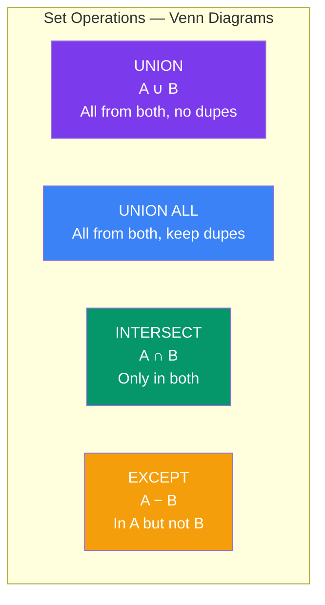

## Set Operations

Set operations **combine results from multiple SELECT queries** into a single result. They work on rows, not columns.

### Real-World Analogy

Think of two **guest lists**:

- **UNION**: Everyone who's on EITHER list (no duplicates)
- **UNION ALL**: Everyone on both lists (including duplicates)
- **INTERSECT**: People on BOTH lists
- **EXCEPT**: People on list A but NOT on list B

### Visual Guide



### Sample Data

```sql
-- Employees who know SQL
SELECT name FROM sql_team;
-- Alice, Bob, Carol

-- Employees who know Python
SELECT name FROM python_team;
-- Carol, David, Eve
```

### UNION vs UNION ALL

```sql
-- UNION: removes duplicates (slower — sorts to detect dupes)
SELECT name FROM sql_team
UNION
SELECT name FROM python_team;
-- Result: Alice, Bob, Carol, David, Eve  (Carol appears once)

-- UNION ALL: keeps duplicates (faster)
SELECT name FROM sql_team
UNION ALL
SELECT name FROM python_team;
-- Result: Alice, Bob, Carol, Carol, David, Eve  (Carol appears twice)
```

| Feature | UNION | UNION ALL |
|---------|-------|-----------|
| Duplicates | Removed | Kept |
| Performance | Slower (sorts to deduplicate) | Fast |
| Use when | You want distinct results | You know there are no duplicates |

### INTERSECT

```sql
-- Employees who know BOTH SQL AND Python
SELECT name FROM sql_team
INTERSECT
SELECT name FROM python_team;
-- Result: Carol  (only Carol is in both teams)
```

### EXCEPT

```sql
-- Employees who know SQL but NOT Python
SELECT name FROM sql_team
EXCEPT
SELECT name FROM python_team;
-- Result: Alice, Bob  (they know SQL but not Python)
```

### Rules for Set Operations

```text
1. Same number of columns in all SELECT statements
2. Corresponding columns must have compatible data types
3. Column names come from the FIRST SELECT
4. ORDER BY goes at the VERY END (applies to whole result)
```

```sql
-- ✅ Correct: same columns, same types
SELECT id, name FROM employees
UNION
SELECT id, name FROM contractors;

-- ❌ Wrong: different number of columns
SELECT id, name FROM employees
UNION
SELECT id FROM contractors;

-- ❌ Wrong: incompatible types
SELECT id, salary FROM employees
UNION
SELECT id, name FROM contractors;  -- salary vs name - types don't match
```

### ORDER BY with Set Operations

```sql
-- ORDER BY goes at the very end
SELECT name, salary FROM employees WHERE dept_id = 1
UNION
SELECT name, salary FROM employees WHERE dept_id = 2
ORDER BY salary DESC;

-- Use column position or alias from the first SELECT
SELECT name AS employee_name, salary
FROM employees WHERE dept_id = 1
UNION
SELECT name, salary FROM employees WHERE dept_id = 2
ORDER BY employee_name;
```

### Practical Examples

**Combine active and archived orders:**

```sql
SELECT id, customer_id, total, 'active' AS source
FROM orders
UNION ALL
SELECT id, customer_id, total, 'archived'
FROM orders_archive
ORDER BY id;
```

**Find customers who never ordered:**

```sql
-- Customers with no orders
SELECT id, name FROM customers
EXCEPT
SELECT customer_id, customer_name FROM orders;
```

**Find products in both categories (intersection):**

```sql
SELECT product_id FROM inventory
INTERSECT
SELECT product_id FROM current_promotions;
```

---

### In Simple Words

- **UNION** combines queries and removes duplicates; **UNION ALL** keeps them
- **INTERSECT** returns rows that exist in BOTH queries
- **EXCEPT** returns rows from the first query that are NOT in the second
- All SELECTs must have the **same number of columns** with **compatible types**
- **ORDER BY** goes at the very end — it sorts the final combined result
