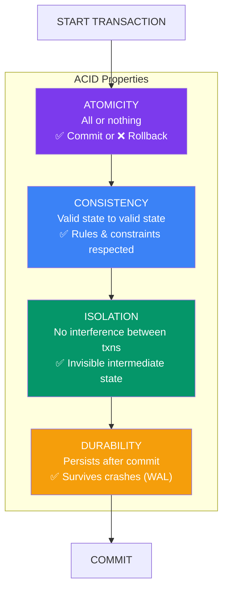

## 9. Transactions & ACID Properties

> 📖 **Isolation levels and deadlocks are covered in detail on the [Isolation Levels & Deadlocks page →](/DSA-Notes-Problems/sql/isolation-levels-and-deadlocks)**

### What is a Transaction?
A **transaction** is a sequence of SQL operations treated as a single logical unit. Either **all succeed** or **all fail**.

```sql
START TRANSACTION;

    UPDATE accounts SET balance = balance - 500 WHERE id = 1;  -- debit
    UPDATE accounts SET balance = balance + 500 WHERE id = 2;  -- credit

COMMIT;    -- make changes permanent

-- If anything fails:
ROLLBACK;  -- undo all changes in transaction
```

### ACID Properties



```
┌─────────────────────────────────────────────────────────────┐
│                    ACID PROPERTIES                          │
├──────────────┬──────────────────────────────────────────────┤
│ ATOMICITY    │ All or nothing — transaction fully completes  │
│              │ or fully rolls back. No partial updates.      │
├──────────────┼──────────────────────────────────────────────┤
│ CONSISTENCY  │ Database moves from one valid state to        │
│              │ another. All rules/constraints are respected. │
├──────────────┼──────────────────────────────────────────────┤
│ ISOLATION    │ Concurrent transactions don't interfere with  │
│              │ each other. Intermediate state is invisible.  │
├──────────────┼──────────────────────────────────────────────┤
│ DURABILITY   │ Once committed, changes persist even on       │
│              │ system crash (written to disk/WAL).           │
└──────────────┴──────────────────────────────────────────────┘
```

### Transaction Flow

```
BEGIN ──────────────────────────────────────────► COMMIT
  │                                                  │
  │    [SQL 1] → [SQL 2] → [SQL 3] → ...            │
  │                                                  ▼
  │                                          Changes are
  │                                          permanent
  │
  ▼
ROLLBACK
  │
  ▼
All changes undone
(returns to state before BEGIN)
```

### SAVEPOINT

```sql
START TRANSACTION;
    INSERT INTO orders VALUES (1, 'Alice', 500);
    SAVEPOINT sp1;

    INSERT INTO order_items VALUES (1, 'Laptop', 1, 500);
    SAVEPOINT sp2;

    -- Something goes wrong with payment
    ROLLBACK TO sp1;  -- undo only from sp1, keep order

COMMIT;
```

> 📖 **Isolation levels, anomalies, and deadlocks are now on the dedicated [Isolation Levels & Deadlocks page →](/DSA-Notes-Problems/sql/isolation-levels-and-deadlocks)**

---