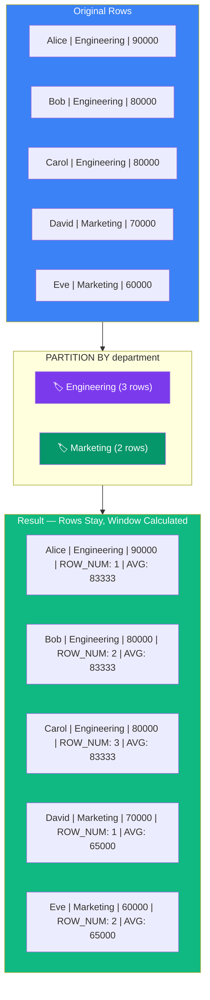

## Window Functions

Window functions let you **calculate across related rows** while keeping each row intact. Unlike `GROUP BY` which collapses rows, window functions keep all rows.

### Real-World Analogy

Think of **students taking a test**:

- **GROUP BY**: "Show me the average score per class" → collapses all students into one row per class
- **Window Function**: "Show me each student's score AND their class average on the same row" → keeps all students, adds extra info

### How Window Functions Work



### Basic Syntax

```sql
SELECT name, department, salary,
       window_function() OVER (
           PARTITION BY column   -- group into windows (like GROUP BY)
           ORDER BY column       -- order within each window
           frame_clause          -- which rows to include
       ) AS alias
FROM employees;
```

### ROW_NUMBER, RANK, DENSE_RANK

```sql
SELECT name, department, salary,
    ROW_NUMBER() OVER (PARTITION BY department ORDER BY salary DESC) AS row_num,
    RANK()        OVER (PARTITION BY department ORDER BY salary DESC) AS rank_num,
    DENSE_RANK()  OVER (PARTITION BY department ORDER BY salary DESC) AS dense_rank_num
FROM employees;
```

```text
Salaries per department: 90000, 80000, 80000, 70000

ROW_NUMBER:  1, 2, 3, 4   ← always unique, no ties
RANK:        1, 2, 2, 4   ← tie gets same rank, then SKIP
DENSE_RANK:  1, 2, 2, 3   ← tie gets same rank, no SKIP
```

### LAG and LEAD

Compare a row with the previous or next row:

```sql
SELECT name, salary, hire_date,
    LAG(salary, 1)  OVER (ORDER BY hire_date) AS prev_salary,
    LEAD(salary, 1) OVER (ORDER BY hire_date) AS next_salary,
    salary - LAG(salary, 1) OVER (ORDER BY hire_date) AS salary_change
FROM employees;
```

```text
┌────────┬────────┬──────────────┬──────────────┬──────────────┐
│ name   │ salary │ prev_salary  │ next_salary  │ change       │
├────────┼────────┼──────────────┼──────────────┼──────────────┤
│ Alice  │ 60000  │ NULL         │ 70000        │ NULL         │
│ Bob    │ 70000  │ 60000        │ 80000        │ +10000       │
│ Carol  │ 80000  │ 70000        │ 90000        │ +10000       │
│ David  │ 90000  │ 80000        │ NULL         │ +10000       │
└────────┴────────┴──────────────┴──────────────┴──────────────┘
```

### Running Totals

```sql
SELECT name, department, salary,
    SUM(salary) OVER (
        ORDER BY salary
        ROWS BETWEEN UNBOUNDED PRECEDING AND CURRENT ROW
    ) AS running_total,
    AVG(salary) OVER (PARTITION BY department) AS dept_avg
FROM employees;
```

### NTILE — Divide into Buckets

```sql
-- Split employees into 4 salary quartiles
SELECT name, salary,
    NTILE(4) OVER (ORDER BY salary DESC) AS quartile
FROM employees;
```

### FIRST_VALUE and LAST_VALUE

```sql
SELECT name, department, salary,
    FIRST_VALUE(name) OVER (PARTITION BY department ORDER BY salary DESC) AS highest_paid,
    LAST_VALUE(name)  OVER (PARTITION BY department ORDER BY salary DESC
        RANGE BETWEEN UNBOUNDED PRECEDING AND UNBOUNDED FOLLOWING) AS lowest_paid
FROM employees;
```

### Real-World Examples

**Top-N per group (e.g., top 2 salaries per department):**

```sql
SELECT name, department, salary
FROM (
    SELECT name, department, salary,
        DENSE_RANK() OVER (PARTITION BY department ORDER BY salary DESC) AS dr
    FROM employees
) ranked
WHERE dr <= 2;
```

**Year-over-year comparison:**

```sql
SELECT year, revenue,
    LAG(revenue, 1) OVER (ORDER BY year) AS prev_year_revenue,
    (revenue - LAG(revenue, 1) OVER (ORDER BY year)) / 
        LAG(revenue, 1) OVER (ORDER BY year) * 100 AS yoy_growth_pct
FROM yearly_sales;
```

**Cumulative percentage (running total / total):**

```sql
SELECT name, salary,
    SUM(salary) OVER (ORDER BY salary) AS running_total,
    ROUND(SUM(salary) OVER (ORDER BY salary) / SUM(salary) OVER () * 100, 2) AS cum_pct
FROM employees;
```

---

### In Simple Words

- Window functions **don't collapse rows** — each original row stays in the result
- `PARTITION BY` creates groups (like `GROUP BY` but doesn't collapse)
- `ORDER BY` inside `OVER()` defines the order within each window
- **ROW_NUMBER** = unique number per row; **RANK** = ties share rank, then skip; **DENSE_RANK** = ties share rank, no skip
- **LAG/LEAD** = compare with previous/next row
- Very common in **interview questions** — practice writing them!
