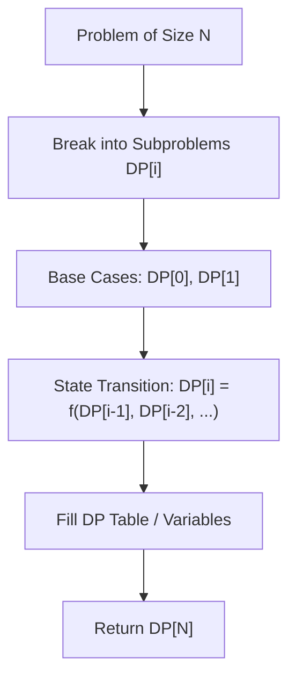

# Best Time to Buy and Sell Stock

<div style="display:flex; gap:0.5rem; margin-bottom:1.5rem; align-items:center;">
  <span style="background:#22c55e22; color:#22c55e; padding:2px 10px; borderRadius:12px; fontWeight:600; fontSize:0.85rem;">Easy</span>
  <span style="color:#64748b; fontSize:0.85rem;">Day 1 • Striver Blind 75</span>
</div>

## 📌 Problem Overview

You are given an array `prices` where `prices[i]` is the price of a given stock on day `i`.

You want to maximize your profit by choosing a single day to buy and a different day in the future to sell. Return the maximum profit. If no profit is possible, return `0`.

### Examples & Constraints
**Example 1:**
- **Input:** `prices = [7,1,5,3,6,4]`
- **Output:** `5`
- **Explanation:** Buy on day 2 (price = 1), sell on day 5 (price = 6), profit = 5.

**Example 2:**
- **Input:** `prices = [7,6,4,3,1]`
- **Output:** `0`
- **Explanation:** Prices only decrease, so no profit is possible.

**Constraints:**
- `1 ≤ prices.length ≤ 10⁵`
- `0 ≤ prices[i] ≤ 10⁴`

---

## 💡 Approach & Intuition

Best Time to Buy and Sell Stock is a one-pass sliding window: track the minimum price seen so far and the best profit achievable by selling today.

### 🎯 Pattern Recognition
**Pattern: Expanding Window with Running Min**

When you need the best pair (min, later max) in one pass, track the running minimum on the left and evaluate the profit at each right-side candidate.

---

## 📊 Step-by-Step Execution (Mermaid Diagram)



---

## 🐢 Brute Force Solution

### Code
```javascript
function maxProfit(prices) {
  let max = 0;
  for (let i = 0; i < prices.length; i++) {
    for (let j = i + 1; j < prices.length; j++) {
      max = Math.max(max, prices[j] - prices[i]);
    }
  }
  return max;
}
```

- **Time Complexity:** `O(n²)`
- **Space Complexity:** `O(1)`
- **Explanation:** Check every buy/sell pair.

---

## ⚡ Optimized Solution

### Code
```javascript
function maxProfit(prices) {
  let minSoFar = prices[0];
  let maxProfit = 0;
  for (let i = 1; i < prices.length; i++) {
    maxProfit = Math.max(maxProfit, prices[i] - minSoFar);
    minSoFar = Math.min(minSoFar, prices[i]);
  }
  return maxProfit;
}
```

- **Time Complexity:** `O(n)`
- **Space Complexity:** `O(1)`
- **Explanation:** Track running minimum and best profit in a single pass.

---

## 🐾 Step-by-Step Walkthrough

1. **Initialize State:** Setup necessary pointers, dynamic programming arrays, or hash maps.
2. **Iterate & Evaluate:** Process the input according to the boundary conditions.
3. **Update & Return:** Compute the optimal answer and return early or at termination.

### 🎙️ FAANG Interview Pitch
1. Brute force checks every pair — O(n²)
2. Instead track the lowest price seen so far
3. At each day compute profit as if selling today
4. Keep the best profit across the whole scan

---

## 💡 Progressive Hints

1. Track the minimum price seen so far.
2. At each day, compute profit if selling today at that minimum.
3. Keep the maximum profit seen across all days.

---

## ⚡ Interactive Practice
👉 **[Solve this problem interactively in the DSA Lab](/DSA-Notes-Problems/dsa/problems/best-time-to-buy-sell-stock)**
