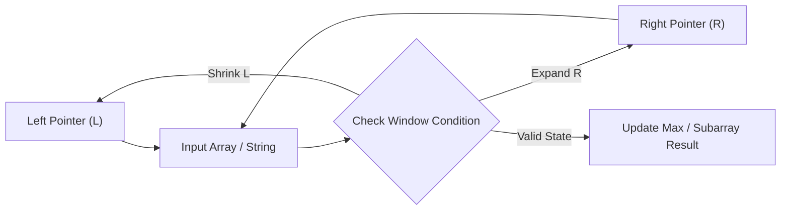

# Container With Most Water

<div style="display:flex; gap:0.5rem; margin-bottom:1.5rem; align-items:center;">
  <span style="background:#f59e0b22; color:#f59e0b; padding:2px 10px; borderRadius:12px; fontWeight:600; fontSize:0.85rem;">Medium</span>
  <span style="color:#64748b; fontSize:0.85rem;">Day 2 • Striver Blind 75</span>
</div>

## 📌 Problem Overview

You are given an integer array `height` of length `n`. There are `n` vertical lines drawn such that the two endpoints of the `i`-th line are `(i, 0)` and `(i, height[i])`.

Find two lines that together with the x-axis form a container that holds the most water. Return the maximum amount of water a container can store.

You may not slant the container.

### Examples & Constraints
**Example 1:**
- **Input:** `height = [1,8,6,2,5,4,8,3,7]`
- **Output:** `49`


**Example 2:**
- **Input:** `height = [1,1]`
- **Output:** `1`


**Constraints:**
- `n == height.length`
- `2 ≤ n ≤ 10⁵`
- `0 ≤ height[i] ≤ 10⁴`

---

## 💡 Approach & Intuition

Container With Most Water tests the greedy two-pointer insight that moving the shorter line inward is the only move that can improve area.

### 🎯 Pattern Recognition
**Pattern: Greedy Two Pointers**

Start with the widest container (both ends). The area is capped by the shorter line, so moving the taller line inward can never help — always move the shorter one.

---

## 📊 Step-by-Step Execution (Mermaid Diagram)



---

## 🐢 Brute Force Solution

### Code
```javascript
function maxArea(height) {
  let max = 0;
  for (let i = 0; i < height.length; i++) {
    for (let j = i + 1; j < height.length; j++) {
      max = Math.max(max, Math.min(height[i], height[j]) * (j - i));
    }
  }
  return max;
}
```

- **Time Complexity:** `O(n²)`
- **Space Complexity:** `O(1)`
- **Explanation:** Check every pair of lines.

---

## ⚡ Optimized Solution

### Code
```javascript
function maxArea(height) {
  let left = 0, right = height.length - 1, max = 0;
  while (left < right) {
    const area = Math.min(height[left], height[right]) * (right - left);
    max = Math.max(max, area);
    if (height[left] < height[right]) left++;
    else right--;
  }
  return max;
}
```

- **Time Complexity:** `O(n)`
- **Space Complexity:** `O(1)`
- **Explanation:** Two pointers shrinking from the widest container, always moving the shorter line.

---

## 🐾 Step-by-Step Walkthrough

1. **Initialize State:** Setup necessary pointers, dynamic programming arrays, or hash maps.
2. **Iterate & Evaluate:** Process the input according to the boundary conditions.
3. **Update & Return:** Compute the optimal answer and return early or at termination.

### 🎙️ FAANG Interview Pitch
1. Start with brute force checking all pairs
2. Start pointers at widest container instead
3. Prove moving the taller line can never increase area
4. Always move the shorter line inward until pointers meet

---

## 💡 Progressive Hints

1. Start with pointers at both ends for maximum width.
2. Area = min(height[left], height[right]) * (right - left).
3. Always move the pointer at the shorter line inward.

---

## ⚡ Interactive Practice
👉 **[Solve this problem interactively in the DSA Lab](/DSA-Notes-Problems/dsa/problems/container-with-most-water)**
