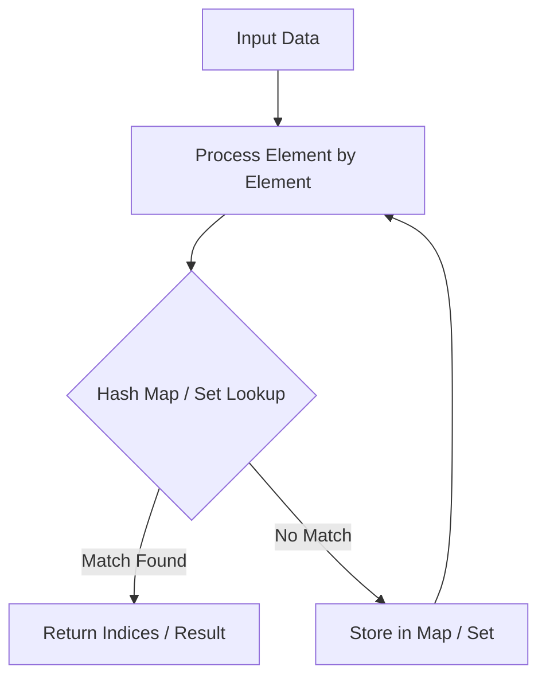

# Contains Duplicate

<div style="display:flex; gap:0.5rem; margin-bottom:1.5rem; align-items:center;">
  <span style="background:#22c55e22; color:#22c55e; padding:2px 10px; borderRadius:12px; fontWeight:600; fontSize:0.85rem;">Easy</span>
  <span style="color:#64748b; fontSize:0.85rem;">Day 1 • Striver Blind 75</span>
</div>

## 📌 Problem Overview

Given an integer array `nums`, return `true` if any value appears **at least twice** in the array.

### Examples & Constraints
**Example 1:**
- **Input:** `nums = [1,2,3,1]`
- **Output:** `true`


**Example 2:**
- **Input:** `nums = [1,2,3,4]`
- **Output:** `false`


**Example 3:**
- **Input:** `nums = [1,1,1,3,3,4,3,2,4,2]`
- **Output:** `true`


**Constraints:**
- `1 ≤ nums.length ≤ 10⁵`
- `-10⁹ ≤ nums[i] ≤ 10⁹`

---

## 💡 Approach & Intuition

Tests your ability to detect duplicates efficiently.

### 🎯 Pattern Recognition
**Pattern: Set for Duplicates**

Use a Set to track seen elements. If an element is already in the Set, you've found a duplicate.

---

## 📊 Step-by-Step Execution (Mermaid Diagram)



---

## 🐢 Brute Force Solution

### Code
```javascript
function containsDuplicate(nums) {
  for (let i = 0; i < nums.length; i++) {
    for (let j = i + 1; j < nums.length; j++) {
      if (nums[i] === nums[j]) return true;
    }
  }
  return false;
}
```

- **Time Complexity:** `O(n²)`
- **Space Complexity:** `O(1)`
- **Explanation:** Compare every pair.

---

## ⚡ Optimized Solution

### Code
```javascript
function containsDuplicate(nums) {
  const seen = new Set();
  for (const num of nums) {
    if (seen.has(num)) return true;
    seen.add(num);
  }
  return false;
}
```

- **Time Complexity:** `O(n)`
- **Space Complexity:** `O(n)`
- **Explanation:** Use a Set for O(1) lookups.

---

## 🐾 Step-by-Step Walkthrough

1. **Initialize State:** Setup necessary pointers, dynamic programming arrays, or hash maps.
2. **Iterate & Evaluate:** Process the input according to the boundary conditions.
3. **Update & Return:** Compute the optimal answer and return early or at termination.

### 🎙️ FAANG Interview Pitch
1. Brute force O(n²)
2. Use a Set for O(n) time
3. Trade O(n) space for O(n) time
4. Early exit optimization

---

## 💡 Progressive Hints

1. Use a Set to track seen numbers.
2. If a number is already in the Set, you have a duplicate.
3. Return true as soon as you find a duplicate.

---

## ⚡ Interactive Practice
👉 **[Solve this problem interactively in the DSA Lab](/DSA-Notes-Problems/dsa/problems/contains-duplicate)**
