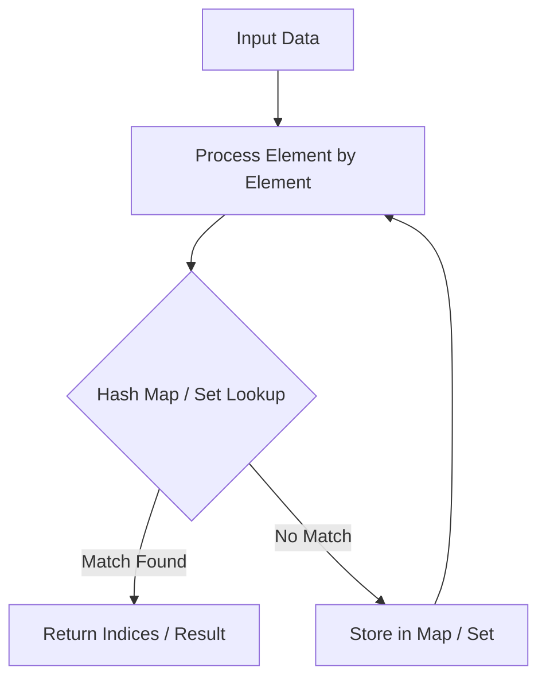

# Find Minimum in Rotated Sorted Array

<div style="display:flex; gap:0.5rem; margin-bottom:1.5rem; align-items:center;">
  <span style="background:#f59e0b22; color:#f59e0b; padding:2px 10px; borderRadius:12px; fontWeight:600; fontSize:0.85rem;">Medium</span>
  <span style="color:#64748b; fontSize:0.85rem;">Day 2 • Striver Blind 75</span>
</div>

## 📌 Problem Overview

Suppose an array of length `n` sorted in ascending order is rotated between `1` and `n` times. Given the sorted rotated array `nums` of unique elements, return the minimum element of this array.

You must write an algorithm that runs in `O(log n)` time.

### Examples & Constraints
**Example 1:**
- **Input:** `nums = [3,4,5,1,2]`
- **Output:** `1`


**Example 2:**
- **Input:** `nums = [4,5,6,7,0,1,2]`
- **Output:** `0`


**Constraints:**
- `n == nums.length`
- `1 ≤ n ≤ 5000`
- `-5000 ≤ nums[i] ≤ 5000`
- `All integers in nums are unique.`

---

## 💡 Approach & Intuition

In a rotated sorted array, the elements to the left of the pivot point are greater than elements to the right of the pivot point. We can use binary search to locate this inflection point.

### 🎯 Pattern Recognition
**Pattern: Inflection Point Binary Search**

Compare `nums[mid]` with `nums[right]`. If `nums[mid] > nums[right]`, the min is in the right half; else, it is in the left half (including mid).

---

## 📊 Step-by-Step Execution (Mermaid Diagram)



---

## 🐢 Brute Force Solution

### Code
```javascript
function findMin(nums) {
  let min = nums[0];
  for (let i = 1; i < nums.length; i++) {
    if (nums[i] < min) min = nums[i];
  }
  return min;
}
```

- **Time Complexity:** `O(n)`
- **Space Complexity:** `O(1)`
- **Explanation:** Linear search of the minimum.

---

## ⚡ Optimized Solution

### Code
```javascript
function findMin(nums) {
  let left = 0;
  let right = nums.length - 1;
  while (left < right) {
    const mid = Math.floor((left + right) / 2);
    if (nums[mid] > nums[right]) {
      left = mid + 1;
    } else {
      right = mid;
    }
  }
  return nums[left];
}
```

- **Time Complexity:** `O(log n)`
- **Space Complexity:** `O(1)`
- **Explanation:** Binary search comparing mid and right.

---

## 🐾 Step-by-Step Walkthrough

1. **Initialize State:** Setup necessary pointers, dynamic programming arrays, or hash maps.
2. **Iterate & Evaluate:** Process the input according to the boundary conditions.
3. **Update & Return:** Compute the optimal answer and return early or at termination.

### 🎙️ FAANG Interview Pitch
1. Compares middle with right boundary to identify sorted direction
2. Cuts search space in half based on inflection pivot
3. Runs in logarithmic O(log n) time

---

## 💡 Progressive Hints

1. Compare `nums[mid]` with `nums[right]`.
2. If `nums[mid] > nums[right]`, the minimum must be to the right of `mid`.
3. Otherwise, the minimum is at `mid` or to its left.

---

## ⚡ Interactive Practice
👉 **[Solve this problem interactively in the DSA Lab](/DSA-Notes-Problems/dsa/problems/find-min-rotated)**
