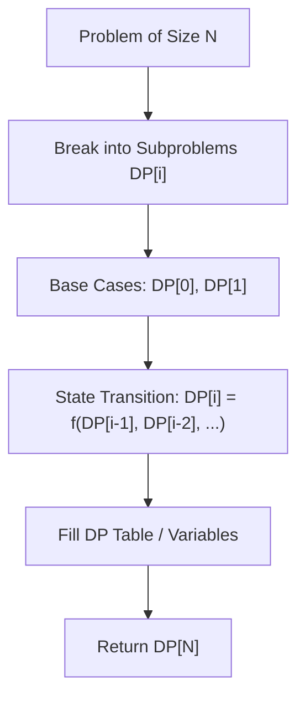

# Maximum Product Subarray

<div style="display:flex; gap:0.5rem; margin-bottom:1.5rem; align-items:center;">
  <span style="background:#f59e0b22; color:#f59e0b; padding:2px 10px; borderRadius:12px; fontWeight:600; fontSize:0.85rem;">Medium</span>
  <span style="color:#64748b; fontSize:0.85rem;">Day 2 • Striver Blind 75</span>
</div>

## 📌 Problem Overview

Given an integer array `nums`, find a subarray that has the largest product, and return *the product*.

### Examples & Constraints
**Example 1:**
- **Input:** `nums = [2,3,-2,4]`
- **Output:** `6`
- **Explanation:** [2,3] has the largest product 6.

**Example 2:**
- **Input:** `nums = [-2,0,-1]`
- **Output:** `0`
- **Explanation:** The result cannot be 2, because [-2,-1] is not a subarray.

**Constraints:**
- `1 <= nums.length <= 2 * 10^4`
- `-10 <= nums[i] <= 10`

---

## 💡 Approach & Intuition

Track both maximum and minimum product at each step because multiplying by a negative number flips max and min.

### 🎯 Pattern Recognition
Dynamic Programming / Min-Max Tracking in Arrays

---

## 📊 Step-by-Step Execution (Mermaid Diagram)



---

## 🐢 Brute Force Solution

### Code
```javascript
function maxProduct(nums) {
  let res = nums[0];
  for(let i=0;i<nums.length;i++) {
    let p = 1;
    for(let j=i;j<nums.length;j++) {
      p *= nums[j];
      res = Math.max(res, p);
    }
  }
  return res;
}
```

- **Time Complexity:** `O(n^2)`
- **Space Complexity:** `O(1)`
- **Explanation:** Compute product of all subarrays.

---

## ⚡ Optimized Solution

### Code
```javascript
function maxProduct(nums) {
  let res = nums[0], maxP = nums[0], minP = nums[0];
  for (let i = 1; i < nums.length; i++) {
    if (nums[i] < 0) [maxP, minP] = [minP, maxP];
    maxP = Math.max(nums[i], maxP * nums[i]);
    minP = Math.min(nums[i], minP * nums[i]);
    res = Math.max(res, maxP);
  }
  return res;
}
```

- **Time Complexity:** `O(n)`
- **Space Complexity:** `O(1)`
- **Explanation:** Track max and min product dynamically.

---

## 🐾 Step-by-Step Walkthrough

1. **Initialize State:** Setup necessary pointers, dynamic programming arrays, or hash maps.
2. **Iterate & Evaluate:** Process the input according to the boundary conditions.
3. **Update & Return:** Compute the optimal answer and return early or at termination.

### 🎙️ FAANG Interview Pitch
Explain how negative numbers swap max and min products. Use O(1) space DP.

---

## 💡 Progressive Hints

1. Keep track of running max and running min.
2. Swap max and min when encountering a negative number.

---

## ⚡ Interactive Practice
👉 **[Solve this problem interactively in the DSA Lab](/DSA-Notes-Problems/dsa/problems/maximum-product-subarray)**
