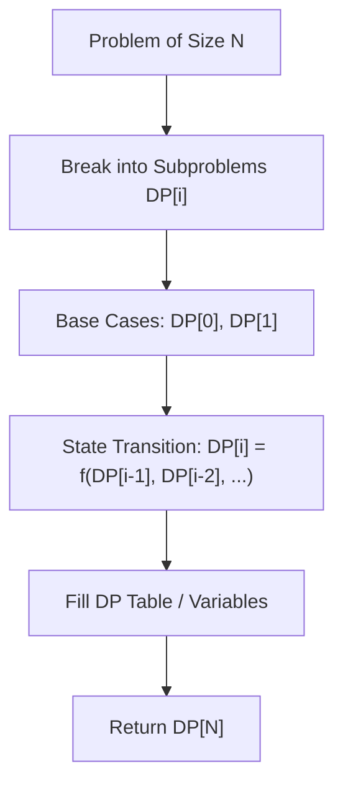

# Maximum Subarray

<div style="display:flex; gap:0.5rem; margin-bottom:1.5rem; align-items:center;">
  <span style="background:#f59e0b22; color:#f59e0b; padding:2px 10px; borderRadius:12px; fontWeight:600; fontSize:0.85rem;">Medium</span>
  <span style="color:#64748b; fontSize:0.85rem;">Day 1 • Striver Blind 75</span>
</div>

## 📌 Problem Overview

Given an integer array `nums`, find the **subarray** with the largest sum, and return its sum.

### Examples & Constraints
**Example 1:**
- **Input:** `nums = [-2,1,-3,4,-1,2,1,-5,4]`
- **Output:** `6`
- **Explanation:** The subarray [4,-1,2,1] has the largest sum 6.

**Example 2:**
- **Input:** `nums = [1]`
- **Output:** `1`


**Example 3:**
- **Input:** `nums = [5,4,-1,7,8]`
- **Output:** `23`


**Constraints:**
- `1 ≤ nums.length ≤ 10⁵`
- `-10⁴ ≤ nums[i] ≤ 10⁴`

---

## 💡 Approach & Intuition

Maximum Subarray (Kadane's Algorithm) is a classic DP problem that teaches optimal substructure.

### 🎯 Pattern Recognition
**Pattern: Kadane's Algorithm**

Track current subarray sum and maximum sum seen so far. Reset to 0 if current sum goes negative.

---

## 📊 Step-by-Step Execution (Mermaid Diagram)



---

## 🐢 Brute Force Solution

### Code
```javascript
function maxSubArray(nums) {
  let max = -Infinity;
  for (let i = 0; i < nums.length; i++) {
    let sum = 0;
    for (let j = i; j < nums.length; j++) {
      sum += nums[j];
      max = Math.max(max, sum);
    }
  }
  return max;
}
```

- **Time Complexity:** `O(n²)`
- **Space Complexity:** `O(1)`
- **Explanation:** Check every possible subarray.

---

## ⚡ Optimized Solution

### Code
```javascript
function maxSubArray(nums) {
  let maxSum = nums[0];
  let currentSum = nums[0];
  for (let i = 1; i < nums.length; i++) {
    currentSum = Math.max(nums[i], currentSum + nums[i]);
    maxSum = Math.max(maxSum, currentSum);
  }
  return maxSum;
}
```

- **Time Complexity:** `O(n)`
- **Space Complexity:** `O(1)`
- **Explanation:** Kadane's Algorithm.

---

## 🐾 Step-by-Step Walkthrough

1. **Initialize State:** Setup necessary pointers, dynamic programming arrays, or hash maps.
2. **Iterate & Evaluate:** Process the input according to the boundary conditions.
3. **Update & Return:** Compute the optimal answer and return early or at termination.

### 🎙️ FAANG Interview Pitch
1. Start with brute force O(n²)
2. Extending a negative prefix never helps
3. Compare current element vs current element + previous sum
4. Track global maximum

---

## 💡 Progressive Hints

1. What is the maximum sum ending at each position?
2. If current sum goes negative, start fresh.
3. Track two values: current sum and max sum.

---

## ⚡ Interactive Practice
👉 **[Solve this problem interactively in the DSA Lab](/DSA-Notes-Problems/dsa/problems/maximum-subarray)**
