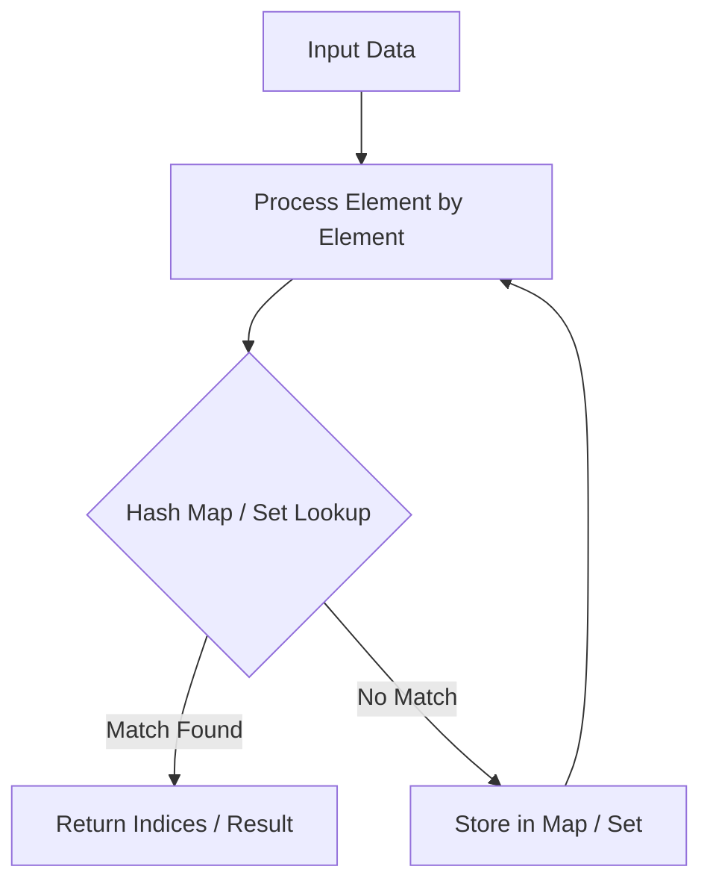

# Product of Array Except Self

<div style="display:flex; gap:0.5rem; margin-bottom:1.5rem; align-items:center;">
  <span style="background:#f59e0b22; color:#f59e0b; padding:2px 10px; borderRadius:12px; fontWeight:600; fontSize:0.85rem;">Medium</span>
  <span style="color:#64748b; fontSize:0.85rem;">Day 1 • Striver Blind 75</span>
</div>

## 📌 Problem Overview

Given an integer array `nums`, return an array `answer` such that `answer[i]` is equal to the product of all the elements of `nums` except `nums[i]`.

You must solve it **without division** and in **O(n)** time.

### Examples & Constraints
**Example 1:**
- **Input:** `nums = [1,2,3,4]`
- **Output:** `[24,12,8,6]`


**Example 2:**
- **Input:** `nums = [-1,1,0,-3,3]`
- **Output:** `[0,0,9,0,0]`


**Constraints:**
- `2 ≤ nums.length ≤ 10⁵`
- `-30 ≤ nums[i] ≤ 30`

---

## 💡 Approach & Intuition

Product of Array Except Self tests prefix/suffix product techniques to avoid division while staying at O(n) time.

### 🎯 Pattern Recognition
**Pattern: Prefix/Suffix Accumulation**

When each result depends on everything except the current element, compute a running product from the left, then a running product from the right, and combine.

---

## 📊 Step-by-Step Execution (Mermaid Diagram)



---

## 🐢 Brute Force Solution

### Code
```javascript
function productExceptSelf(nums) {
  return nums.map((_, i) => nums.reduce((p, n, j) => i === j ? p : p * n, 1));
}
```

- **Time Complexity:** `O(n²)`
- **Space Complexity:** `O(n)`
- **Explanation:** Recompute the product for every index.

---

## ⚡ Optimized Solution

### Code
```javascript
function productExceptSelf(nums) {
  const n = nums.length;
  const answer = new Array(n).fill(1);
  let prefix = 1;
  for (let i = 0; i < n; i++) {
    answer[i] = prefix;
    prefix *= nums[i];
  }
  let suffix = 1;
  for (let i = n - 1; i >= 0; i--) {
    answer[i] *= suffix;
    suffix *= nums[i];
  }
  return answer;
}
```

- **Time Complexity:** `O(n)`
- **Space Complexity:** `O(1) excluding output`
- **Explanation:** Two passes accumulating prefix and suffix products.

---

## 🐾 Step-by-Step Walkthrough

1. **Initialize State:** Setup necessary pointers, dynamic programming arrays, or hash maps.
2. **Iterate & Evaluate:** Process the input according to the boundary conditions.
3. **Update & Return:** Compute the optimal answer and return early or at termination.

### 🎙️ FAANG Interview Pitch
1. Note division would be simplest but is disallowed (and breaks with zeros)
2. Build prefix products left to right
3. Build suffix products right to left, multiplying into the same array
4. Discuss O(1) extra space excluding the output array

---

## 💡 Progressive Hints

1. Compute the product of all elements to the left of each index.
2. Compute the product of all elements to the right of each index.
3. Multiply the two together for the final answer, without using division.

---

## ⚡ Interactive Practice
👉 **[Solve this problem interactively in the DSA Lab](/DSA-Notes-Problems/dsa/problems/product-of-array-except-self)**
