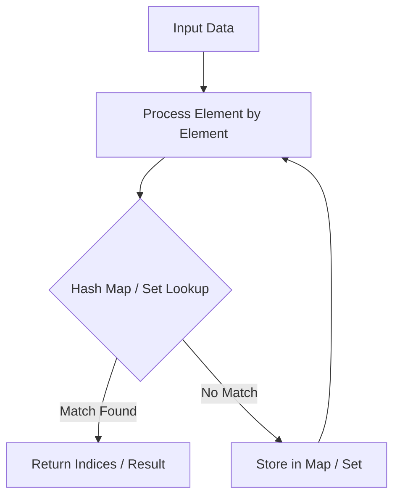

# Search in Rotated Sorted Array

<div style="display:flex; gap:0.5rem; margin-bottom:1.5rem; align-items:center;">
  <span style="background:#f59e0b22; color:#f59e0b; padding:2px 10px; borderRadius:12px; fontWeight:600; fontSize:0.85rem;">Medium</span>
  <span style="color:#64748b; fontSize:0.85rem;">Day 2 • Striver Blind 75</span>
</div>

## 📌 Problem Overview

Search for a target in a rotated sorted array. The array was sorted then rotated at an unknown pivot. Must be O(log n).

### Examples & Constraints
**Example 1:**
- **Input:** `nums = [4,5,6,7,0,1,2], target = 0`
- **Output:** `4`


**Example 2:**
- **Input:** `nums = [4,5,6,7,0,1,2], target = 3`
- **Output:** `-1`


**Constraints:**
- `1 ≤ nums.length ≤ 5000`
- `All values are unique.`

---

## 💡 Approach & Intuition

Extends binary search to handle rotated sorted arrays. Tests deep understanding of the binary search invariant.

### 🎯 Pattern Recognition
**Pattern: Modified Binary Search**

Even in a rotated array, at least one half is fully sorted. Determine which half, then check if target lies in it.

---

## 📊 Step-by-Step Execution (Mermaid Diagram)



---

## 🐢 Brute Force Solution

### Code
```javascript
function search(nums, target) { return nums.indexOf(target); }
```

- **Time Complexity:** `O(n)`
- **Space Complexity:** `O(1)`
- **Explanation:** Linear scan via indexOf.

---

## ⚡ Optimized Solution

### Code
```javascript
function search(nums, target) {
  let left = 0, right = nums.length - 1;
  while (left <= right) {
    const mid = Math.floor((left + right) / 2);
    if (nums[mid] === target) return mid;
    if (nums[left] <= nums[mid]) {
      if (target >= nums[left] && target < nums[mid]) right = mid - 1;
      else left = mid + 1;
    } else {
      if (target > nums[mid] && target <= nums[right]) left = mid + 1;
      else right = mid - 1;
    }
  }
  return -1;
}
```

- **Time Complexity:** `O(log n)`
- **Space Complexity:** `O(1)`
- **Explanation:** Modified binary search identifying sorted halves.

---

## 🐾 Step-by-Step Walkthrough

1. **Initialize State:** Setup necessary pointers, dynamic programming arrays, or hash maps.
2. **Iterate & Evaluate:** Process the input according to the boundary conditions.
3. **Update & Return:** Compute the optimal answer and return early or at termination.

### 🎙️ FAANG Interview Pitch
1. Check which half is sorted via nums[left] <= nums[mid]
2. If target is in sorted half, search there
3. Otherwise search the other half

---

## 💡 Progressive Hints

1. One half is always sorted.
2. Compare nums[left] with nums[mid] to determine which half.
3. Check if target falls in the sorted half.

---

## ⚡ Interactive Practice
👉 **[Solve this problem interactively in the DSA Lab](/DSA-Notes-Problems/dsa/problems/search-rotated-array)**
