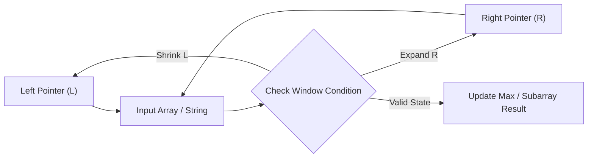

# 3Sum

<div style="display:flex; gap:0.5rem; margin-bottom:1.5rem; align-items:center;">
  <span style="background:#f59e0b22; color:#f59e0b; padding:2px 10px; borderRadius:12px; fontWeight:600; fontSize:0.85rem;">Medium</span>
  <span style="color:#64748b; fontSize:0.85rem;">Day 2 • Striver Blind 75</span>
</div>

## 📌 Problem Overview

Given an integer array `nums`, return all the triplets `[nums[i], nums[j], nums[k]]` such that `i != j`, `i != k`, and `j != k`, and `nums[i] + nums[j] + nums[k] == 0`.

Notice that the solution set must not contain duplicate triplets.

### Examples & Constraints
**Example 1:**
- **Input:** `nums = [-1,0,1,2,-1,-4]`
- **Output:** `[[-1,-1,2],[-1,0,1]]`


**Example 2:**
- **Input:** `nums = [0,1,1]`
- **Output:** `[]`


**Example 3:**
- **Input:** `nums = [0,0,0]`
- **Output:** `[[0,0,0]]`


**Constraints:**
- `3 ≤ nums.length ≤ 3000`
- `-10⁵ ≤ nums[i] ≤ 10⁵`

---

## 💡 Approach & Intuition

**Why this problem exists:**
3Sum is a classic problem that extends the two-sum concept and tests your ability to avoid O(n³) solutions through sorting and two-pointer technique.

**What it teaches:**
• Sorting + two-pointer combination
• Avoiding duplicate triplets
• Reducing complexity from O(n³) to O(n²)

**Interview relevance:**
One of the most frequently asked medium-difficulty problems. Tests combinatorial thinking and optimization.

### 🎯 Pattern Recognition
**Pattern: Fixed + Two Pointers**

Fix one element with a loop, then use two pointers (left, right) on the remaining subarray to find pairs that sum to -(fixed value). Sort first to enable two-pointer search and duplicate handling.

**When to use this pattern:**
• Finding k-sum combinations
• Any problem where sorting + two pointers can reduce complexity
• Finding pairs that satisfy a condition

---

## 📊 Step-by-Step Execution (Mermaid Diagram)



---

## 🐢 Brute Force Solution

### Code
```javascript
function threeSum(nums) {
  const result = [];
  for (let i = 0; i < nums.length; i++) {
    for (let j = i + 1; j < nums.length; j++) {
      for (let k = j + 1; k < nums.length; k++) {
        if (nums[i] + nums[j] + nums[k] === 0) {
          result.push([nums[i], nums[j], nums[k]]);
        }
      }
    }
  }
  return result;
}
```

- **Time Complexity:** `O(n³)`
- **Space Complexity:** `O(n)`
- **Explanation:** Check every possible triplet — O(n³) time. Also includes duplicates.

---

## ⚡ Optimized Solution

### Code
```javascript
function threeSum(nums) {
  nums.sort((a, b) => a - b);
  const result = [];
  
  for (let i = 0; i < nums.length - 2; i++) {
    if (i > 0 && nums[i] === nums[i - 1]) continue; // skip duplicates
    
    let left = i + 1, right = nums.length - 1;
    
    while (left < right) {
      const sum = nums[i] + nums[left] + nums[right];
      
      if (sum === 0) {
        result.push([nums[i], nums[left], nums[right]]);
        while (left < right && nums[left] === nums[left + 1]) left++;
        while (left < right && nums[right] === nums[right - 1]) right--;
        left++;
        right--;
      } else if (sum < 0) {
        left++;
      } else {
        right--;
      }
    }
  }
  
  return result;
}
```

- **Time Complexity:** `O(n²)`
- **Space Complexity:** `O(1) excluding output`
- **Explanation:** Sort the array (O(n log n)). Fix one element, then use two pointers on the remaining subarray. Skip duplicates to avoid repeat triplets. O(n²) total.

---

## 🐾 Step-by-Step Walkthrough

1. **Initialize State:** Setup necessary pointers, dynamic programming arrays, or hash maps.
2. **Iterate & Evaluate:** Process the input according to the boundary conditions.
3. **Update & Return:** Compute the optimal answer and return early or at termination.

### 🎙️ FAANG Interview Pitch
**How to explain:**
1. Sort is essential for both two-pointer and duplicate handling
2. Fix one element (skip duplicates). For each, use two pointers on the rest
3. Move pointers based on sum: too low → left++, too high → right--
4. Skip duplicates when found

**Follow-ups:**
• "What about 3Sum closest?" → Track the closest sum instead of exact match
• "What about 4Sum?" → Add another nested loop (O(n³)) or use the same pattern recursively
• "What if the array is already sorted?" → Skip the sorting step, O(n²) directly

---

## 💡 Progressive Hints

1. Sort the array first — enables two-pointer approach and duplicate handling.
2. Fix one element, then use two pointers on the remaining elements to find pairs summing to -(fixed value).
3. Skip duplicate values to avoid duplicate triplets in the result.

---

## ⚡ Interactive Practice
👉 **[Solve this problem interactively in the DSA Lab](/DSA-Notes-Problems/dsa/problems/three-sum)**
