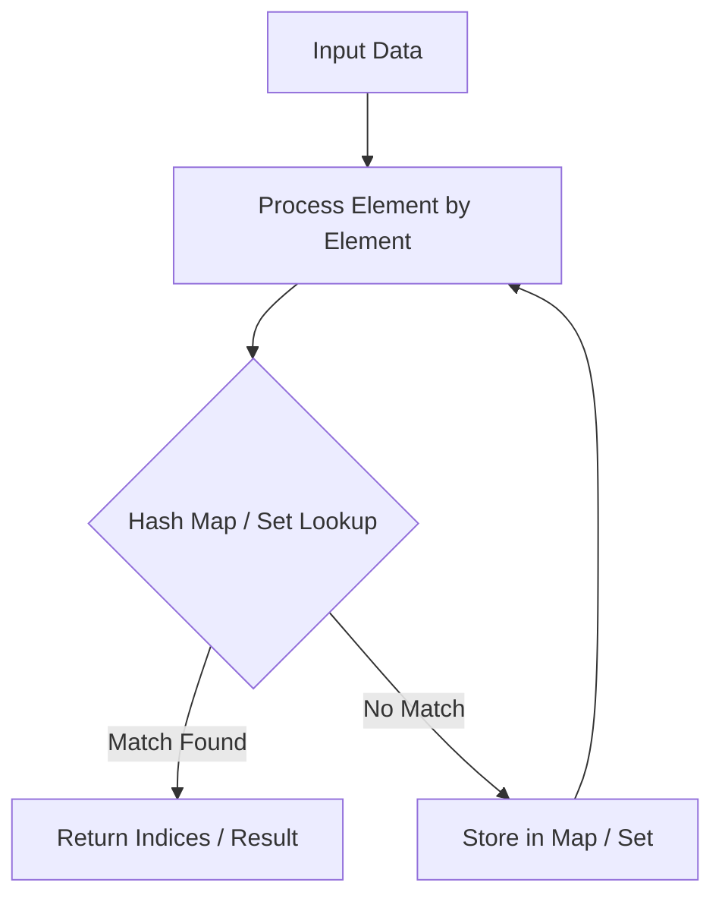

# Two Sum

<div style="display:flex; gap:0.5rem; margin-bottom:1.5rem; align-items:center;">
  <span style="background:#22c55e22; color:#22c55e; padding:2px 10px; borderRadius:12px; fontWeight:600; fontSize:0.85rem;">Easy</span>
  <span style="color:#64748b; fontSize:0.85rem;">Day 1 • Striver Blind 75</span>
</div>

## 📌 Problem Overview

Given an array of integers `nums` and an integer `target`, return indices of the two numbers such that they add up to `target`.

You may assume that each input would have **exactly one solution**, and you may not use the same element twice.

You can return the answer in any order.

### Examples & Constraints
**Example 1:**
- **Input:** `nums = [2,7,11,15], target = 9`
- **Output:** `[0,1]`
- **Explanation:** Because nums[0] + nums[1] == 9, we return [0, 1].

**Example 2:**
- **Input:** `nums = [3,2,4], target = 6`
- **Output:** `[1,2]`


**Example 3:**
- **Input:** `nums = [3,3], target = 6`
- **Output:** `[0,1]`


**Constraints:**
- `2 ≤ nums.length ≤ 10⁴`
- `-10⁹ ≤ nums[i] ≤ 10⁹`
- `-10⁹ ≤ target ≤ 10⁹`
- `Only one valid answer exists.`

---

## 💡 Approach & Intuition

**Why this problem exists:**
Two Sum is the quintessential interview problem that tests your understanding of hash maps for O(1) lookups.

**What it teaches:**
• Using hash maps for fast element lookup
• The complement pattern (target - current)
• Trading space for time

### 🎯 Pattern Recognition
**Pattern: Hash Map Lookup**

When you need to find a pair of elements that satisfy a condition, and checking all pairs is too slow (O(n²)), consider using a hash map to store elements you've already seen for O(1) lookup.

---

## 📊 Step-by-Step Execution (Mermaid Diagram)



---

## 🐢 Brute Force Solution

### Code
```javascript
function twoSum(nums, target) {
  for (let i = 0; i < nums.length; i++) {
    for (let j = i + 1; j < nums.length; j++) {
      if (nums[i] + nums[j] === target) return [i, j];
    }
  }
  return [];
}
```

- **Time Complexity:** `O(n²)`
- **Space Complexity:** `O(1)`
- **Explanation:** Check every pair of numbers.

---

## ⚡ Optimized Solution

### Code
```javascript
function twoSum(nums, target) {
  const map = new Map();
  for (let i = 0; i < nums.length; i++) {
    const complement = target - nums[i];
    if (map.has(complement)) return [map.get(complement), i];
    map.set(nums[i], i);
  }
  return [];
}
```

- **Time Complexity:** `O(n)`
- **Space Complexity:** `O(n)`
- **Explanation:** One pass with a hash map.

---

## 🐾 Step-by-Step Walkthrough

1. **Initialize State:** Setup necessary pointers, dynamic programming arrays, or hash maps.
2. **Iterate & Evaluate:** Process the input according to the boundary conditions.
3. **Update & Return:** Compute the optimal answer and return early or at termination.

### 🎙️ FAANG Interview Pitch
**How to explain:**
1. Start with brute force (nested loops)
2. Use a hash map for O(1) lookups
3. Explain the complement pattern
4. Walk through the one-pass solution

---

## 💡 Progressive Hints

1. Can you store values you've already seen?
2. What value do you need to find for each element to reach the target?
3. For each number, check if its complement exists in a hash map.

---

## ⚡ Interactive Practice
👉 **[Solve this problem interactively in the DSA Lab](/DSA-Notes-Problems/dsa/problems/two-sum)**
