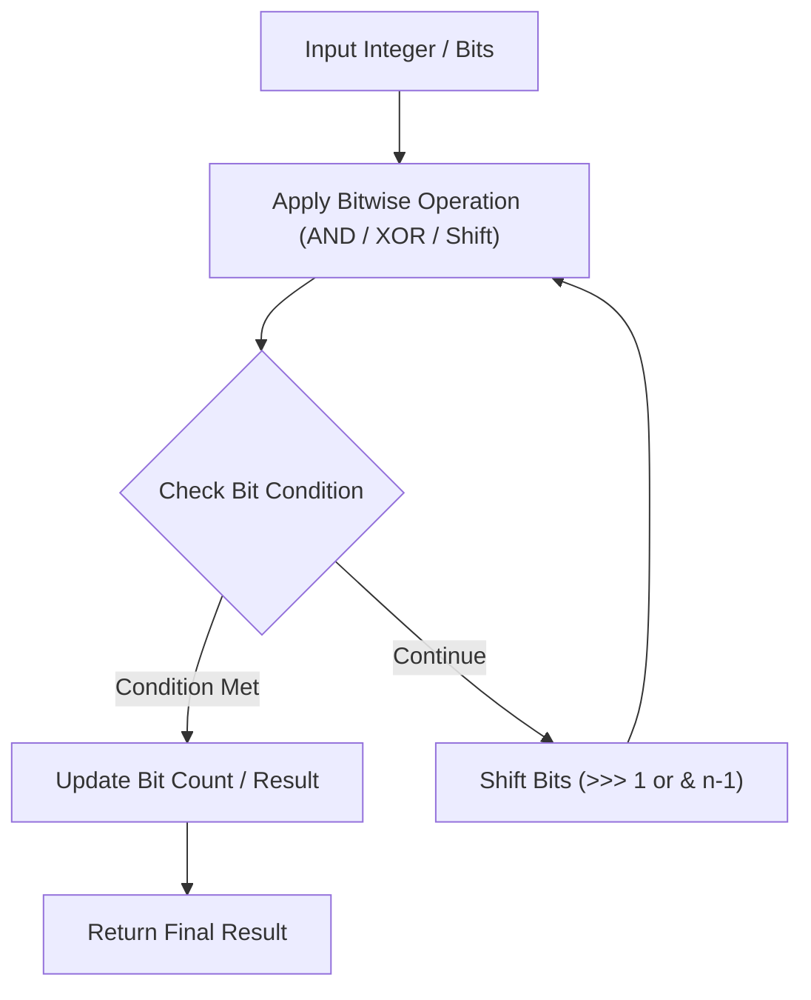

# Missing Number

<div style="display:flex; gap:0.5rem; margin-bottom:1.5rem; align-items:center;">
  <span style="background:#22c55e22; color:#22c55e; padding:2px 10px; borderRadius:12px; fontWeight:600; fontSize:0.85rem;">Easy</span>
  <span style="color:#64748b; fontSize:0.85rem;">Day 3 • Striver Blind 75</span>
</div>

## 📌 Problem Overview

Given an array `nums` containing `n` distinct numbers in the range `[0, n]`, return *the only number in the range that is missing from the array*.

### Examples & Constraints
**Example 1:**
- **Input:** `nums = [3,0,1]`
- **Output:** `2`


**Constraints:**
- `n == nums.length`
- `1 <= n <= 10^4`
- `0 <= nums[i] <= n`

---

## 💡 Approach & Intuition

Sum formula `n * (n + 1) / 2` minus array sum gives missing number.

### 🎯 Pattern Recognition
Gauss Sum / Bitwise XOR

---

## 📊 Step-by-Step Execution (Mermaid Diagram)



---

## 🐢 Brute Force Solution

### Code
```javascript
function missingNumber(nums) {
  const n = nums.length;
  let expected = (n * (n + 1)) / 2;
  let actual = nums.reduce((a, b) => a + b, 0);
  return expected - actual;
}
```

- **Time Complexity:** `O(n)`
- **Space Complexity:** `O(1)`
- **Explanation:** Gauss sum.

---

## ⚡ Optimized Solution

### Code
```javascript
function missingNumber(nums) {
  const n = nums.length;
  let expected = (n * (n + 1)) / 2;
  let actual = nums.reduce((a, b) => a + b, 0);
  return expected - actual;
}
```

- **Time Complexity:** `O(n)`
- **Space Complexity:** `O(1)`
- **Explanation:** Gauss summation formula.

---

## 🐾 Step-by-Step Walkthrough

1. **Initialize State:** Setup necessary pointers, dynamic programming arrays, or hash maps.
2. **Iterate & Evaluate:** Process the input according to the boundary conditions.
3. **Update & Return:** Compute the optimal answer and return early or at termination.

### 🎙️ FAANG Interview Pitch
Subtract total array sum from total expected sum n*(n+1)/2.

---

## 💡 Progressive Hints

1. Sum from 0 to n is n * (n + 1) / 2.

---

## ⚡ Interactive Practice
👉 **[Solve this problem interactively in the DSA Lab](/DSA-Notes-Problems/dsa/problems/array-missing-number)**
