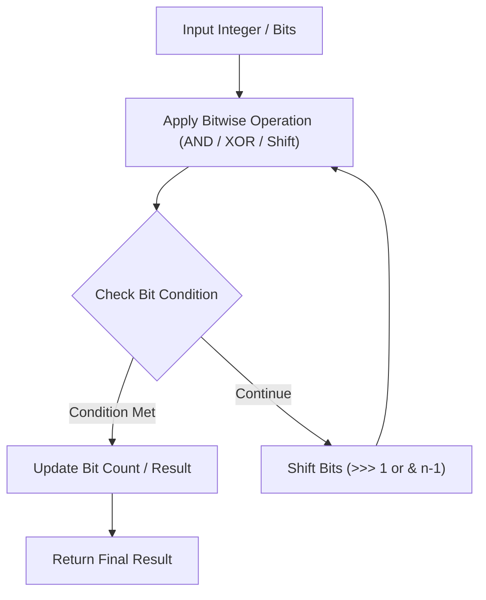

# Counting Bits

<div style="display:flex; gap:0.5rem; margin-bottom:1.5rem; align-items:center;">
  <span style="background:#22c55e22; color:#22c55e; padding:2px 10px; borderRadius:12px; fontWeight:600; fontSize:0.85rem;">Easy</span>
  <span style="color:#64748b; fontSize:0.85rem;">Day 3 • Striver Blind 75</span>
</div>

## 📌 Problem Overview

Given an integer `n`, return an array `ans` of length `n + 1` such that for each `i` (`0 <= i <= n`), `ans[i]` is the number of `1`'s in the binary representation of `i`.

### Examples & Constraints
**Example 1:**
- **Input:** `n = 5`
- **Output:** `[0,1,1,2,1,2]`


**Constraints:**
- `0 <= n <= 10^5`

---

## 💡 Approach & Intuition

`ans[i] = ans[i >> 1] + (i & 1)` using dynamic programming.

### 🎯 Pattern Recognition
Bit Manipulation DP

---

## 📊 Step-by-Step Execution (Mermaid Diagram)



---

## 🐢 Brute Force Solution

### Code
```javascript
function countBits(n) {
  const ans = new Array(n + 1).fill(0);
  for (let i = 1; i <= n; i++) {
    ans[i] = ans[i >> 1] + (i & 1);
  }
  return ans;
}
```

- **Time Complexity:** `O(n)`
- **Space Complexity:** `O(n)`
- **Explanation:** O(n) DP bit relation.

---

## ⚡ Optimized Solution

### Code
```javascript
function countBits(n) {
  const ans = new Array(n + 1).fill(0);
  for (let i = 1; i <= n; i++) {
    ans[i] = ans[i >> 1] + (i & 1);
  }
  return ans;
}
```

- **Time Complexity:** `O(n)`
- **Space Complexity:** `O(n)`
- **Explanation:** O(n) DP bit relation.

---

## 🐾 Step-by-Step Walkthrough

1. **Initialize State:** Setup necessary pointers, dynamic programming arrays, or hash maps.
2. **Iterate & Evaluate:** Process the input according to the boundary conditions.
3. **Update & Return:** Compute the optimal answer and return early or at termination.

### 🎙️ FAANG Interview Pitch
Number of bits for i equals bits for i >> 1 plus i % 2.

---

## 💡 Progressive Hints

1. Use previous DP values for i >> 1.

---

## ⚡ Interactive Practice
👉 **[Solve this problem interactively in the DSA Lab](/DSA-Notes-Problems/dsa/problems/counting-bits)**
